<div align="center">


<br/>


### 🚆 Indian Railway Live Tracker + RailAI : Frontend

[🌐 **Live App**](https://railway-tracking-frontend.vercel.app/) ·
[🎨 Frontend Repo](https://github.com/ashrithBalaji456/Railway_Tracking_Frontend) ·
[💻 Backend Repo](https://github.com/ashrithBalaji456/Railway_Tracking_Backend)

</div>

---

## 📑 Table of Contents

1. [Overview](#-overview)
2. [Architecture](#-architecture)
3. [Tech Stack](#-tech-stack)
4. [Workflow Charts](#-workflow-charts)
5. [Data Charts](#-data-charts)
6. [Project Structure](#-project-structure)
7. [Environment Variables](#-environment-variables)
8. [Getting Started](#-getting-started)
9. [Android App (Capacitor)](#-android-app-capacitor)
10. [Deployment](#-deployment)
11. [Security & Notes](#-security--notes)
12. [Roadmap & TODOs](#-roadmap--todos)

---

## 🌟 Overview

**RailTrack India Frontend** is the client side of the RailTrack India system. It is a **single-page application** built with **React 19, TypeScript and Vite**, styled with **Tailwind CSS 4**, using **Leaflet** for maps and **React Router** for navigation. It talks to the [Spring Boot backend](https://github.com/ashrithBalaji456/Railway_Tracking_Backend) over HTTP using **Axios**.

The same web build is also packaged as an **Android app** through **Capacitor** (app id `com.railwaytracking.app`, name *Railway Tracking*).

| Item | Value | Source |
|---|---|---|
| Live site | https://railway-tracking-frontend.vercel.app/ | repo "About" link |
| Page title | *RailTrack India - Live Railway Tracking* | live site |
| Backend API | `https://railway-tracking-backend-gwa2.onrender.com` | `.env.example` |
| Android app id | `com.railwaytracking.app` | `capacitor.config.ts` |
| Build output | `dist/` | `capacitor.config.ts` (`webDir`) |

---

## 🏗 Architecture

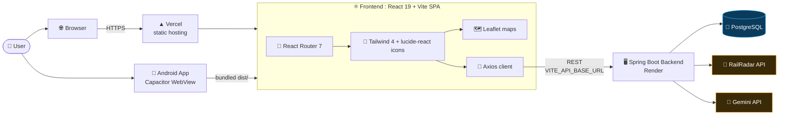

> The Axios → backend → RailRadar/Gemini chain comes from the backend repo's `pom.xml` and `.env.example`. How each page uses it is in `src/`; see [TODOs](#-roadmap--todos).

---

## 🧰 Tech Stack

All versions are copied as declared in `package.json`.

| Layer | Technology | Declared version |
|---|---|---|
| UI library | React / React DOM | `^19.2.8` |
| Language | TypeScript | `~6.0.2` |
| Bundler / dev server | Vite | `^6.0.0` |
| React plugin | `@vitejs/plugin-react` | `^5.0.1` |
| Routing | `react-router-dom` | `^7.18.2` |
| Styling | Tailwind CSS + `@tailwindcss/vite` | `^4.3.3` |
| Icons | `lucide-react` | `^1.31.0` |
| Maps | Leaflet (+ `@types/leaflet`) | `^1.9.4` |
| HTTP client | Axios | `^1.19.0` |
| Mobile wrapper | `@capacitor/core`, `@capacitor/android`, `@capacitor/cli` | `^8.5.3` |
| Linter | Oxlint | `^1.75.0` |
| Hosting | Vercel (SPA rewrite in `vercel.json`) | n/a |

---

## 🔄 Workflow Charts

> 📌 Diagrams 1, 2, 3 and 6 are based on real config files (`package.json`, `vercel.json`, `capacitor.config.ts`, `.env.example`). Diagrams 4, 5 and 7 are **conceptual**: they show the normal flow implied by the dependencies. Compare them with your actual pages and adjust names.

### 1️⃣ Build & Deploy Pipeline

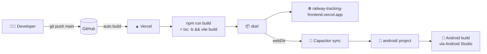

### 2️⃣ Single-Page-App Routing on Vercel

`vercel.json` rewrites **every** path to `index.html`, so deep links and page refreshes work.

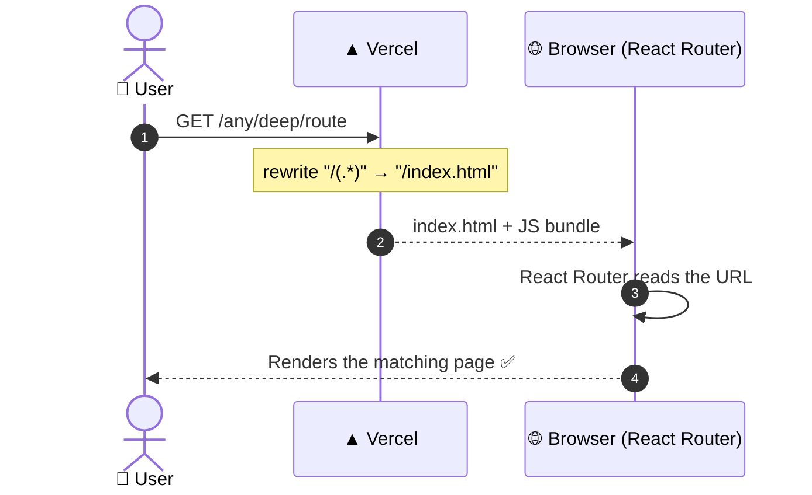

### 3️⃣ Environment Variable Resolution

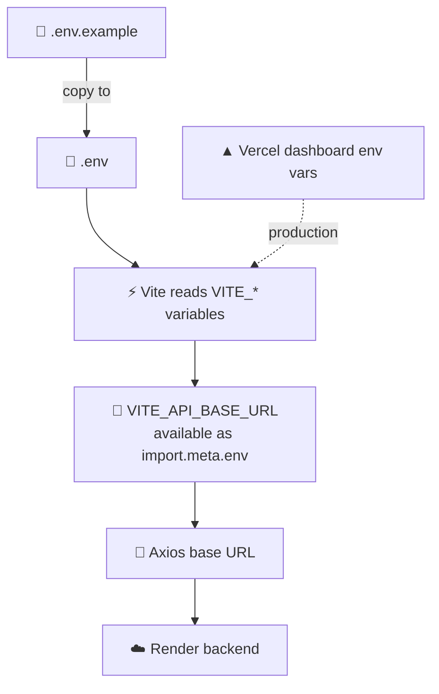

### 4️⃣ API Request Lifecycle *(conceptual)*

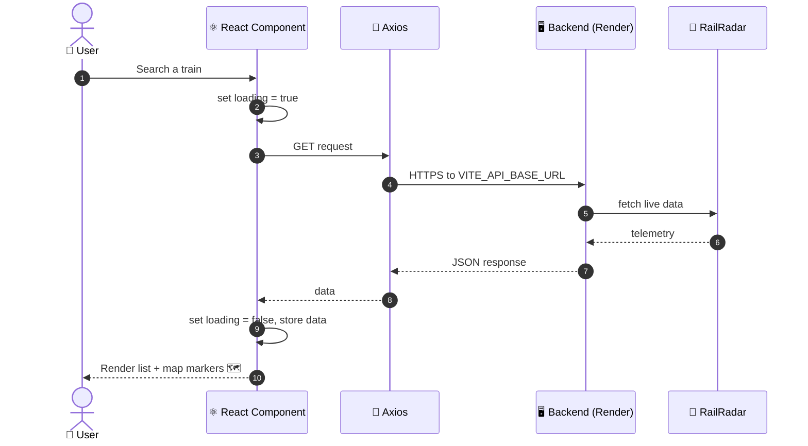

### 5️⃣ Request State Machine *(conceptual)*

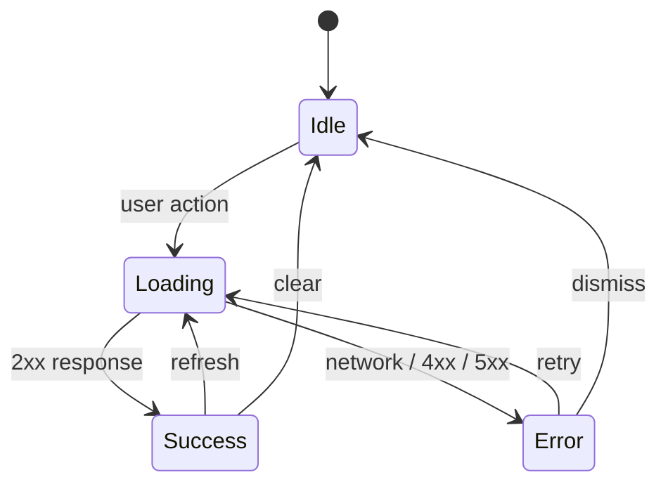

### 6️⃣ Web vs Android Delivery

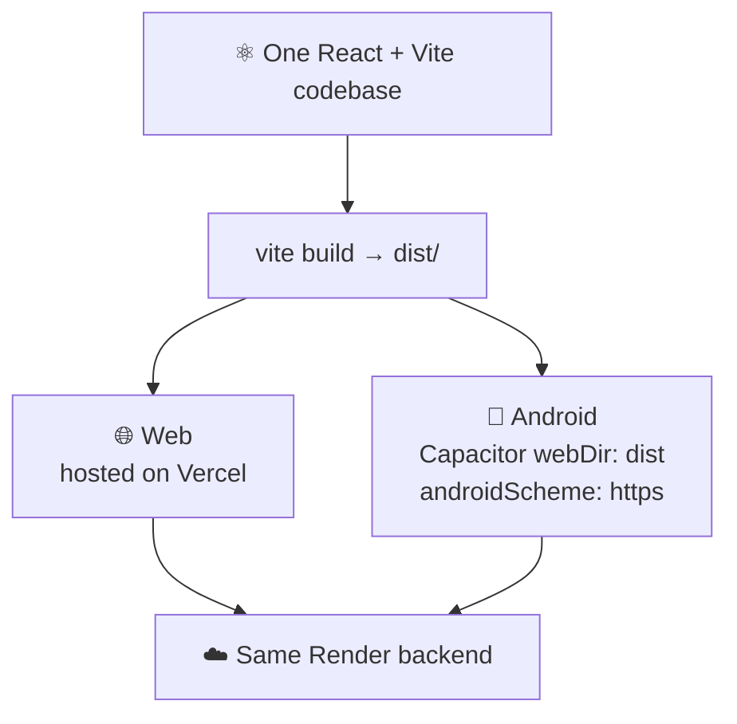

### 7️⃣ User Journey *(conceptual)*

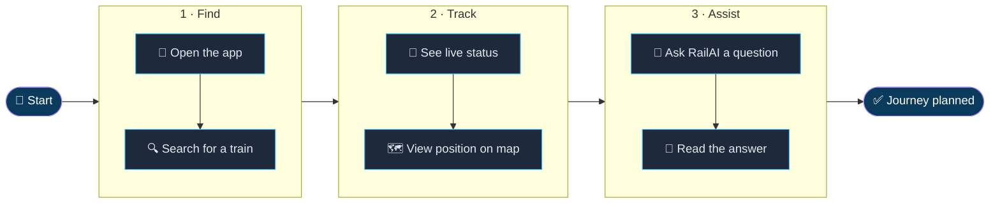

---

## 📊 Data Charts

Every number here was counted from `package.json` or the repository's root listing, not estimated.

### 📦 Runtime dependencies by purpose (11)

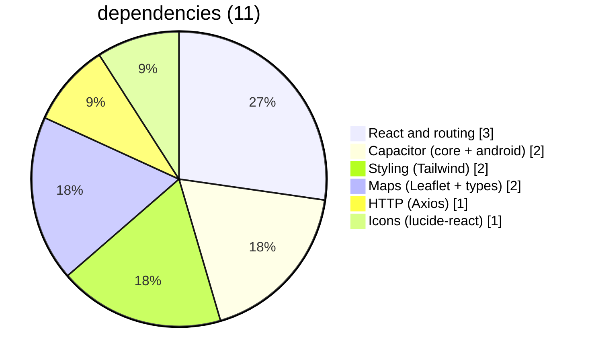

### 🛠 Dev dependencies by purpose (8)

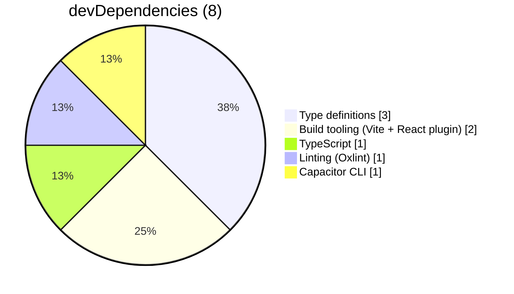

### 📈 Same data as a bar chart

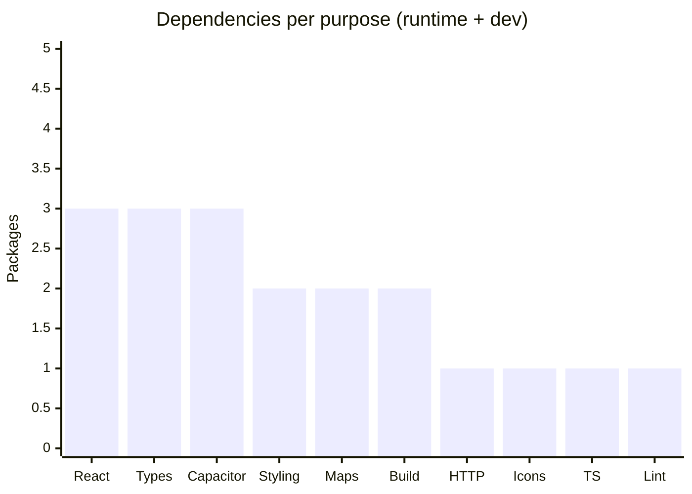

### 🗂 Repository root contents (16 items)

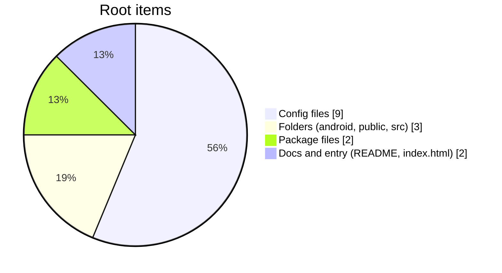

### ⚙️ npm scripts

| Script | Command | Purpose |
|---|---|---|
| `npm run dev` | `vite` | Start dev server with HMR |
| `npm run build` | `tsc -b && vite build` | Type-check, then production build to `dist/` |
| `npm run lint` | `oxlint` | Run the linter |
| `npm run preview` | `vite preview` | Serve the production build locally |

### 🧩 Feature map

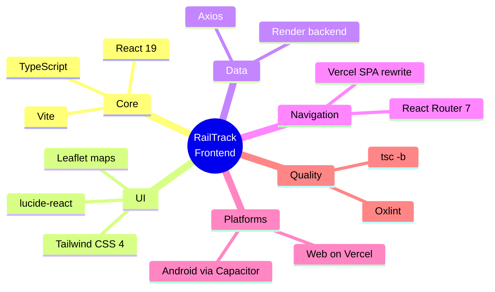

> 📉 **Not included on purpose:** page counts, bundle-size charts, Lighthouse scores and language percentages. I could not read `src/` or run a build, and made-up numbers would mislead. See the TODOs for how to add real ones.

---

## 📁 Project Structure

Root items confirmed from the repository:

```text
Railway_Tracking_Frontend/
├── android/               # Capacitor Android project
├── public/                # Static assets
├── src/                   # React + TypeScript source
├── .env.example           # VITE_API_BASE_URL template
├── .gitignore
├── .oxlintrc.json         # Oxlint config
├── capacitor.config.ts    # appId, appName, webDir, androidScheme
├── index.html             # Vite entry
├── package.json
├── package-lock.json
├── tsconfig.json
├── tsconfig.app.json
├── tsconfig.node.json
├── vercel.json            # SPA rewrite → /index.html
├── vite.config.ts
└── README.md
```

### Source Structure (`src/`)

```text
src/
├── components/            # Reusable UI components
│   ├── AndroidBackButtonHandler.tsx # Android native predictive back & gesture handler
│   ├── Footer.tsx         # Responsive footer with links
│   ├── Navbar.tsx         # Header navigation, disruptions indicator & mobile drawer
│   ├── ProtectedRoute.tsx # Route authentication guard
│   ├── RailAiWidget.tsx   # Floating interactive Gemini AI Assistant chatbot
│   ├── RecentSearchesBar.tsx # Quick-tap search query chips
│   └── RecentSearchesDropdown.tsx # Full recent searches management overlay
├── context/
│   └── LanguageContext.tsx # Multi-language transliteration & localization provider
├── pages/
│   ├── DisruptionsPage.tsx # Train Disruptions & Alerts Hub with in-memory filters
│   ├── Favorites.tsx      # User saved train and station bookmarks
│   ├── Home.tsx           # Hero search, live train lookup, station finder
│   ├── JourneyPlanner.tsx # Mobile-first stacked multi-leg journey solver
│   ├── Login.tsx          # User sign-in with JWT token acquisition
│   ├── MapTracker.tsx     # Fullscreen interactive Leaflet map with live GPS
│   ├── Register.tsx       # Account creation & registration
│   ├── SearchHistoryPage.tsx # Synced user search records
│   ├── StationExplorer.tsx# Station live boards (arrivals/departures)
│   └── TrainDetails.tsx   # Live timetable, cancellation badges, fares & delay report
├── services/
│   ├── api.ts             # Axios client, interceptors & endpoint contracts
│   ├── searchHistoryService.ts # Hybrid local storage & backend synced history
│   └── stationService.ts  # Station metadata & suggestions cache
├── types/
│   └── index.ts           # Unified TypeScript interfaces and DTO models
└── utils/
    └── transliteration.ts# Multi-script Indian language transliteration engine
```

---

## 🔑 Environment Variables

| Variable | Purpose | Example in `.env.example` |
|---|---|---|
| `VITE_API_BASE_URL` | Base URL of the backend API | `https://railway-tracking-backend-gwa2.onrender.com` |

For local development against a local backend, set it to `http://localhost:8080` (the backend's default port).

---

## 🚀 Getting Started

### Prerequisites

- Node.js and npm (a version that supports Vite 6 and React 19; check the [Vite docs](https://vite.dev/) for the current minimum)
- A running backend, either the deployed Render one or a local copy of the [backend repo](https://github.com/ashrithBalaji456/Railway_Tracking_Backend)

### Run locally

```bash
git clone https://github.com/ashrithBalaji456/Railway_Tracking_Frontend.git
cd Railway_Tracking_Frontend

npm install
cp .env.example .env        # then edit VITE_API_BASE_URL if needed
npm run dev
```

Vite normally serves on **http://localhost:5173**, which matches the CORS example in the backend's `.env.example`.

### Production build

```bash
npm run build      # type-check + bundle into dist/
npm run preview    # serve dist/ locally
```

---

## 📱 Android App (Capacitor)

The `android/` folder already exists, so the platform has been added. Typical flow:

```bash
npm run build
npx cap sync android
npx cap open android      # opens Android Studio
```

Config in use: app id `com.railwaytracking.app`, app name `Railway Tracking`, web assets from `dist`, `androidScheme: 'https'`.

> ⚠️ The `cap` commands above are the standard Capacitor CLI workflow. Verify them against the [Capacitor docs](https://capacitorjs.com/docs) for version 8.

---

## ☁️ Deployment

| Part | Platform | Evidence |
|---|---|---|
| Frontend | Vercel | live URL + `vercel.json` |
| Backend | Render | URL in `.env.example` |
| Mobile | Android build via Capacitor | `capacitor.config.ts`, `android/` |

Set `VITE_API_BASE_URL` in the Vercel project's environment variables, then redeploy. Vite reads these at **build time**, so changing the value needs a new build.

---

## 🔒 Security & Notes

- Anything prefixed `VITE_` is **embedded in the public JavaScript bundle**. Never put API keys or secrets in it. The backend keeps RailRadar and Gemini keys server-side.
- The backend must allow this frontend's origin in its `FRONTEND_URL` CORS list (the Vercel URL, and `http://localhost:5173` for dev).
- With `androidScheme: 'https'`, the Android app may send requests from a different origin than the website. If the Android build gets CORS errors, check the origin it uses and add it to the backend's `FRONTEND_URL`. I have not tested this, so please verify.
- The repo's current `README.md` is the default Vite template text. Replace it with this file.

---

## 🗺 Roadmap & TODOs

- [ ] Fill the real **`src/` tree** (pages, components, services)
- [ ] Add a **routes table** (path → page) from React Router config
- [ ] Add **screenshots / GIFs** of the live app
- [ ] Add **real build stats** (`vite build` prints bundle sizes) and a Lighthouse report
- [ ] Add a **CI badge** after setting up GitHub Actions
- [ ] Add a `LICENSE` file

---

<div align="center">


Made with ☕ and 🚆 by **[ashrithBalaji456](https://github.com/ashrithBalaji456)**

⭐ Star the repo if it helped you.

</div>
