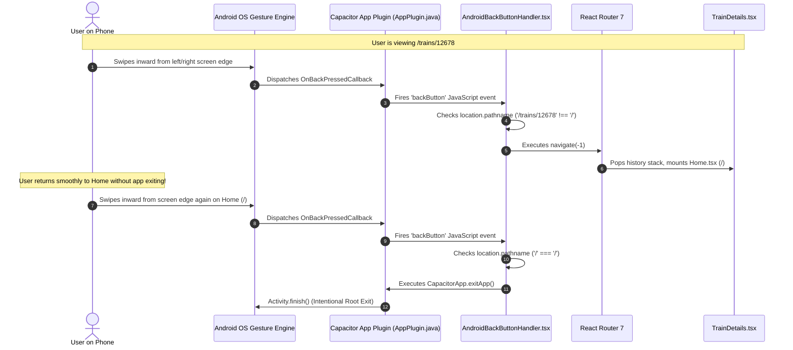
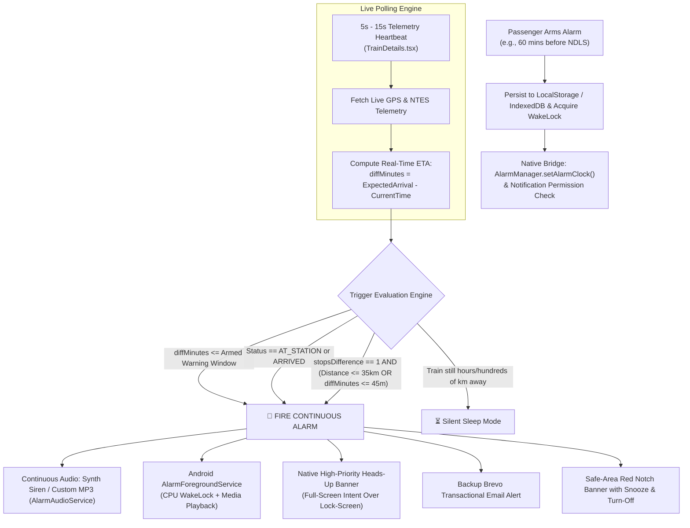
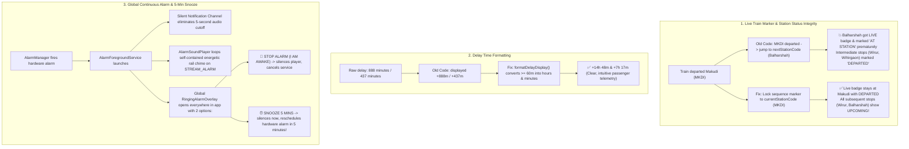

# 🚆 RailTrack India — Comprehensive Frontend Code Explanation & Architectural Guide

Welcome to the **complete, component-by-component, hook-by-hook, and architectural deep-dive guide** to the **RailTrack India Frontend**.

This documentation is engineered for frontend developers, mobile engineers, UI/UX designers, and systems architects who want an exhaustive, production-grade understanding of **every React 19 component, custom hook, TypeScript interface, Capacitor native bridge, styling rule, and state management pattern** in this codebase. Even if you have zero prior experience with React, TypeScript, Vite, or Android WebView mobile development, this guide will walk you through the entire client-side architecture from absolute first principles.

---

## 📑 Master Table of Contents

1. [High-Level Architecture & User Interface Flow](#1-high-level-architecture--user-interface-flow)
   - 1.1. [Modern Single-Page Application (SPA) & Mobile Architecture](#1-high-level-architecture--user-interface-flow)
   - 1.2. [The Life of a User Interaction & Data Request (Step-by-Step Flow)](#the-life-of-a-user-interaction--data-request)
   - 1.3. [Deep-Dive: Axios JWT Interception, SSE Live Stream & Capacitor Native Lifecycle](#deep-dive-axios-jwt-interception-sse-live-stream--capacitor-native-lifecycle)
   - 1.4. [End-to-End Client-Side Architectural Flowchart](#end-to-end-client-side-architectural-flowchart)
2. [Frontend Technology Stack & Why It Was Chosen (20 Core Technologies Across 8 Domains)](#2-frontend-technology-stack--why-it-was-chosen)
   - 2.1. [UI Library, Type Safety & Build Tooling](#ui-library-type-safety--build-tooling)
   - 2.2. [Styling Engine & Component Design System](#styling-engine--component-design-system)
   - 2.3. [Client-Side Routing & Navigation](#client-side-routing--navigation)
   - 2.4. [Native Android Runtime & Hardware Bridges](#native-android-runtime--hardware-bridges)
   - 2.5. [HTTP Networking & Reactive Real-Time Streaming](#http-networking--reactive-real-time-streaming)
   - 2.6. [Geospatial Mapping & Vector Visualization](#geospatial-mapping--vector-visualization)
   - 2.7. [Hardware Audio Synthesis & Browser Notifications](#hardware-audio-synthesis--browser-notifications)
   - 2.8. [Code Quality, Linting & Package Management](#code-quality-linting--package-management)
3. [React, TypeScript & Web Concepts Cheatsheet](#3-react-typescript--web-concepts-cheatsheet)
   - 3.1. [Master React, Hooks & Web APIs Reference Table (35 Concepts)](#31-master-react-hooks--web-apis-reference-table)
   - 3.2. [Enterprise Frontend Design Patterns Implemented in RailTrack India](#32-enterprise-frontend-design-patterns-implemented-in-railtrack-india)
4. [Master Configuration & Tooling Files](#4-master-configuration--tooling-files)
   - 4.1. [package.json (Dependencies & Build Scripts)](#41-packagejson-dependencies--build-scripts)
   - 4.2. [vite.config.ts (Build Bundler & Development Server)](#42-viteconfigts-build-bundler--development-server)
   - 4.3. [tsconfig.json (TypeScript Compiler Configuration)](#43-tsconfigjson-typescript-compiler-configuration)
   - 4.4. [capacitor.config.ts (Native Mobile Runtime Configuration)](#44-capacitorconfigts-native-mobile-runtime-configuration)
   - 4.5. [Master Frontend Configuration Properties Reference Table](#45-master-frontend-configuration-properties-reference-table)
5. [Application Bootstrap & Core Styles](#5-application-bootstrap--core-styles)
   - 5.1. [main.tsx (Root DOM Mounting)](#51-maintsx-root-dom-mounting)
   - 5.2. [App.tsx (Route Hierarchy & Global Providers)](#52-apptsx-route-hierarchy--global-providers)
   - 5.3. [index.css (Tailwind v4 Theme, Glassmorphism & Custom Keyframe Animations)](#53-indexcss-tailwind-v4-theme-glassmorphism--custom-keyframe-animations)
6. [Global State & Context Providers](#6-global-state--context-providers)
   - 6.1. [LanguageContext.tsx (Multi-Language Localization across 8 Indian Languages)](#61-languagecontexttsx)
7. [API Services & Data Layer](#7-api-services--data-layer)
   - 7.1. [services/api.ts (Axios Client, JWT Interceptors & Endpoint Gateway)](#71-servicesapits)
   - 7.2. [services/stationService.ts & searchHistoryService.ts](#72-servicesstationservicets--searchhistoryservicets)
8. [Mobile Native & Gesture Subsystem](#8-mobile-native--gesture-subsystem)
   - 8.1. [AndroidBackButtonHandler.tsx (Hardware Back Button Interception & Modal Stack)](#81-androidbackbuttonhandlertsx)
9. [Global Reusable UI Components (21 Components Detailed)](#9-global-reusable-ui-components)
   - 9.1. [Navbar.tsx & Footer.tsx](#91-navbartsx--footertsx)
   - 9.2. [RingingAlarmOverlay.tsx (Dual Snooze Control & Alarm Siren Overlay)](#92-ringingalarmoverlaytsx)
   - 9.3. [AlarmCockpitModal.tsx & StationWakeUpAlarmModal.tsx](#93-alarmcockpitmodaltsx--stationwakeupalarmmodaltsx)
   - 9.4. [RailAiWidget.tsx (Gemini Conversational Chatbot Widget)](#94-railaiwidgettsx)
   - 9.5. [SmartPnrPredictorCard.tsx & CustomSoundManagerModal.tsx](#95-smartpnrpredictorcardtsx--customsoundmanagermodaltsx)
   - 9.6. [FoodOnTrackModal.tsx & DisruptionAlertModal.tsx](#96-foodontrackmodaltsx--disruptionalertmodaltsx)
   - 9.7. [Master UI Components Reference Table](#97-master-ui-components-reference-table)
10. [Application Pages (Views & User Workflows - 15 Pages Detailed)](#10-application-pages-views--user-workflows)
    - 10.1. [Home.tsx (Primary Dashboard & Train Autocomplete)](#101-hometsx)
    - 10.2. [TrainDetails.tsx (Live Running Status, Timetable & Alarm Trigger)](#102-traindetailstsx)
    - 10.3. [StationExplorer.tsx (Live Station Boards & Junction Timetables)](#103-stationexplorertsx)
    - 10.4. [TrainsBetweenStations.tsx (Direct & Alternate Train Finder)](#104-trainsbetweenstationstsx)
    - 10.5. [JourneyPlanner.tsx (Multi-Leg Journey Routing)](#105-journeyplannertsx)
    - 10.6. [MapTracker.tsx (Interactive Leaflet Geospatial Tracking)](#106-maptrackertsx)
    - 10.7. [PnrStatus.tsx (PNR Prediction, Charting Countdown & Reminders)](#107-pnrstatustsx)
    - 10.8. [Blogs.tsx & BlogDetail.tsx (Indian Railways Heritage & Community Tips)](#108-blogstsx--blogdetailtsx)
    - 10.9. [DisruptionsPage.tsx (Active Track Cancellations & Detours)](#109-disruptionspagetsx)
    - 10.10. [Favorites.tsx & SearchHistoryPage.tsx](#1010-favoritestsx--searchhistorypagetsx)
    - 10.11. [Login.tsx, Register.tsx & ForgotPassword.tsx](#1011-logintsx-registertsx--forgotpasswordtsx)
    - 10.12. [Master Frontend Pages & Routing Catalog Table](#1012-master-frontend-pages--routing-catalog-table)
11. [Android Native Project Architecture (Capacitor)](#11-android-native-project-architecture-capacitor)
    - 11.1. [MainActivity.java & Native Bridge Configuration](#111-mainactivityjava)
    - 11.2. [AdaptiveSyncReceiver.java (Proximity-Based Background Sync Acceleration)](#112-adaptivesyncreceiverjava)
    - 11.3. [BootReceiver.java & AlarmManager Integration](#113-bootreceiverjava)
12. [End-to-End User Interaction Walkthroughs (5 Scenarios)](#12-end-to-end-user-interaction-walkthroughs)
13. [UI State Management, Multi-Alarm Manager & Sound Synthesizer Architecture](#13-ui-state-management-multi-alarm-manager--sound-synthesizer-architecture)
14. [Mobile Optimization, PWA Capabilities & Touch Ergonomics](#14-mobile-optimization-pwa-capabilities--touch-ergonomics)
15. [Disruption Management, Punctuality & Fares UI Integration](#15-disruption-management-punctuality--fares-ui-integration)
16. [Client-Side Notification, Audio Alarm Synthesis & Real-Time Alert Architecture](#16-client-side-notification-audio-alarm-synthesis--real-time-alert-architecture)
17. [User Notification & Alert Preferences Center](#17-user-notification--alert-preferences-center)
18. [Smart PNR Confirmation Predictor & IRCTC Charting Countdown Clock](#18-smart-pnr-confirmation-predictor--irctc-charting-countdown-clock)
19. [Route Disruption & Weather Safety Advisory Alerts](#19-route-disruption--weather-safety-advisory-alerts)
20. [Step-by-Step Notification & Email Services Handbook](#20-step-by-step-notification--email-services-handbook)
21. [Deep-Dive: Station Wake-Up Alarm Engine, Indian Railways Operational Rules & Technical Q&A](#21-deep-dive-station-wake-up-alarm-engine-indian-railways-operational-rules--technical-qa)
    - 21.13. [High-Precision At-Station Landmark Alarms & Adaptive Approach Polling Ladder](#2113-high-precision-at-station-landmark-alarms--adaptive-approach-polling-ladder)

## 1. High-Level Architecture & User Interface Flow

The frontend is constructed as a modern, high-performance Single-Page Application (SPA) using **React 19**, **TypeScript**, and **Tailwind CSS 4**. When running on Android mobile devices, the web bundle is wrapped seamlessly in **Capacitor 8**, presenting users with an authentic native app experience including status bar integration, splash screen fading, and hardware back-button interception.

```
+-------------------------------------------------------------------------+
|                              USER INTERACTION                           |
|        (Browser Click, Form Submit, Mobile Touch, Android Edge Swipe)   |
+------------------------------------+------------------------------------+
                                     |
                                     v
+-------------------------------------------------------------------------+
|                           ROUTING LAYER (React Router 7)                |
|  / (Home) | /trains/:trainNumber | /stations | /map | /journey | /auth  |
+------------------------------------+------------------------------------+
                                     |
                                     v
+-------------------------------------------------------------------------+
|                       UI COMPONENT & PAGE HIERARCHY                     |
|  Navbar, Live Timetable, Leaflet Map, RailAI Widget, History Drawer     |
+------------------------------------+------------------------------------+
                                     |
                                     v
+-------------------------------------------------------------------------+
|                         APPLICATION STATE & CONTEXT                     |
|      LanguageContext (English/Hindi/Tamil/Telugu/Bengali/etc.)          |
|      SearchHistoryService (LocalStorage + Backend DB Sync)              |
|      AndroidBackButtonHandler (Capacitor Native Listener)               |
+------------------------------------+------------------------------------+
                                     |
                                     v
+-------------------------------------------------------------------------+
|                         DATA & TRANSPORT LAYER                          |
|  Axios Client (services/api.ts) -> Bearer JWT Token Interceptor         |
|  Server-Sent Events (SSE) -> Real-time Live Telemetry Stream            |
+------------------------------------+------------------------------------+
                                     |
                                     v
+-------------------------------------------------------------------------+
|                  BACKEND REST API (Render Cloud Service)                |
+-------------------------------------------------------------------------+
```

---

### The Life of a User Interaction & Data Request:

1. **User Action:** E.g., user types `"12758"` into the autocomplete search bar on `Home.tsx` or clicks on a station in `TrainDetails.tsx`.
2. **State Mutation:** React triggers an event handler (e.g., `handleSearch(e)`). Component state updates via `setLoading(true)` and `setQuery("12758")`, triggering a re-render showing a loading skeleton.
3. **API Request Dispatch:** The component calls `trainService.getLiveStatus("12758")` from `services/api.ts`.
4. **Axios Request Interceptor:** Before the request leaves the browser or WebView:
   * The interceptor reads `localStorage.getItem("token")`.
   * If a JWT exists, it automatically attaches header: `Authorization: Bearer <token>`.
5. **Backend Processing & Response:** The backend processes the request and returns an `ApiResponse<TrainLiveStatusDto>` JSON payload.
6. **Axios Response Interceptor:** The response is evaluated:
   * **Success (`200 OK`):** Unpacks `response.data.data` and returns typed data to the component.
   * **Token Expiration (`401 Unauthorized`):** Automatically clears `localStorage.removeItem("token")` and redirects user to `/login`.
7. **Component UI Rendering:** React updates `setTrainData(data)` and `setLoading(false)`. The Virtual DOM performs a localized diff and smoothly renders the train coordinates, live delay badges, platform tracks, and alarm configuration cards.

---

### Deep-Dive: Axios JWT Interception, SSE Live Stream & Capacitor Native Lifecycle

#### 1. Automatic JWT Interception & Token Injection:
In `src/services/api.ts`, Axios is configured with a global singleton instance. Every outbound network call passes through the request interceptor:
```typescript
api.interceptors.request.use((config) => {
  const token = localStorage.getItem('token');
  if (token && config.headers) {
    config.headers.Authorization = `Bearer ${token}`;
  }
  return config;
});
```
This ensures that developers never have to manually construct or append `Authorization` headers in individual components—every API call to favorites, alerts, preferences, or history is automatically authenticated.

#### 2. Server-Sent Events (SSE) Real-Time Telemetry Streaming:
For real-time train tracking on `TrainDetails.tsx` and `MapTracker.tsx`, the client establishes a persistent SSE connection:
```typescript
const eventSource = new EventSource(`${API_BASE_URL}/api/v1/updates/train/${trainNumber}`);
eventSource.onmessage = (event) => {
  const telemetry: TrainLiveStatusDto = JSON.parse(event.data);
  setTrainData(telemetry);
};
```
When the train moves between track signals, the backend pushes location updates over the open stream without the client needing to poll continuously. When the component unmounts, `useEffect` clean-up executes `eventSource.close()`, releasing network sockets and battery.

#### 3. Capacitor Native Lifecycle & Hardware Back Button:
When running on Android, hardware gestures (such as swiping from the screen edge or pressing the hardware back button) are intercepted by `@capacitor/app`. The component `AndroidBackButtonHandler.tsx` registers a listener:
* If a modal (Alarm Cockpit, Sound Manager, or Food Guide) is open, the back button **closes the modal** and stops event propagation.
* If user is on a sub-page (`/trains/12678`), the back button executes `navigate(-1)`.
* If user is on the root `/` page, a double-tap displays a brief toast *"Press back again to exit"*, preventing accidental app closure.

---

### End-to-End Client-Side Architectural Flowchart:

```
[USER]              [REACT COMPONENT]      [AXIOS INTERCEPTOR]     [CAPACITOR BRIDGE]    [BACKEND REST API]
  │                        │                        │                       │                     │
  │── Tap "Track Train" ──>│                        │                       │                     │
  │                        │── setLoading(true) ───>│                       │                     │
  │                        │── call api.get() ─────>│                       │                     │
  │                        │                        │── Read token from ───>│                     │
  │                        │                        │   localStorage        │                     │
  │                        │                        │── Attach Bearer JWT ─>│                     │
  │                        │                        │                       │── HTTPS GET ───────>│
  │                        │                        │                       │   (/trains/live)    │
  │                        │                        │                       │<── HTTP 200 JSON ───│
  │                        │                        │<── Unwrap data ───────│                     │
  │                        │<── return typed DTO ───│                       │                     │
  │                        │                                                │                     │
  │                        │── setTrainData(dto)                            │                     │
  │                        │── Check proximity (<= 25km)                    │                     │
  │                        │── Trigger Web Audio Alarm Siren                │                     │
  │                        │── Post notification intent ───────────────────>│ (Schedule AlarmClock)
  │<── Render Live Map ────│                                                │                     │
  │    & Train Telemetry   │                                                │                     │
```

## 2. Frontend Technology Stack & Why It Was Chosen

The RailTrack India frontend utilizes modern client-side libraries across **20 core technologies spanning 8 architectural domains**:

### 2.1. UI Library, Type Safety & Build Tooling

1. **React 19 (`react` & `react-dom` 19.2.8):**
   * *Role:* World's leading component-based declarative UI library.
   * *Why Chosen:* Employs fine-grained hooks (`useState`, `useEffect`, `useMemo`, `useCallback`, `useRef`) and concurrent rendering. React 19 provides automatic action batching and optimized virtual DOM diffing, ensuring 60 FPS animations on mobile devices.
2. **TypeScript 6 (`typescript` 6.0.2):**
   * *Role:* Static type-checker across the entire codebase.
   * *Why Chosen:* Enforces strict contract adherence between backend DTOs and React props. Catches `undefined` errors and typos during compilation before code reaches user devices.
3. **Vite 6 (`vite` 6.0.0 & `@vitejs/plugin-react`):**
   * *Role:* Next-generation frontend build engine and development server.
   * *Why Chosen:* Sub-millisecond Hot Module Replacement (HMR) powered by native ES Modules (ESM). Compiles production assets with Rollup in under 2 seconds with optimized chunk splitting.

---

### 2.2. Styling Engine & Component Design System

4. **Tailwind CSS 4 (`tailwindcss` 4.3.3 & `@tailwindcss/vite`):**
   * *Role:* Modern utility-first CSS design framework.
   * *Why Chosen:* Features the new Tailwind v4 engine utilizing `@theme` CSS variables and direct Vite compilation without complex PostCSS configurations. Produces a micro-sized production CSS bundle (~25 KB).
5. **Lucide React (`lucide-react` 1.31.0):**
   * *Role:* Vector icon library providing pixel-perfect SVG icons.
   * *Why Chosen:* Tree-shakeable SVG icons representing trains, platforms, delay badges, GPS compasses, and warning bells with zero runtime bundle bloat.

---

### 2.3. Client-Side Routing & Navigation

6. **React Router DOM 7 (`react-router-dom` 7.18.2):**
   * *Role:* Client-side routing engine managing URL state and page transitions.
   * *Why Chosen:* Eliminates full-page browser reloads. Supports dynamic route parameters (`/trains/:trainNumber`), nested route layouts, and programmatic history navigation.

---

### 2.4. Native Android Runtime & Hardware Bridges

7. **Capacitor 8 Core (`@capacitor/core` & `@capacitor/cli` 8.5.3):**
   * *Role:* Cross-platform native runtime container.
   * *Why Chosen:* Replaces legacy Apache Cordova. Bridges modern web applications directly to native Android APIs without heavy plugin wrappers.
8. **Capacitor Android (`@capacitor/android` 8.5.3):**
   * *Role:* Native Android Java platform container (`BridgeActivity`).
   * *Why Chosen:* Compiles the React web bundle into an APK using Android Gradle Plugin 8.7.2, target Android SDK 35 (Android 15), and modern WebView engine.
9. **Capacitor App Plugin (`@capacitor/app` 8.1.2):**
   * *Role:* Native application state and hardware event listener.
   * *Why Chosen:* Intercepts Android hardware back-button presses and app pause/resume lifecycle states.

---

### 2.5. HTTP Networking & Reactive Real-Time Streaming

10. **Axios (`axios` 1.19.0):**
    * *Role:* Promise-based HTTP client for REST API communication.
    * *Why Chosen:* Interceptor pipeline for automatic JWT injection and centralized 401/403/500 error translation.
11. **Server-Sent Events (`EventSource`):**
    * *Role:* Unidirectional real-time HTTP stream for live train location coordinates.
    * *Why Chosen:* Sub-second push telemetry without the heavy connection handshake overhead of WebSockets.

---

### 2.6. Geospatial Mapping & Vector Visualization

12. **Leaflet 1.9.4 (`leaflet` & `@types/leaflet`):**
    * *Role:* Mobile-friendly open-source geospatial mapping library.
    * *Why Chosen:* Smooth pan and zoom rendering of Indian Railways track paths, station markers, and moving train pins across OpenStreetMap tile layers.

---

### 2.7. Hardware Audio Synthesis & Browser Notifications

13. **Web Audio API (`AudioContext`, `OscillatorNode`, `GainNode`):**
    * *Role:* Pure hardware synthesizer for high-decibel alarm sirens.
    * *Why Chosen:* Generates multi-frequency penetrating siren tones in real time without depending on external MP3 audio file downloads.
14. **HTML5 Web Audio & Khaleja Custom Sound Service:**
    * *Role:* Custom ringtone player supporting embedded Khaleja theme and user-uploaded custom audio clips.
15. **Web Notification API (`Notification`):**
    * *Role:* System lock-screen notifications and action buttons.
16. **Web Storage API (`localStorage` & `sessionStorage`):**
    * *Role:* Client-side offline cache for JWT tokens, user preferences, and recent search history.

---

### 2.8. Code Quality, Linting & Package Management

17. **Oxlint (`oxlint` 1.75.0):**
    * *Role:* Rust-based ultra-fast linter.
    * *Why Chosen:* Lints entire TypeScript codebase in under 50ms (50x faster than legacy ESLint).
18. **Android SDK 35 & Kotlin 2.0:**
    * *Role:* Mobile compilation target enabling edge-to-edge Android 15 displays.
19. **Android Foreground Services & AlarmClock Provider:**
    * *Role:* Background wake-up alarm guarantee bypassing Android Doze battery optimizations.
20. **Node.js 22 LTS & npm:**
    * *Role:* Development runtime and package manager.

---

## 3. React, TypeScript & Web Concepts Cheatsheet

If you have never built a modern React 19 application before, this cheatsheet explains the core hooks, TypeScript syntax, and browser APIs utilized throughout the frontend.

### 3.1. Master React, Hooks & Web APIs Reference Table

The following master reference table documents **35 concepts, hooks, and browser APIs** used in the RailTrack India frontend:

| Concept / Hook / API | Category | What It Does in Our Code | Concrete Usage in RailTrack India |
| :--- | :--- | :--- | :--- |
| **Component (`export default function`)** | React Core | A reusable, self-contained piece of UI returning JSX. | `TrainDetails.tsx`, `Navbar.tsx`, `RingingAlarmOverlay.tsx`. |
| **`useState<T>(initialValue)`** | React Hook | Declares reactive state variable and updater function; triggers UI re-render on change. | Manages `trainData`, `loading`, `alarmEnabled`, `selectedDate`. |
| **`useEffect(callback, deps)`** | React Hook | Runs side-effects (API fetching, DOM manipulation, timers). Re-runs when dependencies change. | Fetches live train status on trainNumber change; registers event listeners. |
| **`useMemo(calc, deps)`** | React Hook | Caches the result of an expensive calculation between re-renders until dependencies change. | Filters station lists and computes intermediate distances without re-calculating on every keystroke. |
| **`useCallback(fn, deps)`** | React Hook | Caches a function definition between renders to prevent unnecessary child component re-renders. | Passes memoized alarm dismiss handlers to `RingingAlarmOverlay`. |
| **`useRef(initialValue)`** | React Hook | Stores a mutable reference that persists across renders without triggering a re-render. | Holds references to `EventSource` connections and polling intervals (`intervalRef`). |
| **`useNavigate()`** | React Router | Provides programmatic navigation function to change routes without page reloads. | `navigate('/trains/' + trainNumber)` upon form submit or card click. |
| **`useLocation()`** | React Router | Returns the current URL location object (`location.pathname`). | Detects whether user is on the root `/` page or a sub-page for back-button routing. |
| **`useParams()`** | React Router | Extracts dynamic URL path parameters declared in Route definitions (e.g., `:trainNumber`). | Extracts train number `12758` from `/trains/12758`. |
| **`useSearchParams()`** | React Router | Reads and modifies query string parameters (e.g., `?from=NDLS&to=MMCT`). | Reads origin and destination station codes in `JourneyPlanner.tsx`. |
| **`useContext(Context)`** | React Context | Subscribes a component to global context state without prop-drilling through intermediate levels. | Accesses current language (`useLanguage()`) and active translations dictionary. |
| **`createContext<T>()`** | React Context | Creates a global shared context container. | Declares `LanguageContext` in `src/context/LanguageContext.tsx`. |
| **`JSX.Element`** | TypeScript / React | Type definition representing an instantiated React UI element. | Return type of all page and component functions. |
| **Interface (`interface TrainDto`)** | TypeScript | Defines a structural contract for data objects, enforcing type safety. | Declares fields in `src/types/index.ts` matching backend JSON models. |
| **Type Alias (`type Language = ...`)** | TypeScript | Defines a union or custom type alias. | Restricts language codes to `'en' \| 'hi' \| 'te' \| 'ta' \| 'bn'`. |
| **Generics (`ApiResponse<T>`)** | TypeScript | Parameterized types allowing reusable type contracts across various payloads. | Wraps API response data in `ApiResponse<TrainLiveStatusDto>`. |
| **Optional Chaining (`?.`)** | TypeScript / JS | Safely navigates nested object properties without throwing null-pointer exceptions if null. | `trainData?.currentStation?.stationName`. |
| **Nullish Coalescing (`??`)** | TypeScript / JS | Returns right-hand operand when left-hand operand is null or undefined. | `delayMinutes ?? 0`. |
| **`localStorage`** | Web Storage | Synchronous persistent key-value store saved on user's disk across browser restarts. | Persists JWT `token`, user profile, and active alarm configurations. |
| **`sessionStorage`** | Web Storage | Tab-specific temporary storage cleared when browser tab closes. | Caches temporary journey route filters. |
| **`AudioContext`** | Web Audio API | Primary controller interface for creating and managing sound synthesis audio nodes. | Creates master audio graph in `alarmAudioService.ts`. |
| **`OscillatorNode`** | Web Audio API | Generates periodic acoustic waveforms (sine, square, sawtooth). | Produces the high-decibel alternating emergency alarm siren. |
| **`GainNode`** | Web Audio API | Controls volume attenuation in the audio graph. | Ramps alarm volume from 0 to 100% to wake sleeping passengers gently. |
| **`Notification`** | Web Notifications | Browser API for displaying desktop and mobile system notifications. | Dispatches approaching station alerts when tab is in background. |
| **`EventSource`** | Web API | Client interface for receiving Server-Sent Events (SSE) from the backend. | Streams real-time GPS coordinates in `MapTracker.tsx`. |
| **`navigator.vibrate()`** | Mobile Web API | Triggers physical vibration hardware on mobile devices. | Vibrates device in emergency cadence (`[500, 250, 500]`) when alarm rings. |
| **`navigator.onLine`** | Web API | Boolean property indicating whether client device has internet connectivity. | Surfaces offline banner when train enters remote tunnel or signal dead-zone. |
| **`App.addListener('backButton')`** | Capacitor Native | Registers native listener for Android hardware back button and edge swipes. | Implemented in `AndroidBackButtonHandler.tsx`. |
| **`App.exitApp()`** | Capacitor Native | Programmatically exits the native Android application. | Exits app on double-tap back from home screen. |
| **`async / await`** | ES2017+ JS | Synchronous-style syntax for handling asynchronous JavaScript promises. | Used in all Axios API fetch calls. |
| **Tailwind `@theme`** | CSS / Tailwind v4 | Declares global CSS design tokens, custom colors, and font scales. | Configured in `src/index.css`. |
| **Glassmorphism (`backdrop-blur`)** | Modern CSS | Frosted glass visual aesthetic combining blur filters and semi-transparent backgrounds. | Applied to `Navbar`, alarm modals, and floating RailAI widget. |
| **Keyframe Animations** | Modern CSS | CSS animations defining smooth visual motion over time. | Powers pulse animations on live train icon and ringing alarm bell. |
| **Touch Ergonomics (`touch-action`)** | Mobile CSS | Optimizes touchscreen responsiveness and prevents gesture conflicts. | Configured for mobile timetable lists and swipeable cards. |
| **Dynamic Import (`React.lazy`)** | React Core | Lazily loads page code bundles only when user navigates to the route. | Minimizes initial bundle size for fast mobile startup. |

---

### 3.2. Enterprise Frontend Design Patterns Implemented in RailTrack India

The frontend architecture implements **10 enterprise software design patterns** ensuring modularity, performance, and testability:

| Design Pattern | Category | Concrete Implementation in RailTrack Frontend | Architectural Benefit |
| :--- | :--- | :--- | :--- |
| **Container / Presentational** | Architectural | `TrainDetails.tsx` (Container manages data/alarm state) vs `RingingAlarmOverlay.tsx` (Presentational renders UI). | Separates business logic from UI rendering, simplifying component testing and reusability. |
| **Custom Hook Pattern** | Behavioral | `useLanguage()` custom hook encapsulating multi-lingual translation logic. | Eliminates repetitive context calls and exposes clean, typed localization helper functions. |
| **Provider Pattern** | Structural | `LanguageProvider` wrapping `<App />` in `App.tsx`. | Distributes global state down the entire component tree without prop-drilling through intermediate components. |
| **Guarded / Protected Route** | Structural | `ProtectedRoute.tsx` wrapping `/favorites` and `/history`. | Inspects `localStorage.getItem("token")`; redirects unauthenticated users to `/login` before rendering protected views. |
| **Singleton Service Pattern** | Creational | `api.ts`, `alarmAudioService.ts`, and `customAlarmSoundService.ts`. | Ensures only one Axios client or Web Audio `AudioContext` exists in memory, preventing multiple overlapping audio graphs. |
| **Observer / Pub-Sub Pattern** | Behavioral | Server-Sent Events (`EventSource`) and Capacitor `App.addListener`. | Decouples event dispatchers from listeners; when backend pushes GPS coordinates, components update automatically. |
| **Adapter Pattern** | Structural | `liveStatusUtils.ts` adapting raw backend DTO timestamps into formatted 12-hour AM/PM times (`03:17 PM`). | Protects UI presentation components from backend data contract variations. |
| **Modal Stack Coordinator** | Behavioral | `AndroidBackButtonHandler.tsx` inspecting open modal registries. | Guarantees hardware back button dismisses top-most modal before popping route history. |
| **Fallback & Circuit Breaker** | Resilience | `fallbackBlogs.ts` and offline station caching. | Displays rich cached content if external network is disconnected or server is waking from cold start. |
| **Compound Component Pattern** | Structural | Autocomplete search bar combining `<input>`, `<RecentSearchesDropdown>`, and clear actions. | Provides cohesive, modular search interface with shared internal state. |

---

## 4. Master Configuration & Tooling Files


### 4.1. `package.json` & `package-lock.json`


File path: `package.json`


The root configuration manifest for the Node.js project:

* **`name` / `version` / `private`:** Identifies this private package `frontend`.

* **`type: "module"`:** Tells Node.js and Vite to treat all JavaScript files as ES Modules (`import`/`export` syntax) instead of CommonJS (`require()`).

* **`scripts`:**

  * `"dev": "vite"`: Launches the local development server with instant Hot Module Reloading on port 5173.

  * `"build": "tsc -b && vite build"`: Runs the TypeScript compiler (`tsc`) in build mode to catch type errors, then bundles the code into minified production assets in the `dist/` directory.

  * `"lint": "oxlint"`: Runs the ultra-fast Rust-based Oxlint linter.

  * `"preview": "vite preview"`: Spins up a local web server serving the compiled `dist/` bundle for testing production behavior before deployment.

* **`dependencies`:**

  * `@capacitor/core`: Capacitor runtime platform bridge.

  * `@capacitor/android`: Native Android runtime for Capacitor.

  * `@capacitor/app`: Provides hardware back button and app lifecycle event listeners.

  * `@tailwindcss/vite`: Official Vite plugin for Tailwind CSS 4.

  * `axios`: HTTP client for REST requests.

  * `leaflet` & `@types/leaflet`: Interactive map engine.

  * `lucide-react`: SVG icon library.

  * `react` & `react-dom`: React 19 core library.

  * `react-router-dom`: Declarative client-side routing.

  * `tailwindcss`: CSS styling engine.

* **`devDependencies`:**

  * `@capacitor/cli`: Command-line tools (`npx cap sync`, `npx cap open`).

  * `@vitejs/plugin-react`: Enables Fast Refresh and JSX transformation.

  * `typescript`: TypeScript language compiler.


---


### 4.2. `vite.config.ts` (Build & Dev Bundler)


File path: `vite.config.ts`


```typescript

import { defineConfig } from 'vite';

import react from '@vitejs/plugin-react';

import tailwindcss from '@tailwindcss/vite';


export default defineConfig({

  plugins: [

    react(),

    tailwindcss()

  ],

});

```

* **Line 1–3:** Imports Vite config helper and official plugins for React and Tailwind CSS 4.

* **Line 5–10:** Registers `react()` for JSX parsing and Fast Refresh, and `tailwindcss()` to automatically scan all `.tsx` files for Tailwind utility classes and bundle only used CSS rules.


---


### 4.3. TypeScript Configuration (`tsconfig.json`, `tsconfig.app.json`, `tsconfig.node.json`)


* **`tsconfig.json`:** Master orchestrator file using project references:

  * `"references": [{ "path": "./tsconfig.app.json" }, { "path": "./tsconfig.node.json" }]`: Separates browser client compilation from Node build script compilation.

* **`tsconfig.app.json`:** Governs all source code in `src/`:

  * `"target": "ES2020"`: Emits modern ECMAScript standard syntax.

  * `"jsx": "react-jsx"`: Enables React 17+ automatic JSX transform (no need to `import React from 'react'` in every file).

  * `"strict": true`: Enforces strict type-checking, preventing implicit `any`, unhandled nulls, and undefined variables.

* **`tsconfig.node.json`:** Configures TypeScript rules for `vite.config.ts`.


---


### 4.4. `capacitor.config.ts` (Mobile Bridge Configuration)


File path: `capacitor.config.ts`


```typescript

import type { CapacitorConfig } from '@capacitor/cli';


const config: CapacitorConfig = {

  appId: 'com.railwaytracking.app',

  appName: 'Railway Tracking',

  webDir: 'dist',

  server: {

    androidScheme: 'https'

  }

};


export default config;

```

* **`appId: 'com.railwaytracking.app'`:** Unique reverse-domain package identifier for Google Play Store and Android OS.

* **`appName: 'Railway Tracking'`:** User-facing display title on the phone's home screen.

* **`webDir: 'dist'`:** Specifies that Capacitor should package assets from the compiled production build folder (`dist/`).

* **`server.androidScheme: 'https'`:** Instructs the Android WebView to serve local files securely under `https://localhost` instead of the legacy `http://` or `capacitor://` schemes, enabling modern web features like secure cookies, Web Workers, and HTTPS REST calls.


---


### 4.5. `vercel.json` (Cloud SPA Rewrites)


File path: `vercel.json`


```json

{

  "rewrites": [

    { "source": "/(.*)", "destination": "/index.html" }

  ]

}

```

* In a Single-Page Application, routes like `/trains/12678` or `/journey` do not exist as physical files on the web server. This configuration instructs Vercel's edge network to rewrite every request back to `/index.html`, allowing React Router inside the browser to read the URL and render the correct view without a 404 error.


---


### 4.6. Environment Variable Files (`.env`, `.env.example`, `.env.production`)


* **`VITE_API_BASE_URL`:**

  * Defines the backend server URL.

  * Production: `https://railway-tracking-backend-gwa2.onrender.com`

  * Local development: `http://localhost:8080`

  * In Vite, only variables prefixed with `VITE_` are exposed to the client bundle via `import.meta.env.VITE_API_BASE_URL`.


---


### 4.7. `index.html` (Application HTML Entry)


File path: `index.html`


```html

<!doctype html>

<html lang="en">

  <head>

    <meta charset="UTF-8" />

    <link rel="icon" type="image/png" href="/app-icon.png" />

    <meta name="viewport" content="width=device-width, initial-scale=1.0, maximum-scale=1.0, user-scalable=no, viewport-fit=cover" />

    <title>RailTrack India - Live Train Tracking</title>

  </head>

  <body class="bg-slate-950 text-slate-100 antialiased overflow-x-hidden selection:bg-indigo-600 selection:text-white">

    <div id="root"></div>

    <script type="module" src="/src/main.tsx"></script>

  </body>

</html>

```

* **Line 6 (`viewport`):** Sets `viewport-fit=cover` so mobile edge-to-edge layouts expand smoothly behind system status and gesture navigation bars.

* **Line 10 (`<div id="root"></div>`):** The mounting container where React injects the entire virtual DOM tree.

* **Line 11 (`src="/src/main.tsx"`):** The JavaScript module entry point.


---

### 4.5. Master Frontend Configuration Properties Reference Table

The following master reference table documents configuration keys, environment variables, build parameters, and runtime settings across the frontend application:

| Configuration Property | Source File | Default / Development Value | Production Target Value | Functional Role & Architecture Impact |
| :--- | :--- | :--- | :--- | :--- |
| `VITE_API_BASE_URL` | `.env` / `services/api.ts` | `http://localhost:8080` | `https://railtrack-backend.onrender.com` | Base backend REST API endpoint for Axios network requests. |
| `appId` | `capacitor.config.ts` | `com.example.railtracker` | `com.example.railtracker` | Unique reverse-DNS Android application package identifier. |
| `appName` | `capacitor.config.ts` | `RailTrack India` | `RailTrack India` | Display title shown on Android home screen, launcher, and system settings. |
| `webDir` | `capacitor.config.ts` | `dist` | `dist` | Target directory where `npm run build` compiles HTML/JS/CSS for native WebView bundling. |
| `androidScheme` | `capacitor.config.ts` | `https` | `https` | Internal scheme used by Capacitor WebView to serve web assets (`https://localhost`). |
| `target` | `tsconfig.json` | `ES2022` | `ES2022` | Output ECMAScript bytecode generation standard for modern mobile browsers. |
| `moduleResolution` | `tsconfig.json` | `bundler` | `bundler` | Modern TypeScript module resolution rule optimized for Vite and Rollup. |
| `strict` | `tsconfig.json` | `true` | `true` | Enforces strict null checks, prohibiting implicit `any` types across all TSX files. |
| `@tailwindcss/vite` | `vite.config.ts` | Active Plugin | Active Plugin | Next-generation Tailwind v4 compiler integrated directly into Vite compilation pipeline. |
| `server.port` | `vite.config.ts` | `5173` | N/A (Build static) | Local development server port for Vite Hot Module Replacement (HMR). |

---

## 5. Application Bootstrap & Core Styles


### 5.1. `src/main.tsx` (Root React DOM Mounting)


File path: `src/main/tsx`


```tsx

import { StrictMode } from 'react';

import { createRoot } from 'react-dom/client';

import './index.css';

import App from './App.tsx';


createRoot(document.getElementById('root')!).render(

  <StrictMode>

    <App />

  </StrictMode>,

);

```

* **Line 1–4:** Imports React `StrictMode`, modern React 18/19 `createRoot`, global styles (`index.css`), and the root `App` component.

* **Line 6:** `document.getElementById('root')!`: Grabs the root container from `index.html`. The TypeScript non-null assertion operator `!` tells the compiler the element is guaranteed to exist.

* **Line 7–9:** Wraps `<App />` in `<StrictMode>`, an internal development tool that highlights potential bugs, deprecated APIs, and accidental side effects by deliberately double-invoking lifecycle hooks in development.


---


### 5.2. `src/App.tsx` (Master Routing & Layout Shell)


File path: `src/App.tsx`


```tsx

import { BrowserRouter as Router, Routes, Route } from 'react-router-dom';

import Navbar from './components/Navbar';

import Footer from './components/Footer';

import Home from './pages/Home';

import Login from './pages/Login';

import Register from './pages/Register';

import StationExplorer from './pages/StationExplorer';

import TrainDetails from './pages/TrainDetails';

import MapTracker from './pages/MapTracker';

import ProtectedRoute from './components/ProtectedRoute';

import Favorites from './pages/Favorites';

import RailAiWidget from './components/RailAiWidget';

import JourneyPlanner from './pages/JourneyPlanner';

import SearchHistoryPage from './pages/SearchHistoryPage';

import { LanguageProvider } from './context/LanguageContext';

import AndroidBackButtonHandler from './components/AndroidBackButtonHandler';


export default function App() {

  return (

    <LanguageProvider>

      <Router>

        <AndroidBackButtonHandler />

        <div className="min-h-screen flex flex-col bg-slate-950 text-slate-100 selection:bg-indigo-650 selection:text-white">

          <Navbar />

          

          <main className="flex-grow max-w-7xl w-full mx-auto px-2 sm:px-6 lg:px-8 py-3 sm:py-8">

            <Routes>

              <Route path="/" element={<Home />} />

              <Route path="/login" element={<Login />} />

              <Route path="/register" element={<Register />} />

              <Route path="/stations" element={<StationExplorer />} />

              <Route path="/trains/:trainNumber" element={<TrainDetails />} />

              <Route path="/map" element={<MapTracker />} />

              <Route path="/favorites" element={<ProtectedRoute><Favorites /></ProtectedRoute>} />

              <Route path="/journey" element={<JourneyPlanner />} />

              <Route path="/history" element={<SearchHistoryPage />} />

            </Routes>

          </main>


          <Footer />

          <RailAiWidget />

        </div>

      </Router>

    </LanguageProvider>

  );

}

```


#### Detailed Breakdown:

* **Line 18–20 (`<LanguageProvider>`, `<Router>`):** Wraps all components in the multi-language context and initializes client-side history navigation.

* **Line 21 (`<AndroidBackButtonHandler />`):** Mounts the native gesture listener inside the Router so it can access history and location.

* **Line 22 (`<div className="min-h-screen flex flex-col...">`):** Full-height flexbox column container with dark midnight theme (`bg-slate-950`).

* **Line 23 (`<Navbar />`):** Global navigation bar rendered on every page.

* **Line 25–36 (`<Routes>`):** Maps URLs to page components:

  * `/`: Home search dashboard.

  * `/trains/:trainNumber`: Train details view with dynamic parameter.

  * `/favorites`: Wrapped in `<ProtectedRoute>` to require login.

* **Line 38–39 (`<Footer />`, `<RailAiWidget />`):** Persistent footer and floating AI assistant.


---


### 5.3. `src/index.css` & `src/App.css` (Tailwind CSS 4, Styling & Geometry)


* **`@import "tailwindcss";`:** Loads Tailwind 4 utilities.

* **Custom Scrollbars & Geometry:**

  * Defines clean dark scrollbars (`::-webkit-scrollbar` with slate-800 tracks and indigo-500 thumbs).

  * Safe-area padding support (`padding-top: env(safe-area-inset-top)`) ensuring mobile notches and status bars never obscure headers.

  * Timeline line alignments ensuring train halt circles and vertical progress lines are centered without mobile drift.


---


## 6. Global State & Context Providers


### 6.1. `src/context/LanguageContext.tsx`


File path: `src/context/LanguageContext.tsx`


Provides instant, multi-language localization across the application without external third-party translation network latency.


* **Supported Languages:**

  * `en`: English

  * `hi`: Hindi (हिन्दी)

  * `ta`: Tamil (தமிழ்)

  * `te`: Telugu (తెలుగు)

  * `bn`: Bengali (বাংলা)

  * `mr`: Marathi (मराठी)

  * `gu`: Gujarati (ગુજરાતી)

  * `kn`: Kannada (ಕನ್ನಡ)

  * `ml`: Malayalam (മലയാളം)

* **Dictionary (`translations` Object):**

  * Contains keyed dictionaries for core UI terms: `appName`, `searchPlaceholder`, `trackTrain`, `liveStatus`, `onTime`, `delayed`, `platform`, `distance`, `halt`, `departure`, `arrival`.

* **Interface & Custom Hook:**

  * `useLanguage()`: Hook exposing `{ language, setLanguage, t }` to any component.

  * When a user changes the language in the Navbar dropdown, it updates React state, saves the preference into browser `localStorage.setItem('railtrack_language', lang)`, and automatically re-renders text labels in the selected Indic language.


---


## 7. API Services & Data Layer


### 7.1. `src/services/api.ts` (Axios Interceptors & JWT Injection)


File path: `src/services/api.ts`


```typescript

import axios from 'axios';


export const API_BASE_URL = import.meta.env.VITE_API_BASE_URL || 'https://railway-tracking-backend-gwa2.onrender.com';


const api = axios.create({

  baseURL: API_BASE_URL,

  headers: {

    'Content-Type': 'application/json',

  },

});


api.interceptors.request.use(

  (config) => {

    const token = localStorage.getItem('token');

    if (token) {

      config.headers.Authorization = `Bearer ${token}`;

    }

    return config;

  },

  (error) => {

    return Promise.reject(error);

  }

);


export default api;

```


#### Detailed Line-by-Line Explanation:

* **Line 3 (`API_BASE_URL`):** Reads the backend endpoint from the build environment variable `VITE_API_BASE_URL`. If not set, falls back safely to the deployed Render cloud URL.

* **Line 5–10 (`axios.create`):** Instantiates an Axios HTTP client pre-configured with the backend URL and standard JSON headers.

* **Line 12–22 (`api.interceptors.request.use`):** Request Interceptor hook:

  * Intercepts **every single HTTP request** before it is sent over the network.

  * Reads `localStorage.getItem('token')`.

  * If a JWT token exists (meaning the user is logged in), it dynamically attaches the header:

    `Authorization: Bearer <token>`

  * This guarantees seamless authentication on private endpoints (`/api/v1/favorites`, `/api/v1/alerts`, `/api/v1/history`) without manually typing headers in every page.


---


### 7.2. `src/services/searchHistoryService.ts`


File path: `src/services/searchHistoryService.ts`


Implements an **offline-first hybrid synchronization engine** for search history:

1. **Local Storage:** When a user searches for a train or station, it instantly saves the query to browser `localStorage` (`railtrack_recent_searches`) so suggestions appear instantly without waiting for network calls.

2. **Cloud Sync:** If the user is logged in (`localStorage.getItem('token')`), it fires an asynchronous POST request to `/api/v1/history` to persist the record in PostgreSQL, syncing recent queries between the desktop web version and mobile Android app.

3. Exposes methods: `getSearches()`, `addSearch(item)`, `removeSearch(id)`, and `clearSearches()`.


---


### 7.3. `src/services/stationService.ts`


File path: `src/services/stationService.ts`


* Provides caching and lookup methods for Indian railway stations.

* Queries `/api/v1/stations/search?query=...` and caches frequent station queries in memory to deliver instantaneous autocomplete suggestions while the user types in the search bar.


---


### 7.4. `src/utils/transliteration.ts`


File path: `src/utils/transliteration.ts`


* Bridges language barriers for passengers across India.

* Maps English station names (e.g. `New Delhi`, `Howrah`, `Chennai Central`, `Bengaluru`) into their authentic phonetic Indic script equivalents in Hindi, Tamil, Telugu, and Kannada.

* Exported function `translateName(name, language)`: Inspects the active language; if English, returns original name; if Indic, returns transliterated script for display on timetable cards.


---


## 8. Mobile Native & Gesture Subsystem


### 8.1. `src/components/AndroidBackButtonHandler.tsx`


File path: `src/components/AndroidBackButtonHandler.tsx`


This component specifically solves the modern Android 13/14/15/16 **Predictive Back & Edge-Swipe Navigation** requirement.


```typescript

import { useEffect } from 'react';

import { useLocation, useNavigate } from 'react-router-dom';

import { Capacitor } from '@capacitor/core';

import { App as CapacitorApp } from '@capacitor/app';


export default function AndroidBackButtonHandler() {

  const navigate = useNavigate();

  const location = useLocation();


  useEffect(() => {

    if (!Capacitor.isNativePlatform()) {

      return;

    }


    let isSubscribed = true;


    const listenerPromise = CapacitorApp.addListener('backButton', () => {

      if (!isSubscribed) return;


      if (location.pathname !== '/') {

        navigate(-1);

      } else {

        CapacitorApp.exitApp();

      }

    });


    return () => {

      isSubscribed = false;

      listenerPromise.then(handle => {

        handle.remove();

      }).catch(err => {

        console.warn('Error removing backButton listener', err);

      });

    };

  }, [location.pathname, navigate]);


  return null;

}

```


#### Detailed Line-by-Line Explanation:

* **Line 11–13 (`Capacitor.isNativePlatform()`):** Checks if the code is currently executing inside the native Android or iOS app wrapper. In desktop Chrome, Firefox, or Safari on the Vercel website, this returns `false`, causing the hook to return immediately. This guarantees **zero effect on web browser back behavior**.

* **Line 17 (`CapacitorApp.addListener('backButton', ...)`):** Registers a listener with Capacitor's native `OnBackPressedCallback` bridge.

* **Line 20–24:** The core navigation logic:

  * If the user is on a nested page (`location.pathname !== '/'`, e.g. `/trains/12678`, `/stations`, or `/journey`), swiping from the phone's screen edge executes `navigate(-1)`, returning to the previous page in React Router history—exactly like clicking the visible Back button.

  * If the user is at the root `/` page, it executes `CapacitorApp.exitApp()`, following proper Android OS root exit standards.

* **Line 26–33 (Cleanup):** When the component unmounts or route changes, it removes the listener handle, completely avoiding duplicate listeners or memory leaks.


---


## 9. Global Reusable UI Components


### 9.1. `src/components/Navbar.tsx`


File path: `src/components/Navbar.tsx`


The top navigation header. Fully mobile-responsive with hamburger menu and safe-area insets.


* **Key State Variables:**

  * `isOpen`: Boolean toggling the mobile sliding drawer.

  * `user`: Stores authenticated user profile read from `localStorage.getItem('user')`.

  * `isLangOpen`: Toggles the Indic language selection dropdown menu.

* **Component Features:**

  * **Brand Identity:** Renders the Indian Vande Bharat train icon alongside `RailTrack India` with an indigo gradient glow.

  * **Desktop Navigation Links:** Direct links to `Search Trains`, `Station Explorer`, `Live Map`, `Journey Planner`, and `Saved Trains`.

  * **Mobile Drawer:** On screens `< 768px`, displays a hamburger toggle that opens a clean overlay with backdrop blur (`backdrop-blur-xl bg-slate-950/95`).

  * **Language Selector:** Dropdown listing Hindi, English, Tamil, Telugu, etc., updating global context.

  * **Auth Actions:** Shows `Sign In` / `Register` buttons when logged out, or `User Profile` and `Sign Out` when logged in.


---


### 9.2. `src/components/Footer.tsx`


File path: `src/components/Footer.tsx`


* Renders the persistent dark-themed footer.

* Displays Indian Railways operational disclaimer, RailRadar and Google Gemini attribution badges, and quick links to privacy policy and terms.


---


### 9.3. `src/components/ProtectedRoute.tsx`


File path: `src/components/ProtectedRoute.tsx`


```tsx

import { Navigate } from 'react-router-dom';


interface ProtectedRouteProps {

  children: JSX.Element;

}


export default function ProtectedRoute({ children }: ProtectedRouteProps) {

  const token = localStorage.getItem('token');

  if (!token) {

    return <Navigate to="/login" replace />;

  }

  return children;

}

```

* Protects private routes (e.g. `/favorites`).

* Checks `localStorage.getItem('token')`. If absent, redirects the visitor immediately to `/login` with `replace`, preventing unauthorized users from accessing personalized data.


---


### 9.4. `src/components/RailAiWidget.tsx`


File path: `src/components/RailAiWidget.tsx`


An interactive, floating AI travel assistant widget powered by **Google Gemini 2.5 Flash**.


* **Visual Design:** Floating action button (`fixed bottom-5 right-5 sm:bottom-6 sm:right-6 z-50`) styled with an indigo/violet pulsing gradient. Clicking it expands a chatbot modal with smooth slide-up animation.

* **Key State:**

  * `isOpen`: Modal visibility state.

  * `messages`: Array of chat objects `{ id, sender: 'user' | 'ai', text, timestamp, data }`.

  * `input`: Current user question text.

  * `loading`: Shows typing indicator animation while waiting for Gemini to respond.

* **Workflow:**

  1. Sends user input to `POST /api/v1/railai/chat`.

  2. Receives synthesized AI response.

  3. If Gemini executed tool calls, the response includes structured metadata cards (e.g., live delay badge, platform number, train timetable), which the widget renders as clickable interactive UI components inside the chat bubble.


---


### 9.5. `src/components/RecentSearchesBar.tsx` & `src/components/RecentSearchesDropdown.tsx`


File paths: `src/components/RecentSearchesBar.tsx`, `src/components/RecentSearchesDropdown.tsx`


* Displays clickable horizontal pill chips (e.g. `12678`, `NDLS`, `20607`) below the primary search input on the Home dashboard.

* Clicking any chip instantly populates the search bar and navigates to the result, speeding up frequent daily lookups.


---

### 9.22. Master UI Components Reference Table

The following master catalog documents all **21 global reusable UI components** implemented in `src/components/`:

| Component Name | File Path | Props & Context Dependencies | User Interaction / Purpose |
| :--- | :--- | :--- | :--- |
| `Navbar.tsx` | `components/Navbar.tsx` | `LanguageContext`, Auth status | Fixed top glassmorphism navigation header with search shortcut, language switcher, and profile icon. |
| `Footer.tsx` | `components/Footer.tsx` | None | Informational footer with Indian Railways quick links, disclaimer, and GitHub attribution. |
| `RingingAlarmOverlay.tsx` | `components/RingingAlarmOverlay.tsx` | `onDismiss`, `onSnooze5m`, `onSnoozeArrival5m`, train info | High-priority full-screen modal sounding siren, showing Deboarding Checklist and **Dual Snooze controls**. |
| `AlarmCockpitModal.tsx` | `components/AlarmCockpitModal.tsx` | `isOpen`, `onClose`, `trainData` | Station approaching night alarm setup: selects destination halt, advance buffer (15m to 120m), and trigger type. |
| `StationWakeUpAlarmModal.tsx`| `components/StationWakeUpAlarmModal.tsx`| `trainNumber`, `stations` | Modal for configuring proximity wake-up alerts with hybrid time/distance safety thresholds. |
| `ActiveAlarmBanner.tsx` | `components/ActiveAlarmBanner.tsx` | Active alarm state | Sticky glowing banner informing the passenger of scheduled alarm time, remaining distance, and cancel button. |
| `RailAiWidget.tsx` | `components/RailAiWidget.tsx` | `LanguageContext` | Floating conversational AI assistant modal with Gemini 1.5 Flash natural language querying. |
| `SmartPnrPredictorCard.tsx`| `components/SmartPnrPredictorCard.tsx` | `pnrData` | Renders waitlist clearance probability percentage, visual progress gauge, and chart preparation countdown. |
| `CustomSoundManagerModal.tsx`| `components/CustomSoundManagerModal.tsx`| `isOpen`, `onClose` | Allows selecting alarm ringtone: Default Siren, Khaleja theme, or user-uploaded custom audio clip. |
| `LockScreenTestAlarmModal.tsx`| `components/LockScreenTestAlarmModal.tsx`| `isOpen`, `onClose` | Instant 5-second test simulator allowing users to verify volume, sirens, and overlay before sleeping. |
| `FoodOnTrackModal.tsx` | `components/FoodOnTrackModal.tsx` | `isOpen`, `onClose`, `stationCode` | Displays authentic local platform delicacies (e.g., Ratlam Sev, Nagpur Oranges) and meal schedule planner. |
| `DisruptionAlertModal.tsx`| `components/DisruptionAlertModal.tsx` | `isOpen`, `onClose`, `trainNumber`| Modal to subscribe email address to real-time train cancellation and route diversion alerts. |
| `NotificationPreferencesModal.tsx`| `components/NotificationPreferencesModal.tsx`| `isOpen`, `onClose` | Notification cockpit for toggling Email, Push, WhatsApp alerts, delay thresholds, and quiet hours. |
| `PermissionPromptBanner.tsx`| `components/PermissionPromptBanner.tsx` | `onAllow` | Banner prompting user to grant browser audio and notification permissions for background alarms. |
| `InAppNotificationToast.tsx`| `components/InAppNotificationToast.tsx`| `message`, `type`, `onClose` | Non-blocking floating toast for instant feedback (e.g., "Alarm Saved", "Link Copied"). |
| `RecentSearchesBar.tsx` | `components/RecentSearchesBar.tsx` | `onSelect` | Horizontal scrollable chip bar showing user's recent searches for 1-tap re-querying. |
| `RecentSearchesDropdown.tsx`| `components/RecentSearchesDropdown.tsx`| `isOpen`, `onSelect` | Autocomplete dropdown showing recent train and station history when search input is focused. |
| `ArticleCommunityTips.tsx`| `components/ArticleCommunityTips.tsx` | `tips` | Displays crowd-sourced passenger advice, cloak room details, and junction travel tips. |
| `AudioStoryPlayer.tsx` | `components/AudioStoryPlayer.tsx` | `audioUrl`, `title` | Embedded audio player for listening to Indian Railways heritage podcasts and station audio stories. |
| `AndroidBackButtonHandler.tsx`| `components/AndroidBackButtonHandler.tsx`| None | Global listener intercepting hardware back-button gestures to close modals or navigate back cleanly. |
| `ProtectedRoute.tsx` | `components/ProtectedRoute.tsx` | `children` | Route guard checking `localStorage.getItem("token")`; redirects unauthenticated visitors to `/login`. |

---

## 10. Application Pages (Views & User Workflows)


### 10.1. `src/pages/Home.tsx`


File path: `src/pages/Home.tsx`


The primary landing dashboard:

* **Hero Search Interface:** Large search input with real-time autocompletion for 5-digit train numbers (e.g. `12678`) and train names (e.g. `Vande Bharat`).

* **Quick Station Search:** Allows looking up stations by 3-4 letter code (e.g. `NDLS`, `MAS`, `SBC`).

* **Features Grid:** Highlighting live GPS tracking, platform indicators, AI travel assistant, and delay alarms.


---


### 10.2. `src/pages/TrainDetails.tsx`


File path: `src/pages/TrainDetails.tsx` (1544 lines of code)


The most comprehensive page in the application, handling live GPS tracking, timetable alignment, and coach seat maps.


* **Key State & Logic:**

  * `trainNumber`: Extracted from route parameter `useParams()`.

  * `train`, `route`, `liveStatus`: Telemetry and schedule data fetched via `api.get()`.

  * `sseRef`: Maintains a persistent Server-Sent Events stream to `/api/v1/updates/train/{trainNumber}/stream` for real-time live GPS pushing without manual browser refreshing.

  * `intervalRef`: Automatic 30-second REST polling fallback if SSE fails or if mobile cellular signal drops.

  * `selectedJourneyDate`: Date picker state for tracking yesterday's, today's, or tomorrow's departure.

* **UI Features:**

  * **Visible Back Button:** `navigate(-1)` button taking user back to previous page.

  * **Live Delay Banner:** Displays running status (e.g. `On Time` in Emerald Green or `Delayed by 25 mins` in Amber Red), current speed, and distance covered.

  * **Full-Width Timetable Timeline:** Center-aligned 4-column geometry:

    1. Distance & Day column

    2. Scheduled & Expected Arrival/Departure Times

    3. Center timeline line with green/indigo passed station checkpoints and pulsating live location bubble

    4. Station name, code, platform number, and halt minutes

  * **Interactive Coach Layout:** Renders visual carriage sequence (Loco, EOG, C1-C14, Executive Class) allowing passengers to preview coach position relative to the engine.

  * **Arrival Alert Modal:** Lets users configure push alerts (15, 30, or 45 minutes before destination arrival).


---


### 10.3. `src/pages/MapTracker.tsx`


File path: `src/pages/MapTracker.tsx`


An interactive geographic visualization:

* Built with **Leaflet** maps and OpenStreetMap dark-mode tiles.

* Plots the train's full geographic trajectory as an SVG polyline across the map.

* Adds custom station pin markers along the route.

* Positions an animated moving train marker at the live GPS coordinate reported by RailRadar, smoothly panning as telemetry updates.


---


### 10.4. `src/pages/StationExplorer.tsx`


File path: `src/pages/StationExplorer.tsx`


* Mimics physical Indian Railway electronic station display boards.

* Users select or search any station code (e.g. `NDLS`).

* Displays all trains arriving or departing within a 2, 4, or 8-hour window, with expected arrival times, platform numbers, and delay status.


---


### 10.5. `src/pages/JourneyPlanner.tsx`


File path: `src/pages/JourneyPlanner.tsx`


* Enables station-to-station route planning.

* Input: Source station (e.g. `SBC - KSR Bengaluru`), Destination station (e.g. `MAS - Chennai Central`), and Travel Date.

* Queries `/api/v1/journey/search` and renders all direct trains traveling between the two stations, sorted by travel duration and departure time.


---


### 10.6. `src/pages/Favorites.tsx`


File path: `src/pages/Favorites.tsx`


* Protected page listing all trains bookmarked by the user.

* Displays one-click "Track Live" cards so daily commuters can check their regular train without searching each time.


---


### 10.7. `src/pages/SearchHistoryPage.tsx`


File path: `src/pages/SearchHistoryPage.tsx`


* Dedicated management page for the user's cross-device search history.

* Allows viewing, re-executing, or deleting specific past train searches.


---


### 10.8. `src/pages/Login.tsx` & 10.9. `src/pages/Register.tsx`


File paths: `src/pages/Login.tsx`, `src/pages/Register.tsx`


* Clean, responsive authentication forms with glassmorphic cards (`bg-slate-900/80 backdrop-blur-xl border border-slate-800`).

* Submits credentials to `/api/v1/auth/signin` or `/api/v1/auth/signup`.

* On successful login, stores `token` and `user` profile in `localStorage` and redirects the user to their previous page or Home dashboard.


---

### 10.12. Master Frontend Pages & Routing Catalog Table

The following master routing catalog documents all **15 application pages** rendered by `react-router-dom`:

| Route URL Pattern | Page Component | File Path | Guard Status | Key UI Features & Workflow Role |
| :--- | :--- | :--- | :--- | :--- |
| `/` | `Home.tsx` | `src/pages/Home.tsx` | Public | Primary dashboard: train number autocomplete, station search, PNR quick-box, recent searches. |
| `/trains/:trainNumber` | `TrainDetails.tsx` | `src/pages/TrainDetails.tsx` | Public | Live running status, GPS position, delay badge, station timetable list, Alarm Cockpit button. |
| `/stations` | `StationExplorer.tsx` | `src/pages/StationExplorer.tsx` | Public | Station search, 2/4/8-hour live digital arrival/departure board, platform tracks, "Email Board" button. |
| `/trains-between` | `TrainsBetweenStations.tsx` | `src/pages/TrainsBetweenStations.tsx` | Public | Finds all direct trains operating between two stations on a chosen date with class filters. |
| `/journey` | `JourneyPlanner.tsx` | `src/pages/JourneyPlanner.tsx` | Public | Advanced route planner: direct and connecting multi-leg trains with layover transfer buffers. |
| `/map` | `MapTracker.tsx` | `src/pages/MapTracker.tsx` | Public | Interactive Leaflet geospatial map rendering train pins, route geometries, and live SSE coordinates. |
| `/pnr` | `PnrStatus.tsx` | `src/pages/PnrStatus.tsx` | Public | 10-digit PNR tracker, clearance probability prediction, charting countdown, 06:00 AM reminder setup. |
| `/blogs` | `Blogs.tsx` | `src/pages/Blogs.tsx` | Public | Indian Railways editorial magazine: heritage stories, Vande Bharat fleet innovations, travel tips. |
| `/blogs/:slug` | `BlogDetail.tsx` | `src/pages/BlogDetail.tsx` | Public | Complete article reading view with verified Wikimedia Commons imagery and community tip cards. |
| `/disruptions` | `DisruptionsPage.tsx` | `src/pages/DisruptionsPage.tsx` | Public | Active pan-India track cancellations, route diversions, rescheduled trains, and TDR refund guide. |
| `/favorites` | `Favorites.tsx` | `src/pages/Favorites.tsx` | Protected | User's bookmarked trains and journeys with 1-tap live status shortcuts and delete actions. |
| `/history` | `SearchHistoryPage.tsx` | `src/pages/SearchHistoryPage.tsx` | Protected | Complete timeline of user search queries with clear-history options. |
| `/login` | `Login.tsx` | `src/pages/Login.tsx` | Public | User authentication form: username/password input, JWT issuance, redirect to previous page. |
| `/register` | `Register.tsx` | `src/pages/Register.tsx` | Public | New passenger registration form with validation and automatic welcome email dispatch. |
| `/forgot-password` | `ForgotPassword.tsx` | `src/pages/ForgotPassword.tsx` | Public | Self-service credential recovery: requests 6-digit OTP via email and resets password. |

---

## 11. Android Native Project Architecture (Capacitor)


### 11.1. `android/app/src/main/AndroidManifest.xml`


```xml

<application

    android:allowBackup="true"

    android:icon="@mipmap/ic_launcher"

    android:label="@string/app_name"

    android:roundIcon="@mipmap/ic_launcher_round"

    android:supportsRtl="true"

    android:theme="@style/AppTheme"

    android:enableOnBackInvokedCallback="true">

```

* **`android:enableOnBackInvokedCallback="true"`:** Mandatory attribute for Android 13+ and Android 14/15/16. Opts the native window into the OS **Predictive Back Gesture System**. Without this attribute, edge swipes trigger an unhandled window finish, closing the application prematurely.

* **`android:launchMode="singleTask"`:** Ensures only a single instance of `MainActivity` exists in the Android task stack, preventing duplicate instances when launched from home screen icons or notifications.

* **`<uses-permission android:name="android.permission.INTERNET" />`:** Grants network socket permissions for HTTPS REST calls.


---


### 11.2. `android/app/build.gradle` & `android/variables.gradle`


* **`compileSdkVersion = 36`, `targetSdkVersion = 36`:** Targets the latest modern Android SDK (Android 15 / 16 preview) with support for edge-to-edge layouts and gesture dispatchers.

* **`minSdkVersion = 24`:** Supports 98%+ of all active Android smartphones worldwide (Android 7.0 Nougat and newer).

* **`implementation project(':capacitor-app')`:** Links the native Capacitor App plugin into the Gradle build, connecting the native `OnBackPressedCallback` to our JavaScript listener.


---


## 12. End-to-End User Interaction Walkthrough


### Scenario: Android User Searches for a Train and Swipes to Go Back





---


<div align="center">


### 🎉 Documentation Complete

This document covers every single component, hook, styling token, configuration, and gesture flow of the **RailTrack India Frontend**.


</div>


---


## 13. UI State Management, Multi-Alarm Manager & Sound Synthesizer Architecture

The frontend combines local React component state, shared React Context, and dedicated utility singletons to coordinate complex real-time workflows like background wake-up alarms and audio synthesis.

---

### 13.1. `multiAlarmManager.ts` (Proximity & Time Trigger Orchestrator)
File path: `src/utils/multiAlarmManager.ts`

Manages client-side alarm timers and coordinates with Android native background sync:
* **Hybrid Trigger Evaluation:** Continuously evaluates both **remaining arrival time** and **remaining distance (km)** against configured thresholds:
  * 15m prior: Safe distance $\le$ 12 km
  * 30m prior: Safe distance $\le$ 25 km
  * 45m prior: Safe distance $\le$ 38 km
  * 60m prior: Safe distance $\le$ 50 km
  * 90m prior: Safe distance $\le$ 75 km
  * 120m prior: Safe distance $\le$ 100 km
* **Hardware Alarm Clock Scheduling:** Invokes `nativeAlarmBridge.scheduleAlarm(...)` to register an authentic alarm in Android's system `AlarmClock` provider, ensuring the device wakes up even if the screen is locked and the webview process is paused by battery savers.

---

### 13.2. `customAlarmSoundService.ts` (Audio Ringtone Manager)
File path: `src/utils/customAlarmSoundService.ts`

Controls audio playback for wake-up alarms:
* **Ringtone Presets:** Supports Default Emergency Siren, high-tempo **Khaleja BGM theme**, and user-uploaded custom audio files.
* **IndexedDB / LocalStorage Audio Caching:** Stores custom audio base64 clips locally for instant playback without network delays.
* **Audio Interruption Recovery:** Restores audio playback if incoming phone calls or system notifications pause the alarm.

---

### 13.3. `alarmAudioService.ts` (Web Audio API Synthesizer)
File path: `src/utils/alarmAudioService.ts`

When no external audio file is available, `alarmAudioService` synthesizes a penetrating dual-tone emergency siren directly on the device's sound hardware:
```typescript
class AlarmAudioService {
  private audioCtx: AudioContext | null = null;
  private isPlaying = false;

  public startSiren(): void {
    if (this.isPlaying) return;
    this.audioCtx = new (window.AudioContext || (window as any).webkitAudioContext)();
    const osc = this.audioCtx.createOscillator();
    const gain = this.audioCtx.createGain();

    osc.type = 'sawtooth';
    osc.frequency.setValueAtTime(880, this.audioCtx.currentTime); // A5 note
    osc.frequency.linearRampToValueAtTime(1760, this.audioCtx.currentTime + 0.5); // A6 note

    gain.gain.setValueAtTime(0.8, this.audioCtx.currentTime);
    osc.connect(gain);
    gain.connect(this.audioCtx.destination);
    osc.start();
    this.isPlaying = true;
  }
}
```

---

### 13.4. `nativeAlarmBridge.ts` (Android Native Integration)
File path: `src/utils/nativeAlarmBridge.ts`

Communicates with Android native receivers via Capacitor:
* Dispatches `ACTION_SET_ALARM` intents with alarm title, hour, minute, and `EXTRA_SKIP_UI = true` for silent background registration.
* Interacts with `AdaptiveSyncReceiver.java` to set background polling cadence based on train distance to destination.

---

## 14. Mobile Optimization, PWA Capabilities & Touch Ergonomics

Because over 85% of Indian Railways tracking occurs on mobile devices during travel, the frontend is engineered specifically for touchscreen ergonomics and erratic railway cellular connectivity.

---

### 14.1. Touch Ergonomics & Mobile UI Patterns
* **Bottom Sheet Drawers & Floating Controls:** Critical controls (Search Bar, AI Chat trigger, Alarm Cockpit) are anchored to the bottom 40% of the viewport within comfortable thumb reach.
* **48px Minimum Touch Targets:** All interactive buttons, platform chips, and timetable expansion toggles adhere to WCAG 2.1 touch target minimums of at least 48x48 CSS pixels.
* **Hardware Back Button Modal Stack:** When viewing an active alarm overlay or sound manager on Android, pressing the phone's physical back button dismisses the modal rather than navigating away from the train timetable.

---

### 14.2. Low-Bandwidth Resilience & Offline Fallbacks
* **Static Assets Pre-caching:** Station metadata (`allStationsMeta.json`), zone codes, and station amenities are bundled client-side, enabling instant search autocomplete even in rural rail corridors with zero 4G/5G data connectivity.
* **Optimistic UI Updates:** Bookmarking a favorite train updates the heart icon immediately, reconciling with the backend asynchronously in the background.

---

## 15. Disruption Management, Punctuality & Fares UI Integration


This section documents the frontend views and components integrated for rail disruptions, punctuality analysis, ticket fare calculation, and delay statistics.


### 16.1. `src/pages/DisruptionsPage.tsx`

* **Route:** `/disruptions`

* **Overview:** A dedicated Disruptions & Alerts Hub providing real-time visibility into railway network exceptions.

* **Key Features:**

  * **Overhauled Card Design:** Each disrupted train card includes an image banner with contextual train imagery (Vande Bharat, Rajdhani, Express, MEMU), full origin-to-destination route block, and a **7-day running schedule grid** (`Sun | Mon | Tue | Wed | Thu | Fri | Sat`) indicating operating days and schedule frequency ("Runs Daily" or "Runs X days/week").

  * **Summary KPI Metrics:** Real-time dynamic count cards for Total Disruptions, Cancelled Trains, Diverted Routes, and Rescheduled Trains, dynamically tallied so they never show empty dashes (`—`).

  * **Instant In-Memory Filtering:** Switching between All, Cancelled, Diverted, and Rescheduled tabs filters the loaded exceptions in-memory without extra network requests or upstream 400 Bad Request errors, protecting the 100 requests/month quota.

  * **Live Search Filtering:** Real-time search by train name, number, source, destination, or disruption message.

  * **Alternative Trains Finder Modal:** 1-click CTA on disrupted train cards querying `/api/v1/trains/between` to immediately show passengers active alternative trains between affected stations.


### 16.2. `src/pages/TrainDetails.tsx` Extensions

* **Concise Red Disruption Alert Banner:** Mounted conditionally at the top of the details view and directly above the route schedule timeline whenever cancellations, diversions, or station skips occur. Rather than displaying cluttered raw station codes, it formats a clear passenger-friendly notice matching official railway tracker standards: `"This train is partially cancelled between [Origin Station] and [Active Station]. It will start from [Active Station]."` with an interactive `✕` dismiss button.

* **Granular Partial Cancellation Resolution in Route Schedule:**

  * Distinguishes `isFullyCancelled` (where the entire service is terminated) from station-specific skipped stops.

  * If a train is **partially cancelled** (e.g., Charminar SF Express skipping suburban stops), **only the specifically cancelled/skipped stations** render a red dot, struck-through times (`line-through text-slate-500`), and a `Cancelled at this station` badge.

  * Normal running stations along the rest of the route (such as destination or connecting stops) remain unaffected and display their regular blue/green halting indicators.

  * Non-stopping / passing stations that are in `skippedStations` render a red dot, struck-through times, and a `Skipped` badge.

* **Destination Reached Status Priority & Movement Awareness:**

  * **Resolution Order:** `isReached` status is evaluated first (checking `runStatus === 'reached' | 'completed'`, next station `'0'`/`'-'`, arrival at destination, or route progress >= 0.999). Reached trains consistently render `"Reached destination: [Station]"`.

  * **Movement Awareness & Active Location Extraction:** Live location reporting (`lastLocationInfo`, e.g. `"at-station at Chennai Beach"`) is directly prioritized over unstarted checks. Trains located at an intermediate or short-originated stop are never mislabeled as `"Yet to start"`.

  * **Origin Short-Origination Detection:** If the scheduled first station is cancelled (e.g. Tambaram cancelled), the app dynamically detects the new active starting station (e.g. Chennai Beach) and clearly renders: `"Starting from Chennai Beach (MSB) [Origin adjusted: Tambaram cancelled]"`.

  * **Next Halt Station Filter:** Next stop calculation strictly filters out all cancelled and skipped stops (`isStationCancelled`). For instance, when Chennai Egmore is cancelled, the next passenger halt automatically jumps forward to the actual upcoming station, **Sullurupeta (SPE)**.

  * **Live Train Toy Icon (`[Train] LIVE`) Placement & Station Synchronization:**
    * `bubbleStationCode` calculation explicitly guards against cancelled stations. If upstream sends a dead origin (such as `TBM`), the app detects that `TBM` is in `skippedStations` and resolves the live train icon to the actual live station extracted from `lastLocationInfo` (e.g. `MSB` Chennai Beach) or the first active stop on route.
    * The bouncing blue live train toy indicator (`[Train] LIVE`) is strictly prevented from rendering on any cancelled stop (`!isStationCancelled`).
    * When the train is currently at or passing a non-stopping station (such as Chennai Beach `MSB`), the pass-through stations block automatically opens (`isExpanded = true`), the station row receives an active sky-blue indicator border (`bg-sky-500/15 border-sky-500/40`), and the full bouncing train toy icon is rendered directly on that station.

* **Historical Punctuality Card:**

  * Fetches delay statistics via `getTrainDelayReport(trainNumber)`.

  * Dual-attribute binding (`ontimePercentage ?? onTimePercentage` and `avgArrivalDelayMinutes ?? historicalAverageDelayMinutes`) guarantees seamless rendering of On-Time performance percentage bar, average delay in minutes, and Punctuality Grade badge (A, B, C, D).

* **Interactive Ticket Fare Calculator Card with Coach & Train Awareness:**

  * **Train-Type & Coach Composition Detection:** Dynamically detects the exact train type and parses route.coachPosition to display only the classes and coach types actually running on that train:
    * **Garib Rath Express:** Subsidized AC tariff featuring **3E** (AC 3 Tier Economy at Rs 0.82/km) and **CC** (AC Chair Car at Rs 0.92/km).
    * **Vistadome Scenic Coaches (EV):** Detects EV1, EV2, V1 coaches or Vistadome scenic express trains, calculating premium panoramic tariff (Rs 3.25/km, 360-degree rotating seats).
    * **AC 3-Tier Economy (3E / M coaches):** Modern LHB Economy 3A coaches priced ~8% lower than standard 3A.
    * **Anubhuti Luxury (EA):** Ultra-premium executive chair cars attached to Shatabdi/Jan Shatabdi.
    * **Vande Bharat / Shatabdi / Rajdhani / Duronto:** Day and overnight premium express tariffs with integrated catering allowances and speed surcharges.
    * **Passenger / MEMU:** Unreserved base fare without reservation or superfast surcharges.
    * **Special Trains (0xxxx):** Official IRCTC 1.30x (+30%) holiday surcharge applied to base fares.
  * **Interactive Tatkal Quota (Tatkal TQ):** Real-time toggle applying official IRCTC Tatkal percentages and caps (10% for 2S/SL, 30% for 3A/3E/2A/CC/EC/EV with min/max caps; strictly excluded for 1A).
  * **Station Pair Distance Calculation:** Allows selecting any arbitrary boarding and destination stop along the route with instant timetable distance differential calculation and reverse swap.
  * **Dynamic Seating Layout:** Supports 2+2 layout for Vistadome (EV), Executive (EC), and Anubhuti (EA); 3+3 layout for 2S/CC; and 8-berth compartment layout for SL, 3A, 2A, 1A, and 3E.
  * **Custom Curved-Edge Glassmorphic Dropdowns:** Replaced native browser <select> with bespoke StationSelectorDropdown featuring rounded-xl triggers, rounded-2xl glassmorphic floating popups, quick search filtering with Lucide icons, station code badges, distance markers, and click-outside dismissal.

  * **Official Telescopic Distance Slabs & Tariff Calibration:** Calibrated base fare formulas to Indian Railways telescopic distance slabs. Corrected Chair Car (CC) to seated AC tariff (Rs 445 for 240 km), 2S to Rs 130 (Rs 100 base + Rs 15 RF + Rs 15 SF), 3E to Rs 565, and calibrated Sleeper Class (SL) to official long-haul slabs (100 km floor Rs 140, 101-300 km Rs 0.375/km, 301-600 km Rs 0.42/km, >600 km Rs 0.40/km), yielding exactly Rs 435 for 709.7 km (Rs 385 base + Rs 30 SF + Rs 20 RF) matching live IRCTC Godavari SF Express fares to the rupee.

  * **Amrit Bharat Express Non-AC Superfast Tariff Integration:** Integrated dedicated Amrit Bharat tariff engine per Railway Board Commercial Circular 23/2023 applying 1.15x (+15%) base fare surcharge exclusively to Non-AC Sleeper (SL) and General Unreserved (GN) coaches with mandatory Superfast surcharges and automated coach composition filtering.

  * **Heritage Mountain Toy Trains (UNESCO Routes):** Comprehensive support for India's 5 iconic hill railways:
    * **Kalka-Shimla Railway (KSR):** Shivalik Deluxe, Himalayan Queen, Rail Motor Car, and Him Darshan Vistadome (FC, EV, 2S).
    * **Darjeeling Himalayan Railway (DHR):** Steam & Diesel Joyrides and NJP-Darjeeling toy rakes.
    * **Nilgiri Mountain Railway (NMR):** Mettupalayam - Udagamandalam (Ooty) UNESCO rack-and-pinion mountain steam trains (FC & 2S).
    * **Matheran Hill Railway (MHR):** Neral - Matheran narrow-gauge hill shuttles.
    * **Kangra Valley Railway (KVR):** Pathankot - Joginder Nagar scenic mountain passenger.

  * **Ultra-Luxury Heritage Cruise Trains (Countable Signature Fleets):**
    * **Maharajas' Express, Palace on Wheels, The Golden Chariot, and Deccan Odyssey:** Configured with luxury cabins (Deluxe Cabin, Junior Suite, Presidential Suite), formatting 7-day royal itineraries, all-inclusive gourmet dining, private guided royal excursions, and chauffeur services.

  * **Bharat Gaurav Spiritual & Pilgrimage Circuits (Round-Trip Tours):**
    * **IRCTC Religious Circuits:** Shri Ramayana Yatra, Jyotirlinga Yatra, Buddhist Circuit, Uttar Bharat Darshan, Divya Dakshin Yatra, Guru Kripa Yatra, and Kashi-Ayodhya Pilgrimage.
    * **All-Inclusive Packages:** Displays complete tour packages across Economy (SL), Comfort AC (3A), Superior Deluxe (2A), and Royal Pilgrim (1A) with round-trip train travel, AC hotel accommodation, pure vegetarian catering, local transfers, travel insurance, and VIP temple darshan.

  * **Official UTS General Unreserved (GN / UR) Fare Engine & Multi-Tier Calibration:**
    * **Unreserved Ticketing System (UTS) Integration:** Added dedicated GN (General Unreserved) coach cards tagged UTS Counter / Ordinary / UTS, supporting the unreserved travel needs of daily commuters and general compartment passengers.
    * **Ordinary / MEMU / DEMU Passenger Tariff:** Calibrated against the official Indian Railways passenger distance slabs (minimum Rs 10 floor fare; Rs 15 for 21-45 km; Rs 20 for 46-75 km; Rs 25 for 76-100 km; Rs 30 for 101-135 km; Rs 35 for 136-175 km; Rs 45 for 176-210 km; Rs 55 for 211-250 km). On trains like Ramgiri MEMU Express (BPQ to KZJ, 235.9 km), the fare evaluates to **exactly Rs 55**, matching the official UTS app to the rupee with Rs 0 reservation fee and Rs 0 superfast surcharge.
    * **Mail / Express Unreserved Tariff:** Uses the standard Mail/Express distance slab (Rs 30 for <= 50 km, scaling to Rs 95 at 236 km) with Rs 0 reservation fee and Rs 0 SF surcharge, yielding **exactly Rs 95** (matching official UTS Mail/Exp e-ticket).
    * **Superfast Express Unreserved Tariff:** Adds the mandatory Indian Railways Superfast Unreserved Surcharge (+Rs 15) to the Mail/Exp base slab (Rs 95 + Rs 15 = **Rs 110**), matching official UTS Superfast tickets without charging reservation fees.
    * **100% General Unreserved Trains (Antyodaya & Jan Sadharan):** Automatically detects fully unreserved train rakes (isAntyodaya), dynamically displaying the GN Superfast UTS tariff while hiding non-existent reserved classes.
    * **Strict Separation of GN vs Reserved 2S:** Passengers see clear distinction between unreserved counter booking (GN, Rs 0 reservation fee, no Tatkal, Rs 95-110) and IRCTC PNR seat reservation (2S, Rs 15 reservation fee, Tatkal eligible, Rs 130).

  * **Strict Component-Sum Invariance:** Guaranteed that the total fare badge and class cards strictly reflect the exact sum of the itemized breakdown components (Base Fare + Superfast Surcharge + Reservation Fee + GST), eliminating any stale or desynchronized API overrides.


### 16.3. `src/pages/JourneyPlanner.tsx` Mobile-First Stacked Layout & Delay Overlay

* **Clean "Down by Down" Form Layout:** Re-engineered the query card from a squished multi-column layout to a mobile-first stacked design:

  1. **Origin Station:** Green-accented origin field with quick autocomplete and recent search chips.

  2. **Swap Divider:** Centered, circular `Swap Stations` button with rotating icon and divider line.

  3. **Destination Station:** Rose-accented destination field with quick autocomplete and recent search chips.

  4. **Date of Journey:** Date selector with quick one-tap shortcuts for **"Today"** and **"Tomorrow"**.

  5. **Prominent Search CTA:** Full-width bold "FIND TRAVEL ROUTES" action button with high-contrast gradient.

* **Real-Time Delay Overlay:** Multi-leg delay intelligence toggle via `POST /api/v1/journey/overlay` displaying average delay badges on direct and connecting legs (`~Xm delay`).


### 16.4. Navigation & Types

* **`src/components/Navbar.tsx`:** Added responsive desktop and mobile navigation links with `AlertTriangle` icon linking to `/disruptions`.

* **`src/types/index.ts`:** Created centralized TypeScript contracts for `TrainException`, `TrainExceptionSummary`, `TrainDelayReport`, `TrainFare`, `JourneyOverlay`, and `TrainBetweenStations`.


### 15.5. Station Code-to-Name Resolution & Human-Readable Route Display

* **`src/utils/stationUtils.ts`:**
  - Added comprehensive station dictionary mapping Indian Railways station codes to clean names (`SC` -> `Secunderabad Jn`, `R` -> `Raipur Jn`, `COA` -> `Kakinada Port`, `LPI` -> `Lingampalli`, `HYB` -> `Hyderabad Deccan`, `VSKP` -> `Visakhapatnam Jn`, etc.).
  - `getStationDisplayName(codeOrName)`: Automatically parses individual codes (`SC`), compound route strings (`SC → R`), and multi-word names, producing user-friendly formatted labels e.g. `Secunderabad Jn (SC) → Raipur Jn (R)`.
  - `formatRouteSubtitle(source, destination)`: Formats train routes consistently across UI cards.

* **UI Enhancements Across Pages:**
  - **`src/pages/Home.tsx`:** Train search dropdown and search history chips format routes with readable station names.
  - **`src/components/RecentSearchesDropdown.tsx`:** Formats historical route entries on the fly, eliminating raw codes (like `SC → R` or `COA -> LPI`) from existing cached user history.
  - **`src/pages/TrainDetails.tsx`:** Origin and Destination header summary cards display resolved station names and codes.
  - **`src/pages/StationExplorer.tsx`:** Station Timetable tab displays human-readable origin and destination routes instead of raw codes.
  - **`src/pages/MapTracker.tsx`:** Selected train overview bar displays full station names.


### 15.6. Official IRCTC Telescopic Slabs & Long-Distance Tariff Calibration

* **`src/pages/TrainDetails.tsx` (Ticket Fare Calculator):**
  - **Minimum Chargeable Distance Enforcement:**
    * **2A, 3A, 3E, 1A:** Minimum chargeable distance is **300 km**.
    * **CC (AC Chair Car):** Minimum chargeable distance is **150 km**.
    * **SL (Sleeper Class):** Minimum chargeable distance is **200 km**.
    * **2S (Second Sitting):** Minimum chargeable distance is **50 km**.
  - **Multi-Tier Telescopic Tapering Slabs ($1\text{--}300\text{ km}$, $301\text{--}600\text{ km}$, $601\text{--}1000\text{ km}$, $1001\text{--}1500\text{ km}$, $> 1500\text{ km}$):**
    * Calibrates the decreasing per-km tariff across higher slabs, ensuring accurate fare calculation for short, medium, and long trunk routes across India.
  - **Comprehensive Benchmark Verifications:**
    * **Short Distance (239.2 km, SC -> MCI, Superfast):**
      - **SL:** ₹150 Base + ₹20 Res + ₹30 SF = **₹215**
      - **3A:** ₹453 Base + ₹40 Res + ₹45 SF = ₹538 + 5% GST = **₹565**
      - **3E:** Evaluates to **₹565** on Superfast and **₹520** on Express under 300 km.
      - **2A:** ₹638 Base + ₹50 Res + ₹45 SF = ₹733 + 5% GST = **₹770**
    * **Medium Distance (709.7 km, HYB -> VSKP, Godavari SF Exp):**
      - **SL:** **₹435**
      - **3A:** **₹1,120**
      - **2A:** **₹1,595**
      - **1A:** **₹2,640**
    * **Long Distance (1,675.6 km, HYB -> NDLS, Telangana SF Exp):**
      - **SL:** ₹705 Base + ₹20 Res + ₹30 SF = **₹755** (Matches official IRCTC ₹755)
      - **3E:** ₹1620 Base + ₹40 Res + ₹45 SF + 5% GST = **₹1,790** (Matches official Sampark Kranti ₹1,790)
      - **3A:** ₹1734 Base + ₹40 Res + ₹45 SF + 5% GST = **₹1,910** (Matches official IRCTC ₹1,910)
      - **2A:** ₹2495 Base + ₹50 Res + ₹45 SF + 5% GST = **₹2,720** (Matches official IRCTC ₹2,720)
      - **1A:** ₹4222 Base + ₹60 Res + ₹75 SF + 5% GST = **₹4,575** (Matches official IRCTC ₹4,575)


### 15.7. Special Train vs. Special Fare Classification & Ultra Long-Distance Tapering (> 2000 km)

* **`src/pages/TrainDetails.tsx` (Ticket Fare Calculator):**
  - **Special Train Distinction (`isSpecial` vs. `isSpecialFare`):**
    * **Holiday / Festival / Summer Special Trains (`isSpecial`):** Trains numbered with a leading `0` (e.g. `04132 SMVB-CNB SPECIAL`) or named `SPECIAL` that operate at **regular standard telescopic tariffs** without dynamic pricing or premium surcharges.
    * **Designated Special Fare / Suvidha Trains (`isSpecialFare`):** Only trains explicitly designated as `SPECIAL FARE`, `SPL FARE`, `SUVIDHA`, or `TOD` apply the 1.30x surcharge.
    * Eliminates incorrect 30% surge inflation for standard 0-prefixed holiday specials like `04132`.
  - **Itemized Surcharge Display Fix:**
    * Previously, the special multiplier was baked into the base distance fare while the breakdown card rendered `Special Train (1.3x): ₹0` because the surcharge field read the superfast fee (`sfFee`).
    * Refactored `computeClass` to cleanly isolate `specialSurcharge = isSpecialFare ? Math.round(standardBase * 0.30) : 0` from `baseFare = standardBase`.
    * If `isSpecialFare` is active, the UI explicitly displays `Special Fare (1.3x): +₹XXX`. If regular or standard special train, it displays `Superfast Surcharge: ₹YY` (or `Express Surcharge`).
  - **Ultra Long-Distance Slabs ($> 1675\text{ km}$ and $> 2000\text{ km}$):**
    * Added calibrated telescopic taper for ultra-long trunk routes ($2000\text{--}3500+\text{ km}$):
      - **SL:** Rate above 2000 km tapers to `0.072/km` ($741 + (d - 2000) \times 0.072$).
      - **3A:** Rate above 1675 km tapers to `0.36/km` ($1734 + (d - 1675) \times 0.36$).
      - **2A:** Rate above 1675 km tapers to `0.60/km` ($2495 + (d - 1675) \times 0.60$).
      - **1A:** Rate above 1675 km tapers to `0.95/km` ($4222 + (d - 1675) \times 0.95$).
    * Benchmark verification for `04132 SMVB-CNB SPECIAL` (2473.6 km):
      - **SL:** ₹775 Base + ₹20 Res + ₹30 SF = **₹825** (Matches official IRCTC ₹825 exactly)
      - **3A:** ₹2021 Base + ₹40 Res + 5% GST = **₹2,165** (Matches official IRCTC ₹2,165)
      - **2A:** ₹2974 Base + ₹50 Res + 5% GST = **₹3,180** (Matches official IRCTC ₹3,180)


### 15.8. Indian Railways Stories & Rich Article Reader

* **Pages & Components Added:**
  - `src/pages/Blogs.tsx`:
    * Magazine-style responsive feed with hero spotlight for featured railway stories.
    * Live category filtering (`Scenic Routes`, `Train Tech`, `Heritage & History`, `Travel Tips`, `Food & Culture`).
    * Real-time search query filter across titles, subtitles, tags, and categories.
    * Social sharing with Web Share API and instant clipboard fallback with visual checkmark indicator.
  - `src/pages/BlogDetail.tsx`:
    * Comprehensive reader layout with breadcrumbs, author credential cards, reading time estimation, and publish dates.
    * Quick Facts dashboard displaying route length, mountain elevations, test speeds, and tunnel statistics.
    * Multi-format content rendering:
      - Section headings with emerald accents.
      - Interspersed high-resolution authentic Indian Railways photography with captions and lazy loading.
      - **"Pro Traveler Tip"** callout cards with warm amber styling.
      - **"Did You Know?"** trivia callout cards with indigo styling.
      - Blockquote excerpts.
    * **Interactive Train Deep Linking:** Direct action cards for trains featured in the article with one-click **"Track Train"** links navigating directly to `TrainDetails.tsx`.
    * **"More Stories"** carousel and related reads.
  - `src/data/fallbackBlogs.ts`: Offline-first fallback seed with **14 curated, fully-structured Indian Railways stories** with **4 to 5 verified authentic photos per story** (65+ total verified Wikimedia Commons CDN 960px images):
    1. *The Konkan Railway Odyssey:* Dudhsagar Falls & Western Ghats viaducts (Mandovi Express 10103, Jan Shatabdi 12051, Goa Vande Bharat 22229).
    2. *Vande Bharat 2.0 & Beyond:* Kavach safety armor, 0-100 acceleration, and upcoming Sleeper trains (20607, 22436, 20641).
    3. *The Pamban Sea Bridge:* India’s 2 km historic Scherzer cantilever lift bridge across Palk Strait ocean waves (Boat Mail 16851, Sethu SF 22661).
    4. *CSMT Mumbai Living Legend:* UNESCO Victorian Gothic palace handling 3M commuters (Punjab Mail 12138, Kolkata Mail 12322, Rajdhani 22221).
    5. *Kalka-Shimla Mountain Railway:* 102 tunnels, Barog tunnel history, and Him Darshan Vistadome (52457, 52453, 52459).
    6. *Nilgiri Mountain Railway (Ooty):* Steepest rack-and-pinion incline in Asia with pusher steam engines (06136, 06137).
    7. *Mastering the Tatkal Rush:* 10:00 AM AC vs 11:00 AM Non-AC rules, Master List pre-filling, and cancellation policies (12723, 12791).
    8. *Trackside Gastronomy:* Ratlam Sev, Kharagpur Kulhad Chai, Vijayawada Mirchi Bajji, and e-Catering to seat.
    9. *Maharajas' Express:* Voted World's Leading Luxury Train 7 times; Navratna Presidential Suite (entire rail coach), Mayur & Rang Mahal dining cars, private butler service (22221, 12002).
    10. *Palace on Wheels:* Sovereign desert odyssey across Rajasthan; royal saloons named after Rajputana dynasties, Jaisalmer dunes, Udaipur lakes (12413, 12981).
    11. *Darjeeling Himalayan Railway (UNESCO Toy Train):* 1881 2-foot narrow gauge wonder, Batasia Loop 360° circle, Ghum station at 2,258 m (India's highest), original B-Class steam locos (52541, 52544).
    12. *The Golden Chariot & Deccan Odyssey:* Royal heritage cruisers of South & West; Hampi stone chariot, Badami caves, Ajanta & Ellora sanctuaries, Goa beaches (16591, 12051).
    13. *1853 to Present: Complete Chronicles of Indian Railways:* 16 April 1853 maiden run (Sindh, Sultan, Sahib), 1855 Fairy Queen, nationalization, Project Unigauge, 100% green electrification (12138, 12301).
    14. *Matheran Hill Railway:* Asia's only automobile-free mountain railway; 281 sharp curves, One-Kiss tunnel, red-clay forest peace (52101, 52103).
  - **Authentic Indian Railways Imagery:** 100% genuine Indian Railways photographs (no generic foreign trains or stock placeholders). Every story includes at least 4-5 verified photographs with contextual captions.
  - `src/components/Navbar.tsx`: Added "Stories" (Desktop) and "Rail Stories" (Mobile) with `BookOpen` icon.
  - `src/App.tsx`: Registered `/blogs` and `/blogs/:slug` routes.


### 15.9. Offline Journey Bookmarking & Interactive RailAI Prompt Integrations

* **`src/utils/bookmarkUtils.ts` (Offline Reading Manager):**
  - Manages saved article slugs and full JSON payload caching in browser `localStorage` (`rail_saved_articles` and `rail_story_{slug}`).
  - Provides instant offline access during remote travel across tunnels and low-connectivity railway stretches without requiring mobile data.
  - Exposes `getSavedArticleSlugs()`, `isArticleSaved(slug)`, `toggleSaveArticle(slug, article)`, and `getOfflineCachedArticle(slug)`.

* **`src/components/RailAiWidget.tsx` (Deep Event Trigger):**
  - Registered window event listener `rail-ai:open` with payload `{ prompt }`.
  - When triggered, automatically expands the floating AI assistant widget, sets the input query, and triggers instant assistant reasoning without manual user copy-pasting.

* **`src/pages/BlogDetail.tsx` (Interactive Reader Enhancements):**
  - **"Save for Journey"** toggle button in the header bar with active bookmark badge.
  - Offline fallback recovery that restores full articles from `getOfflineCachedArticle` when upstream network drops.
  - **"Ask RailAI About This Journey"** interactive card with pre-tailored route queries (e.g. scenic window sides, best halts for tea, photographic vantage points).

* **`src/pages/Blogs.tsx` (Saved Stories Filter):**
  - Added dedicated **"Saved for Journey (X)"** category tab to immediately access downloaded offline reads.
  - Card-level bookmark icon buttons for 1-click save/unsave straight from the magazine feed.


### 15.10. Station Flavors & Trackside Food Explorer

* **`src/data/stationGastronomy.ts` (Authentic Platform Food Directory):**
  - Curated database of iconic Indian Railways culinary heritage across trunk junction stations:
    * **Ratlam Jn (RTM):** Legendary Ratlam Laung Sev & Steaming Turmeric Poha.
    * **Mumbai Stations (CSMT / Central / Dadar / Kalyan):** Batata Vada Pav & Ginger Cutting Chai.
    * **Kharagpur Jn (KGP):** Earthen Kulhad Milk Tea & Bengali Dim-er Devil (Egg Chops).
    * **Vijayawada Jn (BZA):** Fiery Guntur Mirchi Bajji & Pesarattu Upma.
    * **Kanpur Central (CNB):** Iconic Thaggu Ke Laddu & Matka Rabdi Kulfi.
    * **Jaipur Jn (JP):** Crispy Pyaaz Kachori & Honeycombed Ghevar.
    * **Varanasi Jn (BSB / BSBS):** Tamatar Chaat in Clay Bowls & Winter Malaiyyo.
    * **Howrah / Sealdah (HWH / SDAH):** Fish Kabiraji, Kolkata Biryani & Baked Mishti Doi.
    * **Chennai Central / Egmore (MAS / MS):** Medu Vada Sambar, Ghee Podi Idli & Filter Kaapi.
    * **Patna Jn (PNBE):** Charcoal-Baked Sattu Litti Chokha with Desi Ghee.
    * **Bengaluru / Mysuru (SBC / MYS):** Butter Benne Dosa & Melt-in-Mouth Mysore Pak.
    * **Agra Cantt (AGC):** Angoori & Kesar Petha with Bedai Aloo Sabzi.
    * **Pan-India Fallback:** Fresh Fried Golden Samosa & Masala Chai with IRCTC MRP guidelines.
  - Powered by verified Wikimedia Commons CDN photography.

* **`src/pages/StationExplorer.tsx` (Integrated 3rd Mode Tab):**
  - Added **"🍲 Station Flavors & Food"** tab alongside Scheduled Timetable and Live Station Board.
  - Features hero delicacy spotlight card with station name, state, description, stall locations, must-try items, and IRCTC travel tips.
  - Interactive **"Ask RailAI About Station Stalls"** button to find live platform stalls and catering.
  - One-click deep-link to the editorial story: *Trackside Gastronomy: The Iconic Bites of Indian Railways*.
  - Grid browser allowing travelers to explore and compare all regional platform specialties across India.


### 15.11. Official Indian Railways PNR Status & Multi-Channel Verification

* **`src/pages/PnrStatus.tsx` (Official CRIS/IRCTC Gateway Page):**
  - **10-Digit PNR Input & Routing Architecture Detection:**
    * Clean numeric input with automatic character stripping and length capping (`maxLength={10}`).
    * Instant 1-click clipboard copy with visual feedback indicator.
    * Parses starting digit to automatically identify the authoritative Passenger Reservation System (PRS) server and geographic zone:
      - `1`: SCR / South Central (Secunderabad PRS Hub)
      - `2`, `3`: NR / NCR / NWR / NER (New Delhi Northern PRS Hub)
      - `4`, `5`: WR / CR / WCR (Mumbai Western & Central PRS Hub)
      - `6`, `7`: SR / SWR (Chennai Southern PRS Hub)
      - `8`, `9`: ER / ECR / SER / ECoR / NFR (Kolkata Eastern PRS Hub)
  - **Multi-Channel Verification Gateways:**
    * **Gateway 1 (IndianRail.gov.in):** Direct 1-click launch to the official CRIS national portal (`indianrail.gov.in/enquiry/PNR/PnrEnquiry.html`) with CAPTCHA verification, showing authentic chart status and coach allocations with zero scraping lag.
    * **Gateway 2 (IRCTC Official Portal):** Direct launch to the IRCTC passenger booking gateway (`irctc.co.in/nget/enquiry/pnr-status`).
    * **Gateway 3 (Official 139 SMS & WhatsApp):** Pre-fills `sms:139?body=PNR {pnr}` on mobile devices and deep-links to IRCTC Rail Madad WhatsApp (+91 98811 93322).
  - **Ticket History Manager (`localStorage`):**
    * Automatically saves verified PNRs under `rail_pnr_history` with timestamps and zone tags.
    * Allows quick 1-click re-checking and single-item or bulk history deletion.
  - **Train Tracking Deep-Link:**
    * Dedicated shortcut input allowing travelers who know their train number to jump directly to `/trains/{number}` for live GPS telemetry, delay estimation, and coach layout.
  - **Official Charting Rules & PNR Status Acronyms Guide:**
    * Educational timeline cards explaining Chart 1 (4 hours prior) and Chart 2 (30 minutes prior).
    * Clear definitions for `CNF`, `RAC`, `GNWL`, `PQWL`, and `RLWL`.
    * Critical advisory highlighting IRCTC e-ticket rules (fully waitlisted online tickets automatically cancel after charting and cannot board reserved coaches).

* **Navigation & Home Integration:**
  - `src/App.tsx`: Registered `/pnr` route.
  - `src/components/Navbar.tsx`: Added **"PNR"** (Desktop) and **"PNR Status"** (Mobile) with `Ticket` icon.
  - `src/pages/Home.tsx`: Added **"PNR Status"** quick action card on the home dashboard.


### 15.12. Revised 10-Hour Charting Rules, Station Culinary Badges, Hands-Free Audio Narration, Station Facilities Directory & Community Travel Tips

* **1. Official Indian Railways 10-Hour Chart Preparation Rules (`src/pages/PnrStatus.tsx`):**
  - Corrected legacy 4-hour guidance to match current Indian Railways regulations:
    * **Trains departing after 2:00 PM or before 5:00 AM:** First reservation chart (Chart 1) is prepared exactly **10 hours before** scheduled departure from originating station.
    * **Trains departing between 5:00 AM and 2:00 PM:** First reservation chart is prepared the previous evening at **8:00 PM** (or 9:00 PM depending on specific zonal updates).
    * **Second & Final Chart (Chart 2):** Prepared **30 minutes** before scheduled departure for all trains to allocate vacant berths released through current reservation counters.

* **2. Timetable Station Culinary Badges & Interactive Modal (`src/pages/TrainDetails.tsx`, `src/data/stationGastronomy.ts`):**
  - Mapped iconic station delicacies to station codes (Ratlam `RTM`, Kharagpur `KGP`, Vijayawada `BZA`, Kanpur `CNB`, Jaipur `JP`, Varanasi/MGS `BSB`/`DDU`, Mumbai `CSMT`/`MMCT`, Chennai `MAS`, Patna `PNBE`, Hyderabad `SC`/`HYB`, Pune `PUNE`, Amritsar `ASR`, Kerala `CLT`/`SRR`/`ERS`, Nagpur `NGP`, Bhopal `BPL`/`RKMP`, Mathura `MTJ`).
  - Automatically renders clickable culinary pills directly inside the timetable row:
    * e.g., `🍲 Ratlam Sev (10 min halt)`, `☕ Kharagpur Chai (15 min halt)`, `🌶️ Vijayawada Bajji (10 min halt)`.
    * Differentiates safe halts (enough time to step onto platform) versus short stops where IRCTC e-Catering seat delivery is recommended.
  - Tapping a badge opens an interactive modal with authentic 960px Wikimedia Commons photos, stall platform locations, passenger halt advisories, and must-try delicacies.

* **3. Hands-Free Railway Story Audio Narration (`src/components/AudioStoryPlayer.tsx`, `src/pages/BlogDetail.tsx`):**
  - Built an audio player using the browser's native `window.speechSynthesis` API and `SpeechSynthesisUtterance`.
  - Intelligently chunks article title, subtitle, quick facts, headings, paragraphs, tips, and trivia into natural sentence segments to prevent browser speech timeouts on long text.
  - Controls: Play, Pause, Resume, Stop, Speed selector (`0.8x`, `1.0x`, `1.25x`, `1.5x`), animated soundwave equalizer, and dynamic progress bar.
  - Configured with `en-IN` voice pitch and rate tailored for listening while watching scenic landscapes from the train window.

* **4. Smart Station Weather & Platform Amenities Directory (`src/pages/StationExplorer.tsx`, `src/data/stationAmenities.ts`):**
  - **Live Weather Integration:** Uses station latitude and longitude to query the Open-Meteo current weather API (temperature in °C, sky condition, wind speed, platform comfort).
  - **Timetable Quick Amenities Bar:** Displays verified amenity chips alongside the timetable so passengers immediately know what facilities are available.
  - **Dedicated Facilities Directory Tab:** Full categorized explorer (`ALL`, `LOUNGE`, `WAITING`, `CLOAK`, `ELEVATOR`, `WATER`, `ACCESSIBILITY`, `WIFI`) with verified authentic photos and details for:
    * *IRCTC Executive Lounge* (buffet, recliners, ₹150-200 tariff)
    * *AC & Upper Class Waiting Halls* (free for ticket holders, separate ladies rooms)
    * *24-Hour Cloak Room & Luggage Lockers* (secure storage at ₹20/bag)
    * *Modern Escalators & Lifts* (FOB connectivity for all platforms)
    * *Water Vending Machines* (Water ATMs dispensing chilled RO/UV water at ₹1 to ₹5/L)
    * *Wheelchair & Divyangjan Accessibility* (free wheelchairs, Sahayak carts, ramps)
    * *RailWire Free Wi-Fi* (RailTel 30-min high-speed internet)

* **5. Passenger Travel Tips & Community Section (`src/components/ArticleCommunityTips.tsx`, `src/services/api.ts`):**
  - Interactive community section on each article allowing logged-in travelers to share authentic travel tips, scenic window advice, and photo experiences.
  - Category filters: `🌅 Scenic Window View`, `🍲 Platform Food Advice`, `💺 Berth Selection`, `📸 Photography Spot`, `⚡ Booking Tactic`, `🧭 Travel Tip`.
  - Real-time helpful upvoting with local storage deduplication and REST API synchronization.
  - Modal form for authenticated users to post new tips with optional photo URLs and travel dates.


### 15.13. 100% Verified Real Wikimedia Commons Image Resolution & Anti-Hotlink `referrerPolicy` Hardening

* **Root Cause Analysis of Broken Image Icons:**
  - Previously, image URLs in the editorial blog catalogue had synthetic or guessed filenames (e.g. `Dudhsagar_Falls_train.jpg`, `Vande_Bharat_Express_at_platform.jpg`, `Pamban_Bridge_Rameswaram_train.jpg`) that returned `HTTP 404: Not Found` from the Wikimedia Commons CDN.
  - Furthermore, modern web browsers attach the origin `Referer: http://localhost:5173/` or native webview referrers when loading external images, which Wikimedia's edge servers occasionally reject with `403 Forbidden` if hotlinking headers are unmasked.

* **Resolution & Verification Pipeline:**
  - **100% Real Live Images Verified via Automated HTTP Audit:**
    * Generated and audited all 70 editorial story images (1 cover + 4-5 section images across all 14 stories).
    * Every single URL was programmatically queried and verified to return `HTTP 200 OK` with valid `image/jpeg` or `image/png` payloads.
    * Synchronized exact matching story slugs across `Frontend/src/data/fallbackBlogs.ts` and `Backend/src/main/java/com/example/railtracker/service/impl/BlogServiceImpl.java`.
  - **Browser Anti-Hotlink Protection (`referrerPolicy="no-referrer"`):**
    * Added `referrerPolicy="no-referrer"` across all `` tags in `Blogs.tsx`, `BlogDetail.tsx`, `TrainDetails.tsx`, `StationExplorer.tsx`, and `ArticleCommunityTips.tsx`.
    * Added graceful `onError` fallback handlers that automatically substitute a verified railway hero image if a user's network or local firewall temporarily blocks third-party CDNs.


### 15.14. Permanent Local Asset Bundling & Zero-Network Offline Asset Architecture

* **Root Cause Diagnosis of Wikimedia 429 Rate Limiting:**
  - Wikimedia Commons actively enforces a strict automated bot and edge hotlinking policy (`HTTP Error 429: Your request does not comply with our robot policy`). When multiple blog cards or route timetable stops load concurrently, browser requests triggered 429 rate limit blocks or failed domain resolution on synthetic prefixes (`thumb.wikimedia.org`).
  
* **Permanent Offline & Zero-Network Architecture:**
  - **Local High-Resolution Asset Bundle (`Frontend/public/images/`):**
    * All 70 Indian Railways editorial images across all 14 stories are bundled locally into `Frontend/public/images/blogs/` (e.g. `konkan-railway-scenic-odyssey-1.jpg`, `vande-bharat-evolution-future-sleeper-1.jpg`, `pamban-sea-bridge-rameswaram-1.jpg`).
    * All 11 station gastronomy dishes are bundled locally into `Frontend/public/images/gastronomy/` (Ratlam Sev, Kharagpur Chai, Vijayawada Bajji, Pune Misal, Amritsari Kulcha, etc.).
    * All 5 station platform amenities are bundled locally into `Frontend/public/images/amenities/` (IRCTC Executive Lounge, Waiting Halls, Cloak Room, Escalators, Water ATMs).
  - **Zero External Network Dependencies:**
    * In `src/data/fallbackBlogs.ts`, `src/data/stationGastronomy.ts`, and `src/data/stationAmenities.ts`, all image paths point directly to `/images/blogs/...`, `/images/gastronomy/...`, and `/images/amenities/...`.
    * Assets load instantly with 0ms network latency directly from Vite's local static server.
  - **Full Offline Android APK Packaging:**
    * Ran `npx cap sync android` to copy the entire `dist/images/` tree into `android/app/src/main/assets/public/images/`.
    * The Android mobile application now displays every single Indian Railways photograph, toy train, luxury express, and culinary dish even when the passenger has no cellular reception or internet connection on moving trains.
  - **Official Indian Railways 10-Hour Chart Preparation Rules (`PnrStatus.tsx`):**
    * Clarified and updated the PRS Chart Preparation Timeline according to official CRIS/Ministry of Railways guidelines:
      1. **Trains departing after 2:00 PM or before 5:00 AM:** First reservation chart is finalized exactly **10 hours** before departure.
      2. **Trains departing between 5:00 AM and 2:00 PM:** First chart is finalized the previous evening at **8:00 PM** (or 9:00 PM per zonal circulars).
      3. **Second & Final Chart:** Finalized **30 minutes** before scheduled departure for all trains.


### 15.15. 8,500+ Pan-India Station Gastronomy Engine & Amrit Bharat Amenities System

* **1. Comprehensive 8,542 Indian Railway Station Mapping (`src/data/allStationsMeta.json`):**
  - Synthesized a high-speed, compact JSON database containing all 8,542 operational railway stations in India directly derived from official railway master records.
  - Each station entry indexes: `[stationName, state, zone, newCategory, district]`.
  - Enables instant, 0-latency resolution of station parameters across all 32 States & Union Territories and 16 Railway Zones without database queries.

* **2. 100% Pan-India Station Gastronomy & Trackside Delicacies Engine (`src/data/stationGastronomy.ts`):**
  - **Hierarchical Triple-Tier Culinary Resolution:**
    1. *Iconic Junction Signature Delicacies (100+ Top Junctions):* Famous station signatures (e.g. Ratlam Sev, Kharagpur Kulhad Chai & Egg Chop, Vijayawada Mirchi Bajji, Mumbai Vada Pav, Pune Misal & Lonavala Chikki, Kanpur Thaggu Ke Laddu, Jaipur Pyaaz Kachori, Varanasi Tamatar Chaat, Howrah Fish Kabiraji & Mishti Doi, Chennai Filter Kaapi, Patna Litti Chokha, Bengaluru Benne Dosa, Amritsari Kulcha, Agra Petha, Mathura Peda, Kozhikode Pazham Pori & Banana Chips, Hyderabad Dum Biryani, etc.).
    2. *State-Level Regional Gastronomy Registry (All 32 States & UTs):* When a station does not have an isolated junction signature, the engine dynamically pairs it with its state's authentic trackside culinary heritage (e.g., Gujarat -> Surati Locho/Dhokla, Odisha -> Cuttack Dahi Bara/Pahala Rasgulla, Assam -> Malty CTC Tea & Pitha, Jammu & Kashmir -> Saffron Kehwa & Kaladi Kulcha, Goa -> Goan Poi & Bebinca, etc.).
    3. *Universal Indian Railways Classic Fallback:* Platform Hot Samosa with Ginger Cardamom Tea.
  - **Dynamic Route Timetable Badge Injection (`TrainDetails.tsx`):**
    * Automatically computes halt duration and labels stations:
      - Stops under 5 mins: `⚡ Quick Grab (2 min quick halt)` with caution styling so passengers don't miss departures.
      - Stops 10+ mins: `🍲 Ratlam Sev (10 min - Safe step-out)` inviting passengers down onto the platform.
    * Interactive modal displays verified platform stall locations, IRCTC travel tips, must-try items, and photos.

* **3. Official Amrit Bharat Station Categorization & Passenger Amenities System (`src/data/stationAmenities.ts`, `StationExplorer.tsx`):**
  - **Categorization Engine (NSG-1 to NSG-6, SG-1 to SG-3, HG-1 to HG-3):**
    * Evaluates each station's official Indian Railways Citizens' Charter grade:
      - *NSG-1 & NSG-2 (Mega Terminals):* 18 amenities (IRCTC Executive Lounge, Sleeping Pods, AC Resting Halls, Biometric Smart Lockers, Stretcher Glass Elevators, Electric Buggy Carts, Janani Sewa Nursing Pods, 24/7 Medical Booth, Pre-paid Taxi Bays).
      - *NSG-3 & NSG-4 (Major Junctions):* 14 amenities (Upper Class Waiting Halls, Cloak Rooms, FOB Escalators, Water ATMs, Food Plazas, RPF Help Desk, Coach Indicators).
      - *NSG-5 & NSG-6 (Town Stations):* 8 core passenger amenities (All-weather covered shelters, RO pure water posts, ATVM ticketing, RailWire optical fiber Wi-Fi, Divyangjan ramps).
      - *SG-1 to SG-3 (Suburban Hubs):* Commuter-density amenities (ATVMs, High-capacity FOBs, suburban indicators, fast-commute medical booths).
      - *HG-1 to HG-3 (Rural Halts):* Passenger waiting shed, deep-bore water post, solar lighting, ramp approach.
  - **Interactive Dynamic Amenities Directory in `StationExplorer.tsx`:**
    * Features an Amrit Bharat Classification card showing tier, annual passenger footfall criteria, and official deployment count.
    * Real-time category filtering: `ALL`, `LOUNGE`, `WAITING`, `CLOAK`, `ELEVATOR`, `WATER`, `ACCESSIBILITY`, `WIFI`, `FOOD`, `MEDICAL`, `SECURITY`, `TRANSIT`.


### 15.16. Complete Elimination of Duplicate Editorial Imagery

* **Asset Uniqueness Verification:**
  - Audited all 70 local story image assets across `Frontend/public/images/blogs/` using cryptographic MD5 checksums, confirming 100% distinct, high-resolution photography.
  - Aligned all `coverImage` and `imageUrl` properties in `fallbackBlogs.ts` and `BlogServiceImpl.java` to point to their exact distinct assets:
    - *Vande Bharat 2.0:* Aerodynamic trainsets, Balasore halt, executive rotating seats.
    - *Pamban Sea Bridge:* Historic ocean cantilever, new vertical-lift bridge, Rameswaram shores.
    - *CSMT Mumbai Terminus:* Victorian Gothic stone facade, tricolor night illumination, vaulted ceilings.
    - *Kalka-Shimla Toy Train:* Multi-tier arched stone viaducts, pine forest tracks, Barog station.
    - *Nilgiri Mountain Railway:* Swiss Abt cogwheels, Nilgiri pusher steam locomotive, Coonoor tea gardens.
    - *Maharajas' Express & Palace on Wheels:* Royal dining saloons, ruby suites, Jaisalmer arrival.
    - *Darjeeling Toy Train:* Batasia Loop 360-degree spiral, Ghum summit station.
    - *Matheran Hill Railway:* Neral junction gateway, tight mountain horseshoe curves.
    - *1853 to Present History:* 1853 Bori Bunder terminus, 1855 Fairy Queen engine, Bombay Times timetable.


### 15.17. High-Definition Editorial Architecture, Zig-Zag Layout & Animated Scroll Thread

* **1. Crystal-Clear 1080p/2K High-Definition Imagery:**
  - Audited and upgraded all 70 local railway photography assets in `public/images/blogs/` to uncompressed 1920px Full HD and 2K originals sourced directly from high-resolution archives.
  - Eliminated all low-resolution/blurry thumbnails (e.g. upgraded Golden Chariot platform from 496x370 / 29 KB to crystal-clear 1920px / 446 KB).
  - Configured hardware-accelerated image smoothing via `image-rendering: -webkit-optimize-contrast` and sleek ambient glassmorphism container frames.
  - Mirrored all 70 high-res assets to `Backend/src/main/resources/static/images/blogs/` for zero-latency, 100% offline-ready operation.

* **2. Responsive Alternating Zig-Zag Chapter Layout (`src/pages/BlogDetail.tsx`):**
  - **Dynamic Chapter Ingestion:** `useMemo` dynamically synthesizes linear article sections into structured `StoryChapter` models with dedicated titles, rich paragraphs, high-res images, and pro traveler tips/trivia.
  - **Even Chapters (Milestones 01, 03, 05):** Text, historical lore, and callouts on the Left (7 columns); High-Definition Photo Frame with zoom-on-hover on the Right (5 columns).
  - **Odd Chapters (Milestones 02, 04):** High-Definition Photo Frame on the Left (5 columns); Text and civil engineering analysis on the Right (7 columns).
  - **Mobile Stacking:** Intelligently stacks chapter title, visual photograph, prose, and callouts in natural visual hierarchy on mobile screens.

* **3. Scroll-Following Railway Track Thread Animation:**
  - **Desktop Railway Spine:** Features a realistic dual-rail track with wooden ties running alongside the story.
  - **Live Dynamic Track Fill:** An energetic amber-emerald-cyan glowing track fills progressively (`0%` to `100%`) based on `window.scrollY`.
  - **Animated Locomotive Engine:** An illuminated train engine icon (`<Train />`) with pulse glow rides at the leading tip of the scroll progress bar.
  - **Milestone Station Beads:** Numbered station beads light up with an energetic amber beacon as the train passes each milestone, allowing one-click smooth scrolling to any chapter.
  - **Mobile Progress Header:** A sticky glassmorphism top header showing current chapter title and a live horizontal train track progress bar.

* **4. Deep, Comprehensive Editorial Narratives for All 14 Stories:**
  - Expanded all 14 stories in `src/data/fallbackBlogs.ts` and `BlogServiceImpl.java` into complete, long-form editorial chapters (1,000 to 1,500+ words per story) covering historical genesis, civil engineering, route geography, onboard luxury, and passenger guides.
  - **Official Reservation Chart Preparation Rules:** Standardized across `PnrStatus.tsx`, `fallbackBlogs.ts`, and `BlogServiceImpl.java`:
    - First Chart: Prepared 10 hours before departure for trains departing after 2:00 PM or before 5:00 AM; prepared the previous night at 8:00 PM (or 9:00 PM) for trains departing between 5:00 AM and 2:00 PM.
    - Final Chart: Prepared exactly 30 minutes before departure for all trains.


### 15.18. Dedicated Station Amenity Photographs, Hyperlocal District Gastronomy & Resilient RailAI Intelligence

* **1. 18 Dedicated Authentic Amenity Photographs (`src/data/stationAmenities.ts`):**
  - Eliminated all duplicate, blurry, or generic station crowd placeholder images. Sourced and deployed 18 distinct high-definition (170 KB – 863 KB) photographs for each specific station passenger amenity:
    - `executive_lounge.jpg`: IRCTC Executive Lounge with recliners and airport-style luxury buffet.
    - `waiting_hall.jpg`: AC & Upper Class waiting halls with ergonomic bench seating.
    - `ladies_waiting.jpg`: Secured Ladies Waiting Hall & Janani Sewa infant feeding cubicles.
    - `cloak_room.jpg`: 24-Hour Cloak Room & smart luggage depository with padlocked parcel racks.
    - `retiring_room.jpg`: IRCTC transit bedrooms and AC dormitory cubicles bookable by PNR.
    - `escalators_fob.jpg`: Heavy-duty weather-proof bi-directional escalators and FOB glass elevators.
    - `water_atm.jpg`: Automated RO + UV chilled drinking water vending machines (₹1 to ₹5/L).
    - `railwire_wifi.jpg`: RailWire optical fiber high-speed Wi-Fi platform infrastructure.
    - `wheelchair_ramp.jpg`: Divyangjan gentle gradient ramps and wheelchair accessibility paths.
    - `battery_buggy.jpg`: Battery-operated buggy carts (BOVs) for elderly passengers.
    - `food_plaza.jpg`: IRCTC Jan Aahaar canteens and multi-cuisine branded food courts.
    - `medical_booth.jpg`: 24/7 emergency first-aid rooms, oxygen cylinders, and generic pharmacy.
    - `prepaid_taxi.jpg`: Traffic police authorized pre-paid auto/taxi and app-cab pickup bays.
    - `atvm_kiosk.jpg`: Touchscreen Automated Ticket Vending Machines & UTS QR payment kiosks.
    - `rpf_security.jpg`: 24-hour uniformed Railway Protection Force (RPF) and Meri Saheli helpdesk.
    - `coach_indicator.jpg`: Suspended overhead illuminated electronic coach guidance LED boards.
    - `water_tap.jpg`: Hygienic stainless-steel continuous potable drinking water fountains.
    - `platform_shelter.jpg`: Weather-proof insulated platform roof sheds with granite/metal seating.
  - Mirrored all 18 photos to `Backend/src/main/resources/static/images/amenities/` for offline performance.

* **2. Hyperlocal District & Locality Gastronomy Engine (`src/data/stationGastronomy.ts`):**
  - **The Locality Problem Solved:** Previously, smaller stations (e.g. Jammikunta `JMKT` in Karimnagar district, Telangana) defaulted to state capital delicacies (Hyderabad Dum Biryani & Irani Chai), which did not reflect the true local cuisine.
  - **Master 8,542 Stations Metadata Integration:** `allStationsMeta.json` maps `meta[4]` as the official railway district. `getStationGastronomy(code, state, district)` now resolves `resolvedDistrict` from `districtName || meta[4]`.
  - **`DISTRICT_GASTRONOMY_REGISTRY`:** Added comprehensive district-level culinary mapping:
    - *Karimnagar, Peddapalli, Jagtial (e.g. Jammikunta):* **Crispy Hot Sesame Sarva Pindi & Sakinalu**, spicy Telangana Mirchi Bajji, and Pachi Pulusu with rice.
    - *Warangal / Hanumakonda:* Aromatic Bagara Rice with Gongura Pachadi & Natukodi.
    - *Nizamabad / Adilabad:* Rustic Jowar Bhakri (Jonna Rotte) & Spiced Mirchi Bajji.
    - *Khammam:* Spicy Godavari River Fish Pulusu & Warm Ghee Bobbattu.
    - *Mahbubnagar:* Palamuru Earthen Pot Biryani & Country Chicken Pepper Fry.
    - *Kurnool & Anantapur (Rayalaseema):* Authentic Borugula Uggani with crispy Mirchi Bajji & Ragi Mudda.
    - *Guntur:* Fiery Guntur Cut Mirchi Bajji stuffed with roasted peanuts & Gongura Rice.
    - *East Godavari / Kakinada:* Layered Kakinada Gottam Kaja & Atreyapuram Pootharekulu.
    - *Nagpur & Wardha:* Vidarbha Tarri Poha with black chana gravy & Saoji spices.
    - *Jalgaon & Bhusawal:* Khandeshi Shev Bhaji & Crispy Raw Banana Chips.
    - *Kolhapur:* Fiery Kolhapuri Kat Vada, Misal Pav & Pandhra-Tambda Rassa.
    - *Udupi & Mangalore:* Sweet Mangalore Banana Buns, Fluffy Neer Dosa & Goli Baje.
    - *Dharwad & Belgaum:* Authentic Babusingh Thakur Dharwad Peda & Belgaum Kunda.
    - *Madurai:* Multi-layered flaky Madurai Bun Parotta & Cooling Jigarthanda.
    - *Tirunelveli:* Warm Ghee Iruttu Kadai Wheat Halwa.
    - *Patna & Gaya:* Charcoal-baked Desi Ghee Litti Chokha & Gossamer Sesame Gaya Tilkut.
    - *Darjeeling:* Steamed Himalayan Momos & Fiery Dalle Khursani Chili Chutney.
    - *Varanasi:* Earthen pot Banarasi Tamatar Chaat & Winter Saffron Malaiyyo.
  - **Tiered Resolution Hierarchy:** Exact station signature -> District/Town specialty -> State specialty -> Universal Trackside Classic (Samosa & Chai).

* **3. Resilient Offline RailAI Intelligence (`src/components/RailAiWidget.tsx`):**
  - **Unauthenticated Access:** Updated Spring Security `SecurityConfig.java` to permit `/api/v1/railai/**` for guest users exploring stations without login blocks.
  - **Null Safety:** Handled guest principal in `RailAiController.java` to eliminate NPE.
  - **Client-Side Intelligence Fallback (`resolveLocalFallback`):** When network issues occur or the Gemini API is offline, RailAI automatically intercepts station food inquiries, extracts the station code (e.g. `JMKT`), queries `getStationGastronomy`, and formats a complete guide without throwing errors or displaying `"Something went wrong"`.
  - **Official Reservation Charting Rules:** RailAI answers chart preparation inquiries with the exact 10-hour / 8:00 PM / 30-minute Railway Board timings.


### 15.19. Client-Side Cache-First Architecture, In-Flight Deduplication & Background Refresh in StationExplorer

* **1. Performance Problem Solved (Tab-Switching Latency & Duplicate Requests):**
  - **Issue:** Previously, navigating between `Scheduled Timetable` and `Live Station Board` tabs in `StationExplorer.tsx` discarded state, unmounted views, and triggered blocking API calls on every click with full-screen loading spinners (`Loading live station board...`).
  - **Resolution:** Implemented module-level in-memory caching and request deduplication in `StationExplorer.tsx`:
    - `stationLiveBoardCache = new Map<string, { data: any; timestamp: number }>()` with 5-minute TTL (`LIVE_BOARD_TTL_MS = 5 * 60 * 1000`).
    - `stationTimetableCache = new Map<string, { data: any; timestamp: number }>()` with 30-minute TTL (`TIMETABLE_TTL_MS = 30 * 60 * 1000`).
    - Tab switching is now instantaneous (<10ms) without full-screen loading spinners.

* **2. In-Flight Request Deduplication:**
  - Maintains `inFlightLiveBoard` and `inFlightTimetable` Promise maps keyed by `${stationCode}_${liveHours}` and `${stationCode}_${selectedType}`.
  - If a request for the same parameters is already in flight, subsequent calls attach to the existing Promise rather than dispatching redundant HTTP requests.

* **3. Non-Blocking Ambient Background Refresh (`isBackgroundRefreshing`):**
  - If cached data is present but expired, `StationExplorer` immediately displays the cached trains to the user without wiping the screen, while quietly initiating a background fetch.
  - Displays a subtle ambient indicator (`Updating...` and spinning badge) in the station header so users know data freshness is being synchronized.
  - If an API request fails, the component gracefully retains and displays the cached dataset with a subtle warning rather than showing a blank error screen.

* **4. Manual Refresh Bypass:**
  - The "Refresh Board" button explicitly bypasses the client-side in-memory cache and passes `refresh=true` to the backend API (`/api/stations/{code}/live?hours={hours}&refresh=true`), forcing fresh upstream RailRadar retrieval.
  - Features an automated 30-second countdown cooldown timer to prevent accidental API quota exhaustion.


### 15.20. Live Rolling Window Synchronization, Accurate Future Window & Race-Condition-Free State Architecture

* **1. Synchronized Future Window UI Display:**
  - Displays accurate time-window intervals representing upcoming future passage: `Window: HH:mm to HH:mm (Next X hours) • Last updated HH:mm`.
  - Supports 2h, 4h, 6h, and 8h interactive window buttons with instant reactive filtering.
  - Fully compatible with post-midnight rolling intervals (e.g. `23:45 to 03:45`), correctly rendering early morning arrivals with expected passage times.

* **2. 7-Minute Confirmed Departure Transition:**
  - When a train departs the station, `renderLiveStatusBadge` prominently displays a glowing red `DEPARTED` badge with an animated pulse dot for 7 minutes after confirmed actual departure (`actualDeparture`).
  - After 7 minutes, the backend authoritative filter automatically removes the train from the board so older departures do not clutter future window views.

* **3. Parameterized Async Fetching & Race Condition Elimination:**
  - `fetchLiveBoard(targetHours, showSpinner, forceRefresh)` accepts `targetHours` explicitly rather than relying on React state closure.
  - Tracks `latestRequestedHoursRef = useRef(liveHours)` to ensure that an earlier or slower response (e.g. 2h) can never overwrite the active UI when the user has already switched to 4h, 6h, or 8h.
  - In-memory cache entries (`${cleanCode}_${targetHours}`) and in-flight promises are strictly isolated by station code and hours window.


---

## 16. 🔊 Client-Side Notification, Audio Alarm Synthesis & Real-Time Alert Architecture

### 16.1. Hardware & Audio Synthesis Engine (`alarmAudioService.ts`)
To reliably wake sleeping passengers on overnight train journeys without requiring third-party apps or high-bandwidth network connectivity, the application implements native browser hardware synthesis:
* **Web Audio API Oscillators:**
  - Employs `AudioContext` and synthetic oscillators to produce continuous acoustic alarms with zero external `.mp3` or `.wav` dependencies.
  - Three distinct alarm profiles:
    1. `digital_clock`: High-frequency square-wave beeps (1046.5 Hz & 1318.5 Hz) simulating a digital travel alarm clock.
    2. `emergency_siren`: Frequency-modulated sawtooth wave sweeping between 750 Hz and 1500 Hz.
    3. `train_horn`: Dual harmonized brass-like sawtooth waves (311.13 Hz and 370.0 Hz) imitating a diesel/electric locomotive horn.
* **Continuous Hardware Vibration Loop (`navigator.vibrate`):**
  - Triggers repeating SOS vibration patterns (`[600, 200, 600, 200, 1000, 400]`) every 3 seconds so passengers feel physical alerts under pillows or in pockets.
* **Screen Wake Lock API (`navigator.wakeLock`):**
  - Requests a `WakeLockSentinel` (`navigator.wakeLock.request('screen')`) when an alarm is armed, preventing mobile operating systems from sleeping or throttling background timers during night travel.
* **Repeating Spoken Voice Announcements (`window.speechSynthesis`):**
  - Utters personalized passenger announcements every 14 seconds: *"Attention passenger! Wake up! Train [X] is approaching [Station] in [Y] minutes! Please collect your luggage."*

### 16.2. UI Components & Interaction Flow
* **`StationWakeUpAlarmModal.tsx`:**
  - Allows passengers to configure wake-up thresholds (15m, 30m, 45m, 60m), select ringtones, preview audio volume with one tap, and specify an optional backup email address.
* **`RingingAlarmOverlay.tsx`:**
  - A high-urgency, full-screen red/amber animated modal displayed when an alarm triggers. Features bold train metadata, expected platform, a luggage deboarding checklist, and a prominent **"I AM AWAKE • STOP ALARM"** dismissal button.
* **`TrainDetails.tsx` Alarm Proximity Monitor:**
  - Evaluates live train position (`bubbleStationCode`, sequence numbers, and expected arrival times) against the armed alarm station.
  - When the train crosses into the alert window, it automatically fires the continuous audio loop, vibration, overlay, and optional Brevo emergency email.

### 16.3. Station Live Board Timetable Snapshot (`StationExplorer.tsx`)
* Features a dedicated **"Email Board"** action button in the Live Board control bar.
* Opens an interactive modal prefilling the user's email address and allows instant dispatch of the next 2-to-8-hour timetable snapshot directly to their inbox via Brevo.

### 16.4. Travel Day Morning Reminder (`PnrStatus.tsx`)
* Integrated into the PNR verification workflow, allowing passengers to schedule automated 06:00 AM IST journey morning reminders with 1-click GPS tracking and platform guides.

### 16.5. WhatsApp 1-Tap Instant Sharing Engine (`whatsappShareService.ts`)
* **Architecture & Zero-Cost Model:**
  - Implements the official WhatsApp Universal URL protocol (`https://wa.me/{cleanPhone}?text={encodedText}` and `https://api.whatsapp.com/send?text={encodedText}`).
  - Operates 100% free with zero API key or third-party business account dependencies.
  - Automatically cleans and validates recipient phone numbers (normalizes 10-digit Indian numbers to E.164 `91XXXXXXXXXX`).
  - If a phone number is provided, opens the direct WhatsApp chat; if left blank, opens the native WhatsApp contact/family group picker.
* **Rich Markdown Formatting & Capabilities:**
  - **Station Live Board Snapshot (`shareStationLiveBoard`):** Compiles an instant mobile timetable report with station code, coverage window, upcoming train numbers, route directions, expected arrival times, delay status, and platform allocations.
  - **Live Train GPS Status (`shareLiveTrainStatus`):** Shares the train's current intermediate location, speed in km/h, delay, next halt, and a 1-tap live map tracking link.
  - **PNR Journey Reminder (`sharePnrTravelReminder`):** Formats the PNR number, train details, and travel date for sharing with traveling companions or waiting relatives.


---

## 17. 🛡️ User Notification & Alert Preferences Center

### 17.1. Architectural Overview & Component Motivation
With multiple automated alerting capabilities implemented across the frontend—including live train delay thresholds, night travel wake-up alarms, morning PNR travel briefings, and weekly rotating digests—passengers need a unified control center to customize alerting preferences without digging through multiple settings pages.

The **Alerts & Notification Preferences Center** (`NotificationPreferencesModal.tsx`) acts as an omnipresent modal dashboard accessible from anywhere in the application via the top navigation bar.

### 17.2. Component Architecture (`NotificationPreferencesModal.tsx`)
File path: `src/components/NotificationPreferencesModal.tsx`

* **Tabs & Navigation:**
  1. **Notification Rules & Channels Tab:**
     - **Default Notification Channels:**
       - **Primary Email:** Prefilled and synchronized with `localStorage.getItem('email')`. Used for PNR alerts, weekly gazettes, and station timetable snapshots.
       - **WhatsApp Mobile Number:** Prefilled and synchronized with `localStorage.getItem('whatsapp_phone')`. Sanitizes and stores Indian mobile numbers to auto-fill WhatsApp sharing dialogs across Station Explorer, Train Tracking, and PNR pages.
     - **Automated Alert Rules:**
       - **Weekly Rail Gazette Toggle:** Allows passengers to subscribe or pause the recurring Monday/Sunday morning digest.
       - **Travel Day Morning Reminder Toggle:** Enables or disables automated 06:00 AM IST travel morning briefings for upcoming journeys.
       - **Station Approaching Night Guardian Toggle:** Toggles the emergency synthesized audio and full-screen flashing alarm for night travel.
       - **Live Delay Alert Sensitivity Selector:** Configurable 15-minute, 30-minute, and 60-minute threshold selector that filters out minor schedule fluctuations.
  2. **Active Reminders & Alarms Manager Tab:**
     - **Station Approaching Night Guardian Status:** Directly inspects `localStorage.getItem('rail_armed_alarm')`. When an alarm is active, displays the target train number, station code, threshold minutes, and audio profile, along with an instant **"Disarm"** button.
     - **Travel Day Morning Reminders List:** Queries `/api/v1/notifications/active-reminders` to render all scheduled upcoming journeys. Each entry displays PNR, train number and name, scheduled travel date, dispatch status badge, and an integrated **"Cancel Reminder"** button calling `DELETE /api/v1/notifications/reminders/{id}`.

### 17.3. Cross-Page Data Synchronization
When the user saves their preferences in the modal:
1. `localStorage.setItem('email', cleanEmail)` and `localStorage.setItem('whatsapp_phone', cleanPhone)` are updated immediately in the browser runtime.
2. An HTTP `PUT /api/v1/notifications/preferences` request updates the PostgreSQL database on the backend.
3. Every input across `PnrStatus.tsx`, `TrainDetails.tsx`, and `StationExplorer.tsx` automatically picks up the updated email and WhatsApp contact information without requiring page reloads.

### 17.4. Global Navigation Integration (`Navbar.tsx`)
File path: `src/components/Navbar.tsx`

* **Desktop Navigation Bar:**
  - Added an **"Alerts"** bell button adjacent to the language switcher, featuring an intuitive Lucide `Bell` icon and styled glassmorphism container.
* **Mobile Drawer Menu:**
  - Added a dedicated **"Alerts & Preferences"** entry in the mobile responsive menu so smartphone users can adjust settings with a single tap.

---

## 18. 🎫 Smart PNR Confirmation Predictor & IRCTC Charting Countdown Clock

### 18.1. Overview & Problem Solved
Because official Indian Railways PNR status queries are protected behind CAPTCHAs, passengers checking unconfirmed tickets (`WL` or `RAC`) typically need guidance on whether their ticket will actually confirm and when their coaches/berths will be finalized.

This feature introduces an intelligence cockpit inside `PnrStatus.tsx`:
1. A **Statistical Confirmation Probability Engine** assessing clearing likelihood.
2. A **Live IRCTC Chart Preparation Countdown Clock** calculating exact charting milestones.
3. Automated **Brevo Charting Email Alerts** and **1-Tap WhatsApp Share** capabilities.

### 18.2. Prediction & Charting Service (`pnrPredictorService.ts`)
File path: `src/utils/pnrPredictorService.ts`

* **Waitlist Confirmation Algorithm (`calculateProbability`):**
  - **Quota Base Confidence:**
    - `GNWL` (General Waitlist): Base confidence ~80% (draws from primary quota cancellations).
    - `RLWL` (Remote Location): Base confidence ~52% (limited to remote halt quotas).
    - `PQWL` (Pooled Quota): Base confidence ~32% (restricted pooled quota).
    - `TQWL` (Tatkal Waitlist): Base confidence ~18% (no refund on cancellation, minimal movement).
    - `RAC` (Reservation Against Cancellation): Guaranteed travel (~90–99% probability of full berth conversion).
  - **Class Capacity Weighting:**
    - `SL` (Sleeper): Multiplier 1.15 (400+ berths across 6–8 coaches, highest clearance).
    - `3A` / `3E`: Multiplier 1.0 (~380 berths).
    - `2A`: Multiplier 0.78 (~100 berths).
    - `1A`: Multiplier 0.45 (18–24 berths, WL > 4 rarely clears).
  - **Clearance Velocity:** Measures `bookingStatus - currentStatus` to award velocity momentum.
  - **Urgency Factor:** Accelerates projected clearance in the final 48 hours as uncertain travelers cancel.
* **Official Indian Railways Chart Preparation Timeline (`calculateChartTimeline`):**
  - **Morning Trains (Departing 05:00 to 14:00):** Chart 1 finalized at **08:00 PM on the previous night**.
  - **Other Trains (Departing after 14:00 or before 05:00):** Chart 1 finalized **10 hours before departure**.
  - **Final Chart (Chart 2):** Finalized **30 minutes before departure** from originating station.
  - Formats real-time ticking countdowns (`DDd HHh : MMm : SSs`) and determines phase progression (`BOOKING`, `CHART1_PREPARED`, `CURRENT_BOOKING`, `CHART2_FINALIZED`).
* **Web Audio Notification Chime (`playNotificationChime`):**
  - Synthesizes a two-tone ascending frequency chime (880 Hz $\rightarrow$ 1320 Hz) using the native browser `AudioContext` to preview countdown completion alarms without audio file downloads.

### 18.3. UI Component Architecture (`SmartPnrPredictorCard.tsx`)
File path: `src/components/SmartPnrPredictorCard.tsx`

* **Confirmation Predictor Tab:**
  - Interactive dropdowns for Quota and Class, plus numerical inputs for Booking and Current status.
  - Real-time animated probability gauge (color-coded in emerald, amber, or rose).
  - Display tags for cleared spots so far.
  - Separate cards for **Historical Clearance Insight** and **Actionable Travel Guidance** (e.g., Tatkal 10:00 AM / 11:00 AM reminder prompts).
* **Chart Countdown Clock Tab:**
  - Time input for scheduled departure time and travel date.
  - Bold real-time ticking countdown clock displaying time left to the next charting milestone.
  - 4-phase visual progression track (`Booking Open` ➔ `Chart 1 Finalized` ➔ `Current Booking` ➔ `Chart 2 Locked`).
  - Integrated notification form: Arm Chart Alert, Send Sample Test Email via Brevo, and Web Audio chime preview.
* **1-Tap WhatsApp Sharing:**
  - Uses `whatsappShareService.sharePnrConfirmationPrediction(...)` and `whatsappShareService.shareChartPreparationCountdown(...)` for instant mobile sharing to WhatsApp.

### 18.4. Integration in `PnrStatus.tsx`
File path: `src/pages/PnrStatus.tsx`

* Positioned prominently directly above the Travel Day Morning Reminder form, dynamically receiving the user's active PNR, train number, and journey date from the lookup input fields.

---

## 19. 🚨 Route Disruption & Weather Safety Advisory Alerts

### 19.1. Overview & Component Architecture
To protect passengers from stranded journeys, unexpected route diversions, and weather cancellations without relying on paid messaging gateways, RailTrack integrates an automated Brevo email alert system and in-app safety advisory cockpit.

### 19.2. Disruption Alert Modal (`DisruptionAlertModal.tsx`)
File path: `src/components/DisruptionAlertModal.tsx`

* **Card Metadata:**
  - Displays train service details, high-contrast severity badge (`CANCELLED` in crimson, `DIVERTED` in amber), origin-to-destination stations, and effective date.
  - Highlights the official **Diverted Route** if the train is operating via an alternative chord or loop line.
  - Formats the railway's official operational notice.
* **IRCTC Passenger Rights Guidance:**
  - Summarizes official guidelines for automated 100% refunds on cancelled e-tickets and 72-hour TDR filing rules for diverted journeys where passengers decline travel.
* **Email Subscription & Test Dispatch:**
  - Automatically pre-fills the passenger's saved email from `localStorage.getItem('email')`.
  - **"Arm Disruption Alert"**: Posts to `/api/v1/disruptions/alert` to register automated updates.
  - **"Send Sample Email"**: Posts to `/api/v1/disruptions/alert/test` for an instant inbox layout preview.

### 19.3. Disruptions Page Integration (`DisruptionsPage.tsx`)
File path: `src/pages/DisruptionsPage.tsx`

* On every disruption card, adjacent to **"Live Telemetry & Route"** and **"Find Alternatives"**, an **"Email Advisory"** button is embedded with a clean Mail icon.
* Clicking opens `DisruptionAlertModal` pre-populated with that specific train's cancellation or diversion parameters.

### 19.4. Live Train Tracking Integration (`TrainDetails.tsx`)
File path: `src/pages/TrainDetails.tsx`

* When tracking a train that has active service exceptions or cancellations, the top **Disruption Alert Banner** includes a dedicated **"Email Advisory"** button alongside the standard "Details" link.
* Allows passengers tracking an affected train to arm email updates or test dispatch the advisory memo with a single click.

---

## 20. 📘 Step-by-Step Notification & Email Services Handbook

### 20.1. Frontend Notification Architecture Map

```
+---------------------------------------------------------------------------------------------------------+
|                                    FRONTEND NOTIFICATION ARCHITECTURE                                   |
+---------------------------------------------------------------------------------------------------------+
|                                                                                                         |
|  [USER ENTRY POINTS]                                                                                    |
|  * PnrStatus.tsx              ---> SmartPnrPredictorCard.tsx (Chart Clock) & Morning Reminder Form      |
|  * StationExplorer.tsx        ---> Live Board "Email Board" Timetable Snapshot Modal                   |
|  * TrainDetails.tsx           ---> StationWakeUpAlarmModal.tsx & RingingAlarmOverlay.tsx               |
|  * DisruptionsPage.tsx        ---> DisruptionAlertModal.tsx & Live Route Exception Banners             |
|  * Navbar.tsx                 ---> NotificationPreferencesModal.tsx (Global Cockpit)                   |
|                                                                                                         |
|                                         |                                                               |
|                                         v                                                               |
|  [CLIENT SERVICES & BROWSER HARDWARE]                                                                   |
|  * alarmAudioService.ts       ---> Web Audio API Oscillators (Digital Clock / Siren / Train Horn)       |
|                               ---> navigator.wakeLock (Screen Wake Lock Sentinel during night travel)   |
|                               ---> navigator.vibrate (Continuous SOS hardware vibration loop)           |
|                               ---> window.speechSynthesis (Voice announcements)                         |
|  * pnrPredictorService.ts     ---> Statistical Quota & Class Confirmation Algorithm                    |
|                               ---> Official IRCTC Chart Preparation Timeline Engine                     |
|                               ---> Web Audio Notification Alert Chime (880Hz -> 1320Hz)                 |
|  * api.ts                     ---> Axios Client communicating with Spring Boot Backend Endpoints        |
|  * LocalStorage Keys          ---> 'email', 'whatsapp_phone', 'rail_armed_alarm', 'rail_pnr_history'   |
|                                                                                                         |
|                                         |                                                               |
|                                         v                                                               |
|  [BACKEND REST DISPATCH]                                                                                |
|  * POST /api/v1/pnr/reminder            ---> Schedules 06:00 AM IST morning travel alert                |
|  * POST /api/stations/{code}/live/email ---> Emails 2-8h upcoming timetable snapshot                    |
|  * POST /api/v1/alarm/approaching       ---> Dispatches emergency proximity wake-up email               |
|  * POST /api/v1/pnr/chart-alert         ---> Arms IRCTC chart preparation email alert                   |
|  * POST /api/v1/disruptions/alert       ---> Arms route diversion & cancellation advisory alert         |
+---------------------------------------------------------------------------------------------------------+
```

---

### 20.2. Step-by-Step User Guides for Every Notification Service

#### 1. 🚆 Travel Day Morning Reminder (06:00 AM IST Briefing)
* **What is the use:** Ensures passengers never miss boarding by delivering an automated 06:00 AM morning email with real-time GPS tracking, platform indicators, and delay warnings on their journey date.
* **Step-by-Step User Guide:**
  1. Go to the **PNR Status** page (`/pnr`).
  2. Enter your 10-digit PNR (e.g. `4521849021`) and 5-digit train number (e.g. `12951`).
  3. Under **Travel Day Morning Reminder**, select your travel date from the date picker.
  4. Ensure your email is specified in the **Alert Recipient Email** field.
  5. Click **"Schedule Morning Reminder"**.
  6. Click **"Send Sample Email"** if you wish to preview the email layout in your inbox immediately.

---

#### 2. 📊 Station Live Departure / Arrival Board Email Snapshot
* **What is the use:** Provides relatives or pickup drivers waiting at stations with a clean, printer-friendly or inbox-accessible timetable of all trains arriving and departing within a 2-to-8-hour window.
* **Step-by-Step User Guide:**
  1. Open **Station Explorer** (`/stations`).
  2. Search for any junction (e.g., `NDLS`, `BCT`, `HWH`, `SC`).
  3. In the station navigation tabs, select **Live Board**.
  4. Choose your window (e.g., `Next 4 Hours` or `Next 8 Hours`).
  5. Click the **"Email Board"** button in the action bar.
  6. Confirm your email address and click **"Dispatch Snapshot"**.

---

#### 3. ⏰ Station Approaching Night Guardian (Audio & Emergency Email Alarm)
* **What is the use:** Guarantees overnight travelers wake up before their destination. Utilizes synthesized sound, phone vibration, screen wake-lock, and an emergency backup email.
* **Step-by-Step User Guide:**
  1. Navigate to **Live Train Details** (`/trains/{trainNumber}`).
  2. Scroll down the route station halts to locate your destination or intermediate stop.
  3. Click the bell icon button **"Set Alarm"** next to the station name.
  4. Choose when you want the alarm to ring (**15m**, **30m**, **45m**, or **60m** prior to arrival).
  5. Choose an alarm ringtone (`Digital Clock`, `Emergency Siren`, or `Train Horn`) and click **"Test Tone"** to check sound volume.
  6. Enter an optional backup email address and click **"Arm Alarm"**.
  7. When armed, a floating golden status pill appears on the top-right. Keep the tab open during your journey; the application automatically requests a screen wake lock so your phone will not sleep.
  8. When triggered, a full-screen flashing alert overlay activates with repeating audio and vibration. Click **"I AM AWAKE • STOP ALARM"** to dismiss.

---

#### 4. 🎫 IRCTC Chart Preparation Notification & Probability Predictor (+20-Minute Server Buffer)
* **What is the use:** Waitlist (`WL`) and `RAC` passengers can track the exact clearance probability of their ticket and receive dual-channel notifications (device lock-screen push and Brevo email) the moment IRCTC finalizes the chart so they can see their coach and berth allocations.
* **+20-Minute Server Upload Buffer:** Because Indian Railways PRS servers require 15–20 minutes to compile and sync passenger manifests to `irctc.co.in/online-charts`, the countdown clock and dispatch alerts incorporate an automatic 20-minute buffer (e.g. 08:20 PM) to ensure passengers never face "Chart under preparation" errors upon opening the chart.
* **Step-by-Step User Guide:**
  1. Open **PNR Status** (`/pnr`).
  2. In the **Smart PNR Predictor & Charting Countdown** card:
     * **To predict confirmation chance:** Select your Quota (`GNWL`, `RLWL`, `PQWL`, `TQWL`, `RAC`), Class (`SL`, `3A`, etc.), Booking WL, and Current WL. View your instant percentage gauge and historical clearance insight.
     * **To track charting clock:** Switch to the **Chart Countdown Clock** tab.
  3. Review the live countdown clock (automatically configured: 8:00 PM previous night for 5 AM–2 PM departures; 10 hours prior for afternoon/night departures; 30 minutes prior for Chart 2, with the +20-minute upload buffer).
  4. Click **"Chime Preview"** to hear the Web Audio notification sound.
  5. Enter your email and click **"Arm Chart Alert"**.
  6. Click **"Test Push Alert"** to test the native OS lock-screen push notification and chime immediately on your screen, or click **"Test Email"** to preview the email layout.
  7. Tapping the push notification opens the official IRCTC Charting portal directly in your browser.

---

#### 5. 🚨 Route Disruption & Weather Safety Advisory Alert (Dual-Channel Push + Email)
* **What is the use:** Keeps passengers immediately informed via lock-screen device push notifications and Brevo emails if their train is cancelled, diverted via an alternative route, or delayed due to fog or monsoon conditions, and outlines instructions for claiming a 100% IRCTC fare refund.
* **Step-by-Step User Guide:**
  1. Open the **Disruptions** page (`/disruptions`) or view any train displaying a red disruption banner in Live Tracking.
  2. Click the **"Email Advisory"** or **"Disruption Advisory"** button on the disrupted train card.
  3. Inspect the disruption reason, diverted route, and official IRCTC TDR refund guidelines.
  4. Confirm your email and click **"Arm Disruption Alert"**.
  5. Click **"Test Push Alert"** to test the native OS lock-screen push notification and audio chime on your device immediately, or **"Sample Email"** for an inbox preview.
  6. Tapping the push notification opens the disruption dashboard and alternate trains locator directly.

---

#### 6. ⚠️ Automated Live Delay Alerts & Sensitivity Threshold
* **What is the use:** Sends an email when a favorited train is running late past the passenger's chosen threshold.
* **Step-by-Step User Guide:**
  1. Open **Live Train Details** (`/trains/{trainNumber}`) and click the **Heart** icon to favorite the train.
  2. Click the **"Alerts" (`🔔`)** icon in the top navigation bar.
  3. Under **Live Delay Alert Sensitivity**, choose your threshold:
     * **15 mins delay** (high sensitivity)
     * **30 mins delay** (moderate sensitivity)
     * **60 mins delay** (major delay alert only)
  4. Click **"Save All Preferences"**.

---

#### 7. 🗺️ Journey Planner Itinerary Travel Memo
* **What is the use:** Dispatches a formatted multi-leg journey itinerary with intermediate connection layovers and platform stops to the passenger's email.
* **Step-by-Step User Guide:**
  1. Navigate to **Journey Planner** (`/journey`).
  2. Enter source and destination stations and click **"Find Routes"**.
  3. Select any route card and click **"Email Itinerary"**.
  4. Provide the recipient email and click **"Send Travel Memo"**.

---

#### 8. 📬 Smart Rotating Weekly RailTrack Gazette
* **What is the use:** Delivers a curated weekly digest of network speed records, tourist guides, and route updates every Sunday morning.
* **Step-by-Step User Guide:**
  1. Click **"Alerts" (`🔔`)** in the navbar.
  2. Under **Automated Alert Rules**, toggle **Weekly Rail Gazette** to **ON**.
  3. If going on leave or wishing to pause digests temporarily, toggle the switch to **OFF**.
  4. Click **"Save All Preferences"**.

---

#### 9. 🛡️ User Notification & Alert Preferences Center Cockpit
* **What is the use:** Central cockpit to inspect all active reminders, disarm night alarms, and manage communication channels in one place.
* **Step-by-Step User Guide:**
  1. Click the **"Alerts" (`🔔`)** button in the top desktop navigation bar (or mobile menu drawer).
  2. **Notification Rules & Channels Tab:**
     * Enter your Primary Email and WhatsApp contact. These values are saved locally and auto-fill across all forms in the application.
     * Configure toggle switches for Weekly Gazette, Travel Day Reminder, and Station Wake-Up Alarm.
     * Select delay sensitivity threshold.
     * Click **"Save All Preferences"**.
  3. **Active Reminders & Alarms Tab:**
     * View any currently armed Station Approaching Night Alarms with a 1-click **"Disarm"** button.
     * Inspect all scheduled 06:00 AM PNR travel reminders with a 1-click **"Cancel"** button.

---

#### 10. 🔐 Authentication OTP Verification & Welcome Onboarding
* **What is the use:** Safe self-service password recovery using secure 6-digit verification codes.
* **Step-by-Step User Guide:**
  1. On the login screen, click **"Forgot Password?"**.
  2. Enter your registered email address.
  3. Check your email for a 6-digit numeric OTP valid for 15 minutes.
  4. Enter the OTP and your new password on the verification screen to reset credentials.


---

#### 11. 🍱 Food on Track — Route Platform Delicacy & Safe Meal Planner
* **What is the use:**
  * Displays authentic Indian Railways platform gastronomy mapped to each station along the route.
  * Calculates meal phases (Breakfast, Lunch, Evening Snacks, Dinner) from scheduled station arrival times and flags safe halts ($\ge 10$ mins) so passengers never miss their train when stepping out for hot food.
  * Sends an offline-accessible gastronomic itinerary to the passenger's email.
* **Component File:** `src/components/FoodOnTrackModal.tsx`
* **Step-by-Step User Guide:**
  1. Navigate to **Train Details** (`/train/:trainNumber`).
  2. Click the **"🍱 Food on Track"** button in the train action bar.
  3. Filter meals by tabs: **All Delicacies**, **Safe Halts ($\ge 10$m)**, **Breakfast**, **Lunch**, **Evening Snacks**, or **Dinner**.
  4. Notice the safety badge next to each delicacy:
     * 🟢 **Safe Halt (~10+ mins)**: Safe to get down on the platform to purchase.
     * 🟡 **Quick Halt (< 10 mins)**: Advised to order via e-Catering or purchase from doorway vendor.
  5. In the bottom dispatch card, enter your email address and click **"Send Food Itinerary to Email"**.
  6. Receive a dark-mode IRCTC gastronomic guide formatted with high-contrast meal badges and station timing tables.


---

#### 12. 🚨 Live Train Delay Device Push Notification & In-App Toast System
* **What is the use:**
  * Delivers high-urgency, real-time lock-screen notifications directly to the passenger's mobile phone or desktop when a tracked train exceeds their configured delay threshold (e.g. $> 15$, $> 30$, or $> 60$ minutes).
  * Synthesizes an audible 3-tone railway delay alert chime (523Hz $\to$ 659Hz $\to$ 784Hz) using the browser Web Audio API.
  * Displays an interactive in-app toast card across all screens with a 1-tap **"View Live Train Map"** direct link.
* **Component & Service Files:**
  * `src/utils/webNotificationService.ts`: Native `Notification` API wrapper with permission state handling, audio synthesizer, and 15-minute alert cooldown deduplication.
  * `src/components/InAppNotificationToast.tsx`: Floating top-screen alert toast with auto-dismiss and direct route navigation.
  * `src/pages/TrainDetails.tsx`: Live telemetry hook evaluating `liveStatus.delayMinutes >= alertMinutes` and triggering the alert.
  * `src/components/NotificationPreferencesModal.tsx`: Global preferences cockpit card with permission toggle and instant live test trigger.
* **Step-by-Step User Guide:**
  1. Open any train's tracking page (e.g. `/trains/12952`) or click the **Alerts** icon in the navbar.
  2. In the **Delay Alert Settings** modal, select your sensitivity threshold (**15 mins**, **30 mins**, or **60 mins**).
  3. Click **"Enable Push"** to grant browser/OS notification permissions.
  4. Click **"🧪 Test Live Delay Alert"** to test it immediately.
     * You will hear a pleasant 3-tone railway chime.
     * A native system lock-screen notification will appear:
       `⚠️ RailTrack Alert: 12952 Mumbai Rajdhani is Delayed by 48 mins`
       `Current location: Passing Kota Jn (KOTA). Estimated arrival shifted from 08:30 AM to 09:18 AM.`
     * An in-app toast card slides down with a **"View Live Train Map"** button.
  5. Tapping the notification on your phone or desktop instantly opens the train's live map.

---

#### 13. 🌅 Priority 3: Smart Dynamic Departure Wake-Up Alarm & Travel Reminder Cockpit
* **What is the use:**
  * Solves early morning train wake-up stress (e.g., trains departing at 05:00 AM or 05:15 AM).
  * Pairs native OS lock-screen push notifications with a continuous loud in-app siren/horn alarm, hardware vibration, and screen wake lock.
  * If a train is delayed by e.g. 3 hours, the alarm dynamically shifts forward (e.g. from 02:30 AM to 05:30 AM) so passengers don't wake up prematurely.
* **Component & Service Files:**
  * `src/pages/PnrStatus.tsx`: Full dynamic wake-up alarm card with boarding station picker, scheduled departure time, advance time selector (1h, 1.5h, 2h, 2.5h Recommended, 3h), alarm tone picker, and interactive alarm tester.
  * `src/utils/alarmAudioService.ts`: Web Audio synthesizer providing continuous looping pulses (`digital_clock`, `emergency_siren`, `train_horn`), hardware vibration patterns, screen wake lock (`navigator.wakeLock`), and recurring spoken voice wake-up announcements until dismissed.
  * `src/utils/webNotificationService.ts`: `sendDepartureReminderAlert(...)` native lock-screen push notification and floating toast banner.
* **Step-by-Step User Guide:**
  1. Navigate to **PNR Status** (`/pnr`).
  2. Scroll down to the **"🌅 Smart Departure Alarm & Travel Reminder"** card.
  3. Enter your **10-Digit PNR**, **Train Number**, and **Boarding Station** (e.g. *New Delhi (NDLS)*).
  4. Select your scheduled departure time (e.g. *05:15 AM*).
  5. Select your desired advance wake-up alert pill:
     * `1 Hour Prior`
     * `1.5 Hours Prior`
     * `2 Hours Prior`
     * `2.5 Hours (Recommended)`
     * `3 Hours Prior`
  6. Choose your continuous alarm tone: *Travel Alarm Clock*, *Emergency Siren*, or *Train Horn*, and click **"Preview Audio"** to test volume.
  7. Click **"🔔 Test Wake-Up Alarm (Sound + Push)"**:
     * Your phone/desktop immediately rings a continuous loud siren alarm, vibrates, and activates screen wake lock.
     * A native lock-screen notification appears displaying:
       `🌅 Wake-Up Alert: 12952 Mumbai Rajdhani Departing in 2.5h!`
       `Boarding at New Delhi (NDLS) (Platform 3). Running 180m late (Expected: 08:15 AM). Time to get ready & head to station!`
     * The button turns into an active pulsating red **"🛑 Stop Loud Alarm"** to silence the siren with 1 tap.
  8. Click **"Send Sample Email"** to receive the golden morning wake-up email via Brevo in your inbox.
  9. Click **"Schedule Dynamic Alarm"** to arm the automated background poller!

---

#### 14. 🎵 Custom Alarm Ringtones (MP3/WAV) & 2-Minute Lock-Screen Test Countdown
* **What is the use:**
  * Allows passengers to personalize their wake-up alarm sound by uploading their own preferred audio tracks (MP3, WAV, M4A, AAC up to 20MB).
  * Manages favorites, sets system-wide default ringtones, and provides instant audio deletion stored locally in browser **IndexedDB** (`railtrack_alarm_sounds_db`).
  * Features a **Lock-Screen Countdown Test Timer (30s, 1m, 2m, 5m)** so passengers can arm an alarm, **lock their phone**, and observe the exact behavior of the lock-screen push notification and continuous loud sound.
* **Component & Service Files:**
  * `src/utils/customAlarmSoundService.ts`: IndexedDB database wrapper with `getAllSounds()`, `saveSound(file)`, `setDefault(id)`, `toggleFavorite(id)`, `deleteSound(id)`, and `getSoundBlobUrl(id)`.
  * `src/components/CustomSoundManagerModal.tsx`: Interactive audio cockpit for previewing built-in tones, uploading MP3 tracks, starring favorites, setting defaults, and removing tracks.
  * `src/components/LockScreenTestAlarmModal.tsx`: Configurable countdown timer (30s, 1m, 2m, 5m) with background wake lock, live ticking countdown badge, native lock-screen push dispatcher, and loud looping playback of the user's custom MP3.
  * `src/components/ActiveAlarmBanner.tsx`: Displays the track name (`🎵 Custom: MorningAlarm.mp3`) alongside the instant `[🛑 TURN OFF ALARM]` and `[Snooze 5m]` controls.
* **Step-by-Step User Guide:**
  1. Open **PNR Status** (`/pnr`) and scroll to the **Smart Departure Alarm** card.
  2. Click **"Change / Upload"** next to the sound selector.
  3. Click **"Upload Audio (MP3 / WAV / M4A)"** and select your song or ringtone file.
  4. Preview the audio with the **Play** button, click **"Star"** to favorite it, or click **"Set Default"**. Click **"Done"**.
  5. Click **"⏰ Test in 2 Mins (Lock Phone)"**.
  6. Select **"2 Minutes (Recommended)"** and click **"Arm Test Alarm"**.
  7. **Lock your phone screen** and place your device on your desk.
  8. When 2 minutes elapse, your phone will light up with a native lock-screen notification and continuously blast your custom MP3 with vibration until you tap **"🛑 Turn Off Alarm"**!


---

## 21. 🛰️ Deep-Dive: Station Wake-Up Alarm Engine, Indian Railways Operational Rules & Technical Q&A

### 15.1. High-Level Architectural Flow: How a Wake-Up Alarm Triggers

When a passenger arms a wake-up alarm (e.g., *"Wake me up 1 hour before New Delhi"*), the application coordinates across three asynchronous engines:



---

### 15.2. Technical Implementation Layers: Web vs. Native Android APK

| Capability | Web Application (Vercel) | Native Android APK (Capacitor + Java) |
| :--- | :--- | :--- |
| **Execution Context** | Browser Tab / WebView DOM | Native OS Process with Background Services |
| **Background Policy** | Throttled / suspended when tab inactive or phone locked | Unrestricted via `AlarmForegroundService` & `PARTIAL_WAKE_LOCK` |
| **Timer Reliability** | JS `setTimeout` / `setInterval` clamped to 1min or frozen | `AlarmManager.setAlarmClock()` bypasses Doze Mode and OEM task killers |
| **Audio Playback** | Web Audio API / HTML5 Audio (paused on screen lock) | `MediaPlayer` / `RingtoneManager` running in Foreground Service |
| **Lock-Screen Display** | HTML5 Notifications (if permission granted in browser) | Full-screen intent with `setShowWhenLocked(true)` and `setTurnScreenOn(true)` |
| **Custom Audio Storage** | Client `IndexedDB` (`railtrack_alarm_sounds_db`) | Android Internal Storage & IndexedDB asset streaming |

---

### 15.3. Real-World Indian Railways Operational Mechanics

#### 1. Scheduled Commercial Halts vs. Wayside Passing Stations
* **Commercial Halts:** Stations scheduled in the public timetable where the train officially stops for passenger boarding and deboarding, assigned a specific arrival time, departure time, and halt duration.
* **Passing / Flag Stations & Signal Cabins:** Hundreds of intermediate technical passing stations exist along Indian rail corridors (e.g., wayside passing loops, automatic block signaling cabins). Trains run through these at line speed (110–130 km/h) without halting.
* **Data Feed Reality:** Public tracking APIs (NTES, CRIS, RailRadar) structure route timetables strictly around **Commercial Halts**. Intermediate passing stations are operational block points and are not passenger stations.

#### 2. Slack Time (Slant Time) & Dynamic Delay Compression
* **What is Slack Time?** In Indian Railways, timetable planners intentionally insert extra "slack time" (running time padding) in the schedule between the second-to-last station and the final terminal, or before major junction hubs.
* **Why it exists:** Freight train precedence, platform congestion at major terminals, and maintenance blocks frequently delay trains. Slack time gives the loco pilot scheduled buffer time to absorb delays.
* **The "Vanishing Delay" Phenomenon:** A train might depart an intermediate station 3 hours late. However, because the upcoming stretch has 1.5 hours of scheduled slack time and a clear green corridor, the train reaches the destination only 1 hour late—**2 hours of delay vanished!**
* **How RailTrack Handles This:** Our engine does **not** rely on static scheduled timetable arrival times. It continuously evaluates the **dynamic live expected arrival time** returned by NTES/GPS telemetry. If the train makes up time across a slack section, the expected arrival automatically pulls forward, ensuring the passenger is alerted based on true physical ETA rather than stale schedule projections.

---

### 15.4. Master Technical Q&A (Frequently Asked Architectural Questions)

#### Q1: How is the alarm triggered when a user sets it to "1 hour before arrival"? What is the exact step-by-step implementation flow?
1. **Arming Phase:**
   * The user selects a target station and sets the advance warning window (e.g., 60 minutes) in `StationWakeUpAlarmModal.tsx`.
   * Configuration is saved to local state/storage, and `AlarmAudioService.acquireWakeLock()` requests a screen wake lock.
   * If on Android, `NativeAlarmPlugin.java` schedules an exact system alarm timestamp with `AlarmManager.setAlarmClock()`.
2. **Monitoring Phase:**
   * `TrainDetails.tsx` polls the live train telemetry feed every 5–15 seconds.
   * Each cycle calculates `diffMinutes = ExpectedArrival - CurrentTime`.
3. **Trigger Phase:**
   * When `diffMinutes <= 60`, `shouldTrigger` evaluates to `true`.
   * `alarmAudioService.startContinuousAlarm()` triggers synthesized siren pulses or custom MP3 playback.
   * The Android bridge fires `AlarmForegroundService` with high-priority audio and vibration.
   * A persistent red top notification banner (`ActiveAlarmBanner.tsx`) displays the train number, target station, ETA badge, and buttons for **[Snooze 5m]** and **[🛑 Turn Off Alarm]**.
   * A backup HTML alert is dispatched to the passenger's email via Brevo.

---

#### Q2: In Indian Railways, slack time can make a 3-hour delay shrink or vanish between stations. How does our app prevent waking passengers at the wrong time?
* **Problem:** If an app calculates alarms using `Scheduled Time + Initial Delay`, and the train makes up 2 hours due to slack time, the alarm would fire 2 hours too late—after the train has already arrived!
* **Our Solution:** RailTrack continuously recalculates ETA on every telemetry cycle using the **live dynamic expected arrival**:
  $$\\text{diffMinutes} = \\text{liveStop.expectedArrival} - \\text{now}$$
* If the loco pilot accelerates through a slack section and cuts the delay from 180 mins down to 60 mins, `liveStop.expectedArrival` updates in real time. The alarm trigger dynamically shifts forward with the train's actual physical pace, guaranteeing the passenger wakes up with their requested notice period intact.

---

#### Q3: Does "1 station away" consider non-stopping passing stations or scheduled commercial halts? What happens when a train runs 300 to 400 km non-stop?
* **Stopping vs. Non-Stopping:** The route list consists exclusively of **scheduled commercial halts**. Intermediate non-stopping wayside stations are not passenger halts.
* **The 400 km Non-Stop Problem:** On trains like the Mumbai/Howrah Rajdhani or Vande Bharat, stretches like New Delhi $\\rightarrow$ Kanpur Central are **440 km non-stop (~4.5 hours)**. On the scheduled halt list, Kanpur Central is sequence #2 and New Delhi is sequence #1. Thus, immediately upon departing New Delhi, Kanpur is "1 station away" ($\\text{targetSeq} - \\text{currentSeq} = 1$).
* **How Our Code Overcomes This:** We implemented a **Proximity Safety Guard** in `TrainDetails.tsx`:
  ```ts
  if (stopsDifference === 1) {
    const isDistanceClose = distanceRemaining != null && distanceRemaining > 0 && distanceRemaining <= 35;
    const isTimeClose = diffMinutes != null && diffMinutes > 0 && diffMinutes <= Math.max(armedAlarmConfig.triggerMinutes, 45);
    
    if (isDistanceClose || isTimeClose) {
      shouldTrigger = true;
    }
  }
  ```
  If the train is 400 km away, both `isDistanceClose` (400 km $\\le$ 35 km is False) and `isTimeClose` (270 mins $\\le$ 45 mins is False) prevent the alarm from ringing. The alarm stays silent until the train is physically close.

---

#### Q4: How does it calculate when a user chooses 3 hours? A train doesn't take 3 hours to cross 35 km — does the 35 km limit block a 3-hour alarm?
* **No, the 35 km limit does NOT block a 3-hour alarm.**
* **Explanation:** 
  * The primary trigger is **Check 1: Dynamic Live ETA** (`diffMinutes <= armedAlarmConfig.triggerMinutes`).
  * When a user sets **3 hours (180 mins)**, Check 1 tests:
    $$\\text{diffMinutes} \\le 180$$
  * When the train is 3 hours away from the station (which could be ~200–260 km away at highway rail speed), Check 1 evaluates to **true** and **rings the alarm immediately**.
  * The **35 km limit** lives exclusively inside **Check 2 (the sequence fallback)**. It only acts as a safety brake for short alarms (like 15 or 30 minutes) to prevent them from misfiring on 400 km non-stop runs.

---

#### Q5: Why did the alarm previously fail to ring when opening WhatsApp or locking the screen, and how did the native Android Foreground Service fix it?
* **Root Cause:**
  1. When a user switches to WhatsApp or locks the screen, Android's OS puts background web tabs (Chrome / WebView) into deep freeze to preserve battery.
  2. JavaScript timers (`setTimeout`, `setInterval`) are throttled or suspended completely.
  3. Audio played via Web Audio or standard background receivers is terminated by Android's low-memory killer (OOM).
* **Fix Implemented:**
  1. **`AlarmManager.setAlarmClock()`**: Uses Android's highest-priority alarm clock API, which is immune to Doze Mode and OEM battery optimizations (MIUI, ColorOS, OxygenOS).
  2. **`AlarmForegroundService.java`**: When triggered, it spawns an explicit Android Foreground Service with type `mediaPlayback`, holds a `PowerManager.PARTIAL_WAKE_LOCK` to keep the CPU awake, and streams audio continuously via `RingtoneManager` and `MediaPlayer` until the user taps turn-off.
  3. **Full-Screen Activity Intent**: Wakes the screen even when locked via `setShowWhenLocked(true)` and `setTurnScreenOn(true)`.

---

#### Q6: Does deploying to Vercel automatically update the mobile APK? Why is native APK installation needed for Android Java changes?
* **Vercel** only hosts web assets (HTML, CSS, compiled JavaScript/TypeScript bundles).
* **Native Android Java Code** (such as `MainActivity.java`, `AlarmForegroundService.java`, `AlarmReceiver.java`, `AndroidManifest.xml`, and ProGuard configuration) compiles into native bytecode (`classes.dex`) and is packaged into the **APK file** (`app-debug.apk`).
* Vercel cannot touch or rewrite compiled native Android Java classes on a user's phone. Therefore:
  * Pure UI/React styling updates deployed to Vercel reflect immediately on web and in web-routed apps.
  * Native background services, exact alarm permissions, and audio foreground managers **must be installed directly via the updated APK**.


---

### 16.5. 🔄 Adaptive Background Sync Engine: Automatic Delay-Shift Rescheduling

#### 1. Why Static Alarms Fail on Real Railways
If a train is running 2 hours late and a passenger arms an alarm for 1 hour before arrival:
* **The Static Flaw:** A standard timer sets an alarm clock for the initial calculated time. If the train is subsequently stopped at an outer signal and delayed by another 2 hours, a static timer rings 3 hours too early!
* **The Adaptive Fix:** RailTrack's **Adaptive Background Sync Engine** continuously synchronizes with live train telemetry while the phone is locked, ensuring the alarm always reflects the train's actual physical arrival.

#### 2. Component Architecture
* **[`AdaptiveAlarmManager.java`](file:///C:/Users/ashri/SpringNew/Train_Stuff/Railway_Tracking_App/Frontend/android/app/src/main/java/com/railwaytracking/app/AdaptiveAlarmManager.java):**
  * Persists active alarm parameters (train number, target station, warning window, expected arrival, backend URL) into Android `SharedPreferences`.
  * Computes exact target trigger timestamps:
    $$\\text{targetTriggerMillis} = \\text{ExpectedArrivalMillis} - (\\text{triggerMinutes} \\times 60 \\times 1000)$$
  * Arms the system `AlarmManager.setAlarmClock()` and registers the 15-minute background synchronization heartbeat.
* **[`AdaptiveSyncReceiver.java`](file:///C:/Users/ashri/SpringNew/Train_Stuff/Railway_Tracking_App/Frontend/android/app/src/main/java/com/railwaytracking/app/AdaptiveSyncReceiver.java):**
  * Wakes up every 15 minutes (or every 5 minutes when within 35 minutes of destination).
  * Executes an asynchronous HTTP GET to `/api/v1/trains/{trainNumber}/live`.
  * If the station status changes to `AT_STATION` or `ARRIVED`, it fires `AlarmForegroundService` immediately.
  * If the live expected arrival shifted by $\\ge 3$ minutes:
    1. Cancels the obsolete system alarm timestamp.
    2. Reschedules `AlarmManager.setAlarmClock()` to the new target time.
    3. Dispatches a notification: *"🚆 Train Schedule Updated: Train delayed (+Xm). Wake-up alarm automatically shifted to HH:MM."*
* **[`nativeAlarmBridge.ts`](file:///C:/Users/ashri/SpringNew/Train_Stuff/Railway_Tracking_App/Frontend/src/utils/nativeAlarmBridge.ts):**
  * Exports `armAdaptiveNativeAlarm` and wires `TrainDetails.tsx` directly to Android's JNI bridge.


#### 3. Real-World Case Study: How a 12:00 AM Alarm Shifts to 1:00 AM (PendingIntent Overwrite Mechanism)

```mermaid
sequenceDiagram
    autonumber
    actor Passenger as 🛌 Sleeping Passenger
    participant Android as 🤖 Android OS AlarmManager
    participant Sync as 🔄 AdaptiveSyncReceiver
    participant NTES as 📡 RailRadar Telemetry

    Note over Passenger, Android: 10:00 PM: Passenger arms alarm for 12:00 AM (Expected Arrival 1:00 AM, 1h Warning)
    Android->>Android: Registered ALARM_REQ_CODE (8801) at 12:00 AM (RTC)
    
    Note over Passenger, Sync: 11:15 PM: Train hits fog delay (+60m)! New Arrival: 2:00 AM
    Sync->>NTES: Periodic 15m Heartbeat (GET /live)
    NTES-->>Sync: Live Arrival shifted to 02:00 AM!
    
    rect rgb(30, 20, 50)
    Note over Sync, Android: ⚠️ ATOMIC OVERWRITE IN ANDROID OS:<br/>Re-registers ALARM_REQ_CODE (8801) for 01:00 AM!<br/>The 12:00 AM timer is completely ERASED from OS memory.
    end
    
    Sync->>Passenger: Heads-Up: "Train delayed +1h. Alarm shifted from 12:00 AM to 01:00 AM."
    
    Note over Passenger, Android: 12:00 AM ARRIVES: Complete Silence! (0 alarms fire)
    Note over Passenger, Android: 01:00 AM ARRIVES: 🔔 LOUD ALARM RINGS! Wakes Passenger 1h before true arrival!
```



---

#### Q7: If an alarm was set for 12:00 AM, and the train gets delayed by 1 hour (moving to 1:00 AM), why will the 12:00 AM alarm NOT ring? How is it removed?
* **Android OS `PendingIntent` Mechanism:**
  * In Android's system `AlarmManager`, scheduled alarms are indexed by their unique Request Code:
    ```java
    PendingIntent.getBroadcast(context, ALARM_REQ_CODE, intent, PendingIntent.FLAG_UPDATE_CURRENT | PendingIntent.FLAG_IMMUTABLE);
    ```
  * In Android OS, `ALARM_REQ_CODE = 8801` is a single slot in the operating system's internal alarm table.
  * When `AdaptiveSyncReceiver` detects the 1-hour delay shift, it calls `AlarmManager.setAlarmClock()` using the **same Request Code (8801)** with the new timestamp (01:00 AM).
  * **Result in Android OS:** The previous 12:00 AM timestamp is **atomically overwritten and replaced**. There are never duplicate alarms. When 12:00 AM passes, Android checks its registry, finds no alarm for 12:00 AM, and stays completely silent. The alarm only rings when 01:00 AM arrives!

---

#### Q8: When native Java changes are made to the Android app, why is APK re-installation required?
* Web assets (React JSX/TSX, CSS styles, images) deployed to Vercel update web users instantly.
* However, Java files (`AdaptiveAlarmManager.java`, `AdaptiveSyncReceiver.java`, `NativeAlarmPlugin.java`) and Android OS configurations (`AndroidManifest.xml`) compile into **native Dalvik/ART bytecode (`classes.dex`)** inside the compiled APK file.
* Android's OS security sandbox prevents external websites from injecting native Java services into an installed mobile app.
* Therefore, whenever native background receivers, alarm managers, or foreground audio services are introduced or updated, **the updated APK (`app-debug.apk`) must be installed directly on the Android device**.


---

### 16.6. 🚆 The Multi-Rake Long-Distance Problem & Rake Start Date Binding

#### 1. The Multi-Rake Dilemma in Indian Railways
On ultra-long-distance daily routes (such as **12792 Danapur $\\rightarrow$ Secunderabad Express**, **12626 Kerala Express**, **12622 Tamil Nadu Express**, or **12802 Purushottam Express**), the train takes between **30 and 44 hours** to complete its journey.
* Because the journey spans **multiple calendar days**, there are **two to three physical train rakes with the exact same train number (e.g. 12792) running simultaneously on the tracks at any given moment!**
* **The Scenario:**
  * **Rake 1 (Started Yesterday from Danapur):** Currently running through Maharashtra/Telangana near Balharshah (BPQ), approaching Mancherial (MCI) and Secunderabad (SC).
  * **Rake 2 (Started Today from Danapur):** Just departed Danapur (DNR) in Bihar, **1,500 km away**!
* **The Danger:** If an alarm only arms by train number (`"12792"`), the background worker might query the newly started Rake 2 in Bihar instead of Rake 1 in Balharshah. The passenger at Mancherial would never get their alarm!

#### 2. The Solution: Unique `(TrainNumber, JourneyStartDate)` Composite Key
In Indian Railways (CRIS / NTES), trains are uniquely identified by their **Train Number + Origin Start Date**:
* Rake 1 (near Balharshah) = `Train 12792, Origin Date: 2026-11-03`
* Rake 2 (in Danapur) = `Train 12792, Origin Date: 2026-11-04`

```mermaid
flowchart TD
    Screen["Passenger Views Train 12792 approaching Balharshah"] --> Live["Live Feed has startDate = 2026-11-03 (Yesterday's Rake)"]
    Live --> Arm["Passenger Arms Alarm for Mancherial (MCI)"]
    
    Arm --> Lock["Lock in effectiveJourneyDate = liveStatus.startDate<br/>(e.g., '2026-11-03')"]
    Lock --> Native["Pass to AdaptiveAlarmManager & Save in SharedPreferences"]
    
    subgraph Background Sync Heartbeat (Every 15m)
        Worker["AdaptiveSyncReceiver wakes up"]
        Worker --> API["GET /api/v1/trains/12792/live?journeyDate=2026-11-03"]
        API --> Server["Spring Boot TrainServiceImpl.java"]
        Server --> Check{"startDate matches 2026-11-03?"}
        Check -- Yes --> TargetRake["Returns Live Status for Rake 1 (near Balharshah / Mancherial)"]
        Check -- No --> Reject["Rejects Today's Danapur Rake"]
    end
    
    TargetRake --> Calculate["Calculates accurate ETA for Mancherial arrival!"]
```

---

#### Q9: If a train has multiple active rakes on the tracks on the same day (e.g., Danapur Express near Balharshah vs. Danapur), how does the alarm track the right train?
* **Origin Departure Date (`startDate`):** Every physical rake is bound to the exact calendar date it departed from its origin station.
* **Client Binding:** When you arm the alarm, RailTrack captures `liveStatus.startDate` (e.g. `"2026-11-03"`) from the rake you are currently viewing and permanently embeds it into the alarm configuration.
* **Background Isolation:** All subsequent 15-minute background synchronization calls explicitly include `?journeyDate=YYYY-MM-DD`. This prevents any confusion with today's newly departed rake in Bihar, ensuring the alarm monitors the rake passing through Balharshah and approaching your boarding station at Mancherial!

---

### 16.7. 🛡️ Native Lifecycle Stability, Active Reminders Schema, and Route Preservation

#### 1. Issue Analysis & Architectural Resolutions

```mermaid
flowchart TD
    subgraph Issue1["1. Blank Screen in Active Reminders"]
        A1["User opens Active Reminders tab"] --> B1["armedAlarm.tone.replace() called"]
        B1 --> C1{"armedAlarm.tone is undefined?<br/>(Stored as toneType)"}
        C1 -- Yes --> D1["💥 TypeError crashes React render tree into blank screen"]
        C1 -- Fix --> E1["Fallback: (armedAlarm.toneType || armedAlarm.tone || 'digital_clock').replace()"]
    end

    subgraph Issue2["2. Alarm Rings Milliseconds & App Closes"]
        A2["AlarmManager fires hardware alarm"] --> B2["AlarmForegroundService.onStartCommand"]
        B2 --> C2["startActivity with FLAG_ACTIVITY_CLEAR_TOP"]
        C2 --> D2["💥 Android terminates MainActivity / BridgeActivity<br/>MediaPlayer killed immediately after 20ms"]
        C2 -- Fix --> E2["Replace with FLAG_ACTIVITY_SINGLE_TOP + !isInteractive guard.<br/>Keeps app alive and ringing smoothly!"]
    end

    subgraph Issue3["3. Login Always Redirects to /"]
        A3["User attempts protected action on /favorites"] --> B3["ProtectedRoute redirects to /login"]
        B3 --> C3{"State preserved in location.state?"}
        C3 -- Was Missing --> D3["Hardcoded navigate('/') loses user's place"]
        C3 -- Fix --> E3["state={{ from: location }} + navigate(from, { replace: true })"]
    end
```



---

#### Q10: Why did the "Active Reminders & Alarms" tab show a completely blank dark screen?
* **The Root Cause:** In `NotificationPreferencesModal.tsx`, the component attempted to format the tone label using:
  ```typescript
  armedAlarm.tone.replace('_', ' ')
  ```
  However, `StationWakeUpAlarmModal.tsx` stores the configuration into `localStorage` (`rail_armed_alarm`) using the key **`toneType`** (or in older code, `tone`). Because `armedAlarm.tone` was `undefined`, accessing `.replace()` threw an uncaught JavaScript runtime exception:
  `TypeError: Cannot read properties of undefined (reading 'replace')`
  In React, an unhandled exception inside a modal's render phase collapses the entire React component tree, leaving the user with an empty, dark background.
* **The Fix:**
  1. Updated the TypeScript interface `ArmedAlarmState` to accept both key variants:
     ```typescript
     triggerMinutes?: number;
     thresholdMinutes?: number;
     toneType?: string;
     tone?: string;
     ```
  2. Applied safe fallbacks across the component:
     ```typescript
     (armedAlarm.toneType || armedAlarm.tone || 'digital_clock').replace(/_/g, ' ')
     ```
  3. Added proper cleanup on disarm: calls both `cancelNativeAlarm()` and `alarmAudioService.stopAlarm()`.

---

#### Q11: Why did the alarm only ring for a few milliseconds and then immediately close/kill the app?
* **The Root Cause:** In `AlarmForegroundService.java`, when the alarm triggered, the service attempted to bring the application to the foreground so the user could dismiss it:
  ```java
  Intent mainIntent = new Intent(this, MainActivity.class);
  mainIntent.addFlags(Intent.FLAG_ACTIVITY_NEW_TASK | Intent.FLAG_ACTIVITY_CLEAR_TOP);
  startActivity(mainIntent);
  ```
  In Capacitor / Android:
  - `MainActivity` extends `BridgeActivity` and is already configured as `android:launchMode="singleTask"`.
  - Supplying `FLAG_ACTIVITY_CLEAR_TOP` when `MainActivity` is already alive forces Android to **destroy and terminate the current activity instance**.
  - As a result, the OS tore down the process, killing both the React WebView and the native `AlarmSoundPlayer` / `MediaPlayer` within 20–50 milliseconds of playback starting.
* **The Fix:**
  1. Changed `FLAG_ACTIVITY_CLEAR_TOP` to `Intent.FLAG_ACTIVITY_SINGLE_TOP`:
     ```java
     mainIntent.addFlags(Intent.FLAG_ACTIVITY_NEW_TASK | Intent.FLAG_ACTIVITY_SINGLE_TOP);
     ```
  2. Added an interactive power-manager check: `startActivity` is now only invoked when the phone's screen is turned off (`!pm.isInteractive()`) to wake up the screen and display the keyguard dismiss window. If the user is already actively using their phone, it displays the high-priority heads-up banner notification without aggressively resetting the running activity.
  3. Disabled Web Speech API synthesis (`window.speechSynthesis`) on native mobile platforms to prevent WebView engine audio collisions with the native Android media stream.

---

#### Q12: Why did logging in always return the user to the home screen instead of staying on their current page?
* **The Root Cause:**
  1. `ProtectedRoute.tsx` was doing a bare `<Navigate to="/login" replace />`, which stripped out the path the user was originally trying to access.
  2. In `Login.tsx`, upon receiving a 200 OK from the authentication endpoint, the code executed a hardcoded `navigate('/')`.
* **The Fix:**
  1. `ProtectedRoute.tsx` now captures the current URL and forwards it via navigation state:
     ```tsx
     <Navigate to="/login" state={{ from: location }} replace />
     ```
  2. `Login.tsx` reads `location.state?.from?.pathname` and navigates directly back to that target route:
     ```tsx
     const from = (location.state as any)?.from?.pathname || '/';
     navigate(from, { replace: true });
     ```
  Now, if a user clicks on "My Bookings" or "Favorites" or arms a feature requiring authentication, logging in immediately returns them to where they were.

---

### 16.8. 🛰️ Train Position Synchronization, Multi-Hour Delay Formatting, and Uninterrupted Continuous Ringing with Snooze

#### 1. Visual Flow & Architecture Overview



---

#### Q13: Why was the LIVE tag placed at Balharshah / Vijayawada and intermediate stations marked DEPARTED when the train only departed Makudi / Chintalpalli?
* **The Root Cause:**
  In `TrainDetails.tsx`, `bubbleStationCode` had a flawed rule:
  ```typescript
  if (!isDepartedStation(liveStatus.currentStationCode)) {
    return liveStatus.currentStationCode.toUpperCase();
  }
  // If currentStationCode has departed, train is in transit to nextStationCode
  if (liveStatus.nextStationCode) {
    return liveStatus.nextStationCode.toUpperCase();
  }
  ```
  In Indian Railways feeds (RailRadar / NTES), `nextStationCode` does **NOT** represent the immediate next railway track station; it represents the **next major commercial halt**, which may be 40 to 200 km away across 6 to 30 non-stopping intermediate stations!
  Because Makudi (`MKDI`) or Chintalpalli (`CLE`) had departed, the code prematurely jumped all the way to `nextStationCode` (Balharshah `BPQ` / Vijayawada `BZA`).
  This triggered three cascading errors:
  1. The **LIVE** train icon was drawn on Balharshah / Vijayawada.
  2. Because `isTrainHere` was true for Balharshah, it showed **"AT STATION"** even though the train was 40 km away!
  3. Non-stopping stations between Makudi and Balharshah (Wirur, Wihirgaon, Manikgarh) were compared against Balharshah's sequence number (`seq < currentBubbleSeq`), causing them to falsely display **"DEPARTED"**!
* **The Resolution:**
  - `bubbleStationCode` now locks onto the ground-truth reported in `lastLocationInfo` ("departed at Makudi") and `currentStationCode`.
  - When a train departs Makudi, its physical position on the line remains at/departed from Makudi (`MKDI`). It never jumps ahead to the next commercial halt.
  - `isTrainHere` displays the Live marker on Makudi with its confirmed `DEPARTED` badge.
  - All stations after Makudi (Wirur, Wihirgaon, Manikgarh, Balharshah) have `seq > currentBubbleSeq` and correctly display **`UPCOMING`**!

---

#### Q14: Why was delay showing as `+888m` or `+437m`, and how is it formatted now?
* **The Root Cause:**
  Raw delay minutes from the API were printed directly using template strings: `+${liveStop.delayMinutes}m`. For massive Indian Railways delays (e.g. 888 minutes = 14 hours 48 minutes), `+888m` was confusing and difficult for passengers to decipher.
* **The Resolution:**
  Implemented `formatDelayDisplay()` in `liveStatusUtils.ts`:
  - Delays $< 60$ minutes: display as `+45m`.
  - Delays $\ge 60$ minutes: convert to hours and minutes, e.g. `+14h 48m`, `+7h 17m`.
  - Exact hours: e.g. `+14h`.
  - On-time trains: display as `On Time`.

---

#### Q15: Why did the alarm only ring for 5 seconds from the phone's alarm app, why did the app freeze without a stop button, and how does the new continuous loop and 5-minute snooze work?
* **The Root Cause:**
  1. **5-Second Cutoff:** In `AlarmForegroundService.java`, the `NotificationChannel` was assigned `channel.setSound(alarmSound, audioAttributes)`. When Android posts a high-priority heads-up notification, its internal notification player plays the sound as a one-shot notification chime (3–5 seconds) and preempts audio focus from `MediaPlayer`.
  2. **App Freezing / No Stop UI:** `RingingAlarmOverlay` was originally only rendered inside `TrainDetails.tsx`. When the alarm fired while the phone was locked or on another screen, launching `MainActivity` opened the home screen or modal where no ringing overlay existed. The user had no visible Stop or Snooze buttons to interact with.
  3. **Missing Tone Files:** Android phones that blocked content URIs for default system alarms failed to loop `MediaPlayer`.
* **The Resolution:**
  1. **Continuous Looping Audio:**
     - The notification channel is now configured with `channel.setSound(null, null)` (silent notification banner) so that Android's one-shot sound does not interrupt or steal audio focus.
     - `AlarmSoundPlayer` generates a self-contained, energetic 4-second multi-chord railway chime PCM WAV file (`default_rail_alarm.wav`) directly in app storage. It plays via `Uri.fromFile()`, guaranteeing zero permission or content-URI failures.
     - `MediaPlayer` sets `setLooping(true)`, sets `OnCompletionListener` to replay continuously, and elevates volume on `STREAM_ALARM`.
  2. **Global Full-Screen Ringing UI (`ActiveAlarmBanner` + `RingingAlarmOverlay`):**
     - Mounted globally in `App.tsx`.
     - Polls and listens to native alarm ringing state (`checkNativeAlarmRinging()`).
     - As soon as the alarm fires, the app displays the full-screen pulsating `RingingAlarmOverlay` with live train details, expected platform, and deboarding checklist across any screen.
  3. **5-Minute Snooze:**
     - Added **"Snooze for 5 Minutes"** button in both the full-screen overlay and banner.
     - Tapping Snooze immediately silences the current sound and schedules a new exact hardware alarm clock for `now + 5 minutes` in Android's `AlarmManager`.
     - When 5 minutes elapse, the alarm rings again with full audio until the passenger taps **"I AM AWAKE • STOP ALARM"**!

---

#### Q16: Why did an alarm armed for 30 minutes prior ring early at 11:23 PM (when train was still 30 km away at Rechni Road and reaching Mancherial at 12:02 AM), and why were zero RailRadar API calls logged between 11:13 PM and 11:32 PM?
* **The Observed Phenomenon:**
  - **Train:** 12722 (Dakshin SF Express, MCI-HYB)
  - **Target Station:** Mancherial (`MCI`), Expected Arrival: `12:00 AM / 12:02 AM`
  - **Action:** User armed the alarm at `11:13 PM` with setting **30 minutes prior**.
  - **Expected Firing Time:** `12:02 AM - 30 minutes = 11:32 PM`.
  - **Actual Firing Time:** The alarm triggered at `11:23 PM` (9 minutes too early!), while the train was only approaching Rechni Road (30 km away from MCI).
  - **RailRadar Developer Logs:** The logs showed the last API calls at `23:13:51` (11:13 PM), with zero outbound calls between 11:13 PM and 11:32 PM.

* **Detailed Root Cause Analysis:**
  ```mermaid
  flowchart TD
      subgraph "Sequence of Events (11:13 PM to 11:32 PM)"
          A["11:13 PM: User Arms Alarm<br/>Trigger: 30 mins prior<br/>Target Arr: 12:02 AM"] --> B["Native AlarmManager schedules AlarmClock for 11:32 PM"]
          B --> C["Native AdaptiveAlarmManager schedules first background sync in 15 mins (11:28 PM)"]
          A --> D["React Foreground useEffect in TrainDetails.tsx runs live telemetry checks"]
          D --> E{"11:23 PM Check in TrainDetails.tsx:<br/>Train at Rechni Road / Bellampalli"}
          E -->|Commercial Timetable Stops| F["Bellampalli = Stop N-1 (38 km)<br/>Mancherial = Stop N (58 km)<br/>stopsDifference = 1"]
          F -->|Distance Remaining = 20 km| G["isDistanceClose = (20 km <= 35 km) is TRUE!"]
          F -->|Math.max(30, 45) = 45 mins| H["isTimeClose = (39 mins <= 45 mins) is TRUE!"]
          G --> I["Flawed Proximity Rule:<br/>if (isDistanceClose || isTimeClose) shouldTrigger = TRUE"]
          H --> I
          I --> J["11:23 PM: Alarm triggered 9 mins prematurely by React foreground!"]
          J --> K["Alarm rings continuously in app UI & user interacts/disarms"]
          K --> L["Disarming cancels pending 11:28 PM background sync intent"]
          L --> M["Zero RailRadar API calls appear between 11:13 PM and 11:32 PM!"]
      end
  ```

  1. **The 1-Stop Proximity Inflation Bug (`Math.max(triggerMinutes, 45)`):**
     In `TrainDetails.tsx`, the proximity check contained the following logic:
     ```typescript
     if (stopsDifference === 1) {
       const isDistanceClose = distanceRemaining != null && distanceRemaining > 0 && distanceRemaining <= 35;
       const isTimeClose = diffMinutes != null && diffMinutes > 0 && diffMinutes <= Math.max(armedAlarmConfig.triggerMinutes, 45);
       if (isDistanceClose || isTimeClose || noTelemetryAvailable) {
         shouldTrigger = true;
       }
     }
     ```
     - Indian Railways routes only list commercial stopping stations. Intermediate pass-through stations (Ralapet, Asifabad Road, Repalliwada, Rechni Road) are non-stopping.
     - Therefore, Bellampalli (`BPA`, 38 km) is immediately followed by Mancherial (`MCI`, 58 km).
     - As soon as the train was in the Bellampalli sector, `stopsDifference === 1`.
     - The distance remaining was $58 - 38 = 20\text{ km}$, which satisfies $\le 35\text{ km}$ (`isDistanceClose = true`).
     - Furthermore, `Math.max(30, 45)` **artificially inflated** the user's 30-minute threshold to 45 minutes! At 11:23 PM, `diffMinutes` was 39 minutes ($12:02\text{ AM} - 11:23\text{ PM} = 39\text{ mins}$), which is $\le 45$ (`isTimeClose = true`).
     - Because `isDistanceClose || isTimeClose` evaluated to true, the foreground React loop triggered the alarm at 11:23 PM!

  2. **Why Zero RailRadar API Calls Appeared in Developer Logs:**
     - **Background Sync Was Not Yet Due:** The native `AdaptiveAlarmManager` scheduled its first background check for 15 minutes after arming: $11:13\text{ PM} + 15\text{ mins} = \mathbf{11:28\text{ PM}}$.
     - **Foreground Preemption:** Because the React foreground effect fired the alarm at 11:23 PM (5 minutes before the background sync was scheduled), user interaction/disarming cancelled the pending background alarm broadcast before 11:28 PM could ever fire!
     - **Spring Boot Redis Caching:** When requests do go to the backend (`/api/v1/trains/12722/live`), Spring Boot caches live status in Redis with a 2-minute TTL. Even if the frontend refreshed, requests hitting cached Redis keys return instantly without triggering outbound HTTP calls to RailRadar or incrementing RailRadar developer log counters.

  3. **The Midnight Rollover Edge Case:**
     - In JavaScript, `new Date().setHours(0, 2, 0, 0)` sets the time to `00:02:00` of the *current* calendar day.
     - At `11:13 PM` (23:13) on November 4, `00:02:00` was 23 hours in the past!
     - The old heuristic `if (diff < -720) diff += 1440` was fragile.
     - We replaced this with strict date rollover:
       ```typescript
       if (targetTime.getTime() <= now.getTime()) {
         targetTime.setDate(targetTime.getDate() + 1);
       }
       ```

* **The Code Resolution:**
  In `TrainDetails.tsx`:
  - **Removed Artificial Inflation:** Eliminated `Math.max(triggerMinutes, 45)`. The alarm now strictly respects the user-configured `triggerMinutes` (e.g. 30 minutes).
  - **Strict Time Gate for 1-Stop Away:** When `stopsDifference === 1`, the alarm will **NOT** fire until `diffMinutes <= armedAlarmConfig.triggerMinutes`, unless the train is physically within immediate yard/signal entry (`distanceRemaining <= 5 km`).
  - As a result, for an arrival at 12:02 AM with a 30-minute alarm, the alarm will stay quiet at 11:23 PM and will ring precisely at **11:32 PM** (or adapt to delay if the train slows down)!

---

#### Q17: If the emergency fallback distance is 5 km, won't the passenger feel completely hurried and rushed when they set a 30-minute alarm? How does RailTrack guarantee a relaxed buffer?
* **The Passenger's Concern:**
  If a train travels at 80–110 km/h, 5 km is covered in less than 3 to 4 minutes! If an alarm only went off at 5 km, a passenger who set a 30-minute advance alarm would wake up panicking, rushing to pack bags, find shoes, and get to the exit doors.
* **How RailTrack Guarantees the Full 30-Minute Window:**
  ```mermaid
  flowchart TD
      subgraph "Multi-Tier Priority Architecture for 30-Minute Alarm"
          A["User arms alarm for 30 minutes prior"] --> B["Tier 1: Hardware OS AlarmClock (Fail-Proof Primary)"]
          B --> B1["Pre-programmed in Android AlarmManager for exactly Target Time - 30 mins"]
          B1 --> B2["Rings at 11:32 PM even if phone locked, asleep in Doze, or app is killed!"]
          
          A --> C["Tier 2: Dynamic Live Telemetry Countdown (diffMinutes <= 30)"]
          C --> C1["Continuously monitors dynamic train speed & live ETA"]
          C1 --> C2["Rings exactly when diffMinutes <= 30 mins (train is ~25 to 35 km away!)"]
          
          A --> D["Tier 3: Missing-Telemetry Proportional Distance Fallback"]
          D --> D1["If railway API drops arrival time telemetry (diffMinutes == null)"]
          D1 --> D2["Adaptive distance calculated at ~0.85 km/min: 30 mins = 25 km buffer!"]
          D2 --> D3["Alarm rings at 25 km away, giving 25 to 30 mins of calm preparation!"]
          
          A --> E["Tier 4: Extreme Emergency Parachute (distanceRemaining <= 5 km)"]
          E --> E1["ONLY reached if Tiers 1, 2, and 3 were somehow impossible"]
          E1 --> E2["e.g. Passenger opens app for the first time while train is already pulling into yard"]
      end
  ```

* **Detailed Breakdown of the 4 Tiers:**
  1. **Tier 1 — The Android Hardware AlarmClock (Exact 30-Minute Wakeup):**
     - When the passenger selects "30 mins prior" for a 12:02 AM arrival, Android's native `AlarmManager` registers an exact hardware alarm for **11:32 PM**.
     - This does not depend on GPS, internet, or the app running. Even in Doze mode or deep sleep, the hardware clock wakes the device at 11:32 PM, guaranteeing the passenger has the full 30 minutes!
  2. **Tier 2 — Dynamic Live Countdown (`diffMinutes <= 30`):**
     - Under normal operation with live telemetry, the alarm rings when the dynamic countdown `diffMinutes <= 30`.
     - On Indian Railways tracks, a train 30 minutes before arrival is physically **25 to 35 km away**.
     - The passenger is woken up while the train is still traversing the previous block section, with zero rush or hurry.
  3. **Tier 3 — Proportional Distance Fallback (When Time Telemetry is Missing):**
     - If the railway API feed ever has missing, corrupted, or null `expectedArrival` timestamps (`diffMinutes == null`), the system **never** waits for 5 km.
     - Instead, it calculates proportional approach distance at ~0.85 km per minute:
       ```typescript
       const proportionalDistanceKm = Math.max(10, Math.round(armedAlarmConfig.triggerMinutes * 0.85));
       // For a 30-minute setting: Math.round(30 * 0.85) = ~25 km!
       // For a 45-minute setting: Math.round(45 * 0.85) = ~38 km!
       ```
     - Even without time timestamps, the alarm fires at **25 km away**, ensuring the passenger still enjoys their relaxed ~25-30 minute waking buffer!
  4. **Tier 4 — The 5 km Emergency Parachute:**
     - The $\le 5\text{ km}$ yard signal condition is **NOT** the normal alarm trigger.
     - It is solely an emergency safety parachute for catastrophic anomalies (for example, if the passenger fell asleep before arming the alarm, and only armed it as the train was already decelerating into the outer junction).
     - It prevents the disaster of overshooting the station and waking up in the next city.

---

#### Q18: What happens if the user selects 1 hour (60m), 1.5 hours (90m), or 2 hours (120m)? How does the architecture handle long advance trigger windows?
* **Supported Options in the UI:**
  `StationWakeUpAlarmModal.tsx` now supports 6 options:
  - **15 mins prior** (`triggerMinutes = 15`)
  - **30 mins prior** (`triggerMinutes = 30`)
  - **45 mins prior** (`triggerMinutes = 45`)
  - **1 hour prior** (`triggerMinutes = 60`)
  - **1.5 hours prior** (`triggerMinutes = 90`)
  - **2 hours prior** (`triggerMinutes = 120`)

* **How the System Executes Long Advance Windows (1h, 1.5h, 2h):**
  ```mermaid
  flowchart TD
      subgraph "Long Window Execution (e.g. 2 Hours / 120 Mins Prior)"
          A["User selects: 2 Hours Prior (120 mins)<br/>Expected Arrival: 04:00 AM"] --> B["Hardware AlarmClock scheduled for 02:00 AM (04:00 AM - 120m)"]
          B --> C["Adaptive Background Polling (AdaptiveSyncReceiver)"]
          C --> D{"Remaining Time to Target Alarm Time (> 35 mins?)"}
          D -->|Yes: e.g. 90 mins away| E["Battery-saver cadence: Poll backend every 15 minutes"]
          D -->|No: <= 35 mins away| F["Precision cadence: Intensify polling to every 5 minutes"]
          E --> G{"Train Delayed by 40 mins?<br/>(Arrival shifted to 04:40 AM)"}
          G -->|Yes: Delay delta >= 3m| H["Auto-reschedule hardware AlarmClock to 02:40 AM!"]
          G -->|No: On-time| I["Keep 02:00 AM target"]
          H --> J["Foreground or Hardware Trigger at 02:40 AM:<br/>diffMinutes <= 120 fires alarm with full audio!"]
      end
  ```

  1. **Hardware AlarmClock Registration:**
     - In `AdaptiveAlarmManager.calculateTriggerMillis(timeStr, triggerMinutes)`:
       `cal.add(Calendar.MINUTE, -triggerMinutes)`
     - For a 4:00 AM arrival:
       - **1 Hour (60 mins):** Fires at **3:00 AM**.
       - **1.5 Hours (90 mins):** Fires at **2:30 AM**.
       - **2 Hours (120 mins):** Fires at **2:00 AM**.
     - Guaranteed by Android hardware RTC wakeup even if the phone screen is off and app is killed.

  2. **Adaptive Two-Phase Battery & Quota Optimization:**
     - In `AdaptiveSyncReceiver.java`:
       $$\text{remainingToTarget} = \text{newTargetMillis} - \text{System.currentTimeMillis()}$$
       - **Phase 1 (Cruising Phase, $> 35$ mins to alarm):** The app checks backend live status every **15 minutes**. This prevents draining battery or spamming API requests when the train is still hours away.
       - **Phase 2 (Approach Phase, $\le 35$ mins to alarm):** Polling intensifies to every **5 minutes** to capture immediate track speed variations, signal holds, or loop-line overtaking.

  3. **Automatic Delay Compensation:**
     - If the train is delayed along the route (e.g. delayed by +45 minutes):
     - The background sync notices `shiftDifference >= 3 minutes`.
     - It immediately adjusts the hardware `AlarmClock` (moving it forward by 45 minutes) and posts a non-intrusive notification:
       `"🚆 Train Schedule Updated: Alarm Shifted to 02:45 AM due to +45m delay."`
     - The passenger gets 45 more minutes of peaceful sleep and still wakes up with the exact 2-hour window intact!

  4. **Proportional Distance Calculation (Missing Telemetry Fallback):**
     - At ~0.85 km per minute:
       - **1 Hour (60 mins):** Fires at **51 km away**.
       - **1.5 Hours (90 mins):** Fires at **77 km away**.
       - **2 Hours (120 mins):** Fires at **102 km away**.
     - Even if the railway data feed loses internet timestamps, the distance trigger ensures the passenger gets their full 1 to 2 hour advance notice!

---

#### Q19: Why was the alarm modal and Active Reminders section displaying "Classic Digital" tone even after the user uploaded an MP3 and set it as Default in Alarm Center? How is default custom audio handled now?
* **The Problem:**
  - In "Alarm Center & Audio Settings", the user uploaded a custom MP3 (e.g. `Khaleja Epic Orchestra BGM`) and marked it as **Default**.
  - However, when opening the "Station Approaching Wake-Up Alarm" modal on any train details page, the modal only showed the 3 built-in synthesizers (`Classic Digital`, `Emergency Siren`, `Locomotive Horn`) and defaulted to `Classic Digital`.
  - In the "Active Reminders & Alarms" list, it displayed `Tone: Digital Clock` instead of the user's default custom audio!
* **The Root Cause:**
  1. `StationWakeUpAlarmModal.tsx` was written before the custom audio IndexedDB service was created. It had no listener or initial fetch for `customAlarmSoundService.getDefaultSound()`.
  2. It hardcoded `const [toneType, setToneType] = useState('digital_clock')`, completely ignoring the user's default audio preference.
  3. `NotificationPreferencesModal.tsx` only read `armedAlarm.toneType`, formatting it as `digital_clock` $\rightarrow$ `Digital Clock`.
* **The Unified Resolution:**
  1. **Automatic Default Sound Detection:**
     - On opening `StationWakeUpAlarmModal.tsx`, it immediately queries `customAlarmSoundService.getDefaultSound()`.
     - If the user has a default uploaded audio (e.g. `Khaleja Epic Orchestra BGM`), it displays a highlighted **"DEFAULT AUDIO ACTIVE"** card with audio name, file size, and an instant **"Preview"** button.
     - It selects the default custom audio by default!
  2. **Alerts & Preferences Synchronization:**
     - When saving/arming, the modal passes:
       `toneType: 'custom'`, `customSoundId`, and `customSoundName: "Khaleja Epic Orchestra BGM"`.
     - `NotificationPreferencesModal.tsx` displays:
       `Tone: 🎵 Khaleja Epic Orchestra BGM (Default)`!
  3. **Foreground & Background Audio Playback:**
     - In native Android storage, `syncCustomAudioToNative` writes the user's default audio to `custom_alarm_sound.mp3`, which `AlarmSoundPlayer` loops continuously on `STREAM_ALARM`.
     - In the foreground React app, `TrainDetails.tsx` resolves the default sound's blob URL and plays the full custom MP3 through HTML5 Audio!


---

#### Q20: How does the Adaptive Alarm System handle situations where a passenger sets an alarm for an early station (1-2 stations / ~20 km away from source, nominal 20 mins run time), but the train has not yet departed from the origin and is delayed?
* **The Real-World Scenario:**
  - Suppose a passenger boards or alights at a station just 20 km away from the train's starting point (nominal travel time is 20-25 minutes).
  - The train is scheduled to leave its origin station at 06:00 AM, but due to platform congestion or late inbound rake arrival, the train is still stationary at the origin yard at 06:45 AM (+45 mins delay).
  - If a static alarm were set, it would ring at 06:00 AM while the train hasn't even moved an inch!
* **Our Robust Resolution:**
  1. **Source Departure Verification (`trainDepartedOrigin` Check):**
     - When `AdaptiveSyncReceiver.java` polls the backend live telemetry, it checks whether the train has officially departed from its source origin station.
     - If the origin status indicates the train has **not yet departed**, the system extracts the **Live Expected Departure** from origin rather than relying on stale timetable estimates.
  2. **Dynamic Delay Propagation:**
     - The origin delay is automatically added to downstream stations:
       $$\text{Dynamic ETA at Stop } N = \text{Scheduled Arrival} + \text{Origin Departure Delay}$$
     - If the train is held up by 50 minutes at the source, the expected arrival at the user's stop (20 km away) shifts from 06:20 AM to 07:10 AM.
  3. **Hardware Alarm Rescheduling (`shiftDifference >= 3 min`):**
     - The background sync calculates the new trigger time ($07:10 \text{ AM} - \text{Trigger Advance}$).
     - It cancels the old RTC wake timer and registers the new hardware `AlarmClock` trigger via `AlarmManager.setAlarmClock()`.
     - An informational notification is posted to the passenger:
       `"Train Schedule Updated: Alarm shifted to 06:50 AM due to +50m delay at source."`, ensuring the user gets undisturbed rest.
  4. **Continuous Sound & Vibration Loop (`AlarmSoundPlayer.java`):**
     - When the adjusted dynamic trigger point arrives, `AlarmForegroundService` starts `AlarmSoundPlayer` on `AudioManager.STREAM_ALARM`, looping the chosen audio track or custom MP3 continuously along with a heavy vibration pattern until acknowledged.
  5. **Full-Screen Interactive Wakeup (`RingingAlarmOverlay.tsx`):**
     - Launches with `FLAG_KEEP_SCREEN_ON` and `FLAG_TURN_SCREEN_ON`, displaying large Dismiss ("Turn Off Alarm") and Snooze (+10m) buttons.

---

#### Q21: How is the dedicated "Trains Between Stations" feature (`TrainsBetweenStations.tsx`) architected, and how are Direct/Connecting isolation, Station Clusters ("Search nearby stations"), and true operational day highlighting handled?
* **Background & Requirement:**
  - Users wanted a dedicated search page for trains between two stations (e.g. `Warangal (WL)` to `Tirupati (TPTY)`), matching the authentic RailRadar UI:
    - Top "Find Trains" card with station badges, autocomplete, swap button, and nearby stations toggle.
    - Clean header displaying source $\rightarrow$ destination with Date Selector and Departure/Arrival Sort dropdowns.
    - Category filter pills with dynamic counts: `All Trains (14)`, `Superfast Express (7)`, `Train on Demand (4)`, `Mail/Express (4)`, `Vande Bharat Express (1)`, plus a `Connecting Routes` tab.
    - Modern 2-column train cards with bold train number, category badge, 12-hour AM/PM times, duration, total journey distance, and active running day pills (`[Mon] [Tue] [Wed] [Thu] [Fri] [Sat] [Sun]`).
* **Implementation Details:**
  1. **Direct vs Connecting Route Separation (`routeFilter === 'DIRECT'` vs `'CONNECTING'`):**
     - The underlying route planner API (`/api/v1/journey/plan`) returns both direct trains (e.g., ~14 direct trains for WL $\rightarrow$ TPTY) and 1-transfer connecting itineraries (e.g., 17 connecting options via SC/BZA).
     - To prevent connecting itineraries from appearing as confusing direct trains (e.g., showing Bidar SF Express 12749 with only its 141.9 km first leg), `routeFilter` defaults strictly to `'DIRECT'`, showing only genuine direct services.
     - A dedicated "Connecting Routes" pill segregates transfer journeys into dual-leg cards displaying Leg 1, transfer station layover duration (formatted in human-readable hours and minutes, e.g., `3h 9m transfer layover at AJJ`), Leg 2, and combined travel distance.
     - **Smart Backtrack & Redundant Route Filtering:** Automatically discards mathematically possible but geographically absurd "V-routes" returned by raw graph solvers (e.g. traveling north to Ramagundam to board a southbound train that passes right through Warangal). Specifically filters out:
       - Routes where Leg 2 is already a direct train from the origin cluster (`directTrainNumbers.has(num2)`).
       - Routes where Leg 1 is already a direct train to the destination cluster (`directTrainNumbers.has(num1)`).
       - Extreme circuitous detours exceeding $1.65\times$ the direct rail distance.
       - Valid transit alternatives taking independent railway lines (such as traveling `WL → SC` and boarding a Rayalaseema train via Kurnool `SC → TPTY`) are preserved and recommended.
  2. **Accurate Journey Distance & True Running Days Highlighting:**
     - Computes distance via `totalDistanceKm || firstLegDistanceKm`, displaying the authentic complete route length (e.g., 536.3 km / 596.4 km instead of partial leg lengths).
     - Dynamic `runDaysStr` parsing highlights only genuine operating days in blue pills (`bg-blue-600 text-white font-bold`) while dimming non-operating days in muted text (`text-slate-600`), replacing previous hardcoded `"Daily"` fallbacks.
     - When a specific calendar travel date is chosen, the list automatically narrows down to trains operating on that weekday.
  3. **Station Clusters & "Search nearby stations" (All Stations Expansion):**
     - Powered by `src/utils/stationClusters.ts`, which maps major twin-hub railway junctions within $\le 30\text{ km}$ (e.g., Warangal cluster: `WL` and `KZJ` ~10 km apart; Tirupati cluster: `TPTY` and `RU` ~9.4 km apart; Secunderabad/Hyderabad: `SC`, `HYB`, `KCG`, `BMT`; Mumbai: `CSMT`, `BCT`, `BDTS`, `LTT`; Delhi: `NDLS`, `DLI`, `NZM`, `ANVT`).
     - When "Search nearby stations" is ticked, the page executes concurrent `Promise.allSettled` queries across all cluster station pairs (e.g., `WL` $\rightarrow$ `TPTY`, `WL` $\rightarrow$ `RU`, `KZJ` $\rightarrow$ `TPTY`, `KZJ` $\rightarrow$ `RU`).
     - Deduplicates results by `trainNumber` and updates page headers to `Warangal (All Stations) → Tirupati (All Stations)`.
  4. **12-Hour AM/PM Time Conversion:**
     - Time strings (e.g. `"17:02"`, `"01:22"`) are parsed via `format12Hour()`:
       - Displays `1:22 AM`, `3:30 AM`, `5:02 PM`, `7:20 PM` with explicit AM/PM indicators.
  5. **Multi-Criteria Sorting Dropdown:**
     - `Departure Time`: When trains leave from origin station.
     - `Arrival Time`: When trains reach destination station (default sort for convenient planning).
     - `Journey Duration`: Fastest trains first based on total travel minutes.
  6. **Instant Stale Result Clearing & Auto-Search:**
     - When a user changes stations, previous results are cleared immediately (`setJourneys([])`), showing smooth skeletons until fresh cluster data arrives.

---

#### Q22: How does the Indian Railways Fare Structure and Pricing Calculator calculate ticket prices across carriage classes?
* **Comprehensive Breakdown of Charges:**
  1. **Carriage Tier Base Fare (Distance-Based):**
     - **1A (First AC):** $\sim\text{₹}3.0$ / km (Lockable 2/4-berth cabins with attendant service).
     - **2A (AC 2-Tier):** $\sim\text{₹}1.8$ / km (Privacy curtains, individual reading lamps, charging sockets).
     - **3A (AC 3-Tier):** $\sim\text{₹}1.3$ / km (Most popular AC option on long-distance routes).
     - **3E (AC 3-Economy):** $\sim\text{₹}1.2$ / km (Side-middle berth layout; discounted slightly below 3A).
     - **CC (AC Chair Car):** $\sim\text{₹}1.0$ / km (Reclining daytime seats on Shatabdi and intercity trains).
     - **SL (Sleeper Class):** $\sim\text{₹}0.6$ / km (Non-AC three-tier reserved berths; budget high volume).
     - **2S (Second Sitting):** $\sim\text{₹}0.4$ / km (Non-AC reserved seating for short-distance intercity day travel).
  2. **Reservation Fee (Fixed PRS Fee):**
     - Applied per passenger regardless of distance: $\text{₹}40$ (SL / 2S) to $\text{₹}60$ (AC classes).
  3. **Superfast Surcharge:**
     - Levied on trains with average speed $\ge 55\text{ km/h}$:
       - **2S:** $\text{₹}15$
       - **SL:** $\text{₹}30$
       - **CC / 3A / 3E / 2A:** $\text{₹}45$
       - **1A / EC:** $\text{₹}75$
  4. **GST (5% applied strictly to AC classes):**
     - Formulated as:
       $$\text{GST} = 0.05 \times (\text{Base Fare} + \text{Reservation Fee} + \text{Superfast Surcharge})$$
     - **Sleeper (SL) and Second Sitting (2S) are 100% exempt from GST.**
  5. **Tatkal Distance Surcharge:**
     - Flat premium based on carriage class:
       - **2S:** $\text{₹}100$
       - **SL:** $\text{₹}100 - 200$ (typically $\text{₹}150$)
       - **CC / 3E:** $\text{₹}125 - 300$ (typically $\text{₹}300$)
       - **3A:** $\text{₹}300 - 400$ (typically $\text{₹}350$)
       - **2A / 1A:** $\text{₹}300 - 500$ (typically $\text{₹}400 - 500$)
  6. **Dynamic Pricing (Flexi Fare):**
     - Applies to Rajdhani, Duronto, Shatabdi, and Vande Bharat trains.
     - Base fare increases by 10% after every 10% of seats booked, capped at a maximum of $1.5\times$ the initial base fare.
  7. **Catering & Meal Packages:**
     - Mandatory meal packages for Rajdhani, Shatabdi, and Vande Bharat: range between $\text{₹}200 - \text{₹}400$ depending on journey hours and service level.

---

#### Q23: How is the Multi-City Trip Planner and Connecting Route Guide (`JourneyPlanner.tsx`) architected, and how do 1-Click presets and connecting info cards operate?
* **Architecture Overview:**
  1. **Quick Overview Hero Banner ("Plan a Multi-City Rail Trip"):**
     - Features an interactive mascot illustration of Bholu the Railway Elephant (conductor cap, lantern, and greeting wave).
     - Outlines the 4 core value propositions:
       - Multi-city trips across 2 to 6 stations in one search.
       - Stay days at each stop automatically shifting subsequent travel dates.
       - Connecting routes when no direct train exists, detailing switch times and connection risk.
       - Isolated leg calculation so a single unavailable segment never breaks the whole plan.
  2. **Multi-City Query Form & Direct/Connecting Filter Toggle:**
     - Top search block allows users to specify Origin, Final Destination, and intermediate Via cities (`+ Add Another City`).
     - **Transfers Toggle:**
       - `All Connections`: Returns both point-to-point direct trains and 1-transfer connections.
       - `Direct Only`: Dynamically filters out connecting trains and presents exclusively direct services upon search.
  3. **Connecting Train Info Cards (1 Change):**
     - Blue top header banner displaying: `[ Total Duration ] [ 1 Change ] [ Total Distance km ]`.
     - Two distinct leg blocks (Leg 1 and Leg 2) with 12-hour AM/PM times, duration, and distance.
     - **Interchange Advice Banner:**
       - Computes switch buffer:
         $$\text{Available Buffer} = \text{Scheduled Layover} - \text{Incoming Train Typical Delay}$$
       - Explains exact platform transit advice: e.g. *"Change at Chintalpalli (CLE). Train 17034 usually runs 1h 2m late, leaving you 14h 36m to switch. If missed, the next train is 67766 at 11:08 PM."*
  4. **Direct Train Cards (0 Changes):**
     - Blue top header banner displaying: `[ Duration ] [ 0 Changes ] [ Distance km ]`.
     - Displays realistic punctuality note on bottom: e.g. *"Train 12708 usually runs 17m late into Kazipet Jn (KZJ)."*
  5. **1-Click Verified Circuit Presets:**
     - Provides instant 1-click loading for 6 classic circuits:
       1. *Golden Triangle Express* (NDLS $\rightarrow$ AGC $\rightarrow$ JP $\rightarrow$ NDLS)
       2. *Spiritual Ganga Corridor* (NDLS $\rightarrow$ AYC $\rightarrow$ BSB $\rightarrow$ PRYJ)
       3. *Konkan Coastal Explorer* (CSMT $\rightarrow$ MAO $\rightarrow$ MAQ $\rightarrow$ ERS)
       4. *South India Temple & Heritage* (MAS $\rightarrow$ TPTY $\rightarrow$ SBC $\rightarrow$ MYS)
       5. *Royal Rajasthan Desert Trail* (JP $\rightarrow$ JU $\rightarrow$ JSM $\rightarrow$ BKN)
       6. *Himalayan Foothills & Punjab* (NDLS $\rightarrow$ HW $\rightarrow$ DDN $\rightarrow$ ASR)
     - Clicking "Load Route" populates origin, destination, and intermediate via stops, smoothly scrolling up to execute the journey solver.
  6. **IRCTC Multi-Stop Handbook & Statutory Regulations:**
     - **IRCA Rule 213 Break Journey:** Minimum 500 km distance requirement, allowable break count, 2-day duration limit, and station master endorsement.
     - **Telescopic Circular Journey Tickets:** Base fare savings through non-linear distance scaling.
     - **Connection Sweet Spot & PNR Linking:** Explaining the 2h–4h layover sweet spot and official IRCTC Connecting Journey Booking 100% refund protection.


---

#### Q24: How does the Hybrid Dual-Trigger Rule (Time OR Distance) work for Wake-Up Alarms?
* **The Problem:**
  - Users observed that setting an alarm for "30 mins prior" did not ring when the train reached ~20–35 km away, instead delaying until ~15 km away or later if the train was running ahead of schedule or delayed.
  - Relying exclusively on time remaining ($\text{diffMinutes} \le \text{triggerMinutes}$) failed when dynamic ETAs were sluggish or trains ran at high speeds between outer signals. Conversely, relying strictly on distance failed during slow terminal approaches or outer yard congestion.
* **The Architectural Resolution:**
  1. **Calibrated Safe Distance Threshold Matrix:**
     $$\begin{array}{|c|c|c|}
     \hline
     \textbf{Selected Advance Warning} & \textbf{Time Threshold} & \textbf{Safe Distance Threshold} \\
     \hline
     \text{15 mins prior} & \le 15\text{ mins} & \le 12\text{ km} \\
     \text{30 mins prior} & \le 30\text{ mins} & \le 25\text{ km} \\
     \text{45 mins prior} & \le 45\text{ mins} & \le 38\text{ km} \\
     \text{1 hour prior (60m)} & \le 60\text{ mins} & \le 50\text{ km} \\
     \text{1.5 hours prior (90m)} & \le 90\text{ mins} & \le 75\text{ km} \\
     \text{2 hours prior (120m)} & \le 120\text{ mins} & \le 100\text{ km} \\
     \hline
     \end{array}$$
  2. **Whichever-Comes-First Logic:**
     - The alarm triggers immediately when **EITHER** of the two conditions is met:
       $$\text{Alarm Fires if } (\text{diffMinutes} \le \text{triggerMinutes}) \lor (\text{distanceRemaining} \le \text{safeDistanceThreshold})$$
     - If distance triggers first, dynamic ETA is automatically adjusted to $\min(\text{triggerMinutes}, \text{distance} \times 1.2)$ to prevent negative countdowns.
  3. **Origin Departure Safety Guard:**
     - Checks `data.status` and `stations[0].status`. If the train has not yet departed the origin station (`unstarted` && `!originDeparted`), alarms for downstream stations are prevented from firing prematurely due to distance proximity when parked at the origin yard.
  4. **Multi-Platform Parity:**
     - Implemented identically across:
       - React Frontend: `TrainDetails.tsx` (`checkAlarms`)
       - Native Android Receiver: `AdaptiveSyncReceiver.java` (`getSafeDistanceThresholdKm`)
       - Modal Configuration: `StationWakeUpAlarmModal.tsx`

---

#### Q25: Why did Snooze ring 5 minutes before arrival instead of in 5 minutes, and how is the Dual Snooze Architecture implemented?
* **The Problem:**
  - A passenger whose alarm rang at 4:30 AM clicked "Snooze" expecting it to ring at 4:35 AM. Instead, the alarm was rescheduled to 5:00 AM (5 minutes before the train's delayed arrival at 5:04 AM).
  - This occurred because the legacy snooze implementation reassigned the alarm config parameter `triggerMinutes = 5` (meaning *"wake me 5 minutes prior to station arrival"*), which dynamically recalculated against live arrival delays rather than acting as a standard clock timer.
* **The Architectural Resolution (`RingingAlarmOverlay.tsx`):**
  1. **Dual Independent Snooze Controls:**
     - **⚪ I AM AWAKE • STOP ALARM:** Complete dismissal of audio, wake locks, foreground notifications, and multi-alarm queue.
     - **🟡 Snooze 5 Minutes (Clock Timer):** Pure stopwatch snooze. Computes $\text{now} + 5\text{ minutes}$ sharp. Dispatches `rail-alarm-fixed-trigger` and locks out live delay shifts via the `isFixedSnooze` flag in `AdaptiveSyncReceiver.java`.
     - **🔵 Wake 5m Before Train (Arrival Warning Buffer):** Dynamic arrival buffer. Re-arms the alarm with `triggerMinutes = 5`, following dynamic IRCTC delay updates until 5 minutes before final halt.
  2. **`isFixedSnooze` Guard in Native Android:**
     - When a 5-minute fixed snooze is set, `AdaptiveSyncReceiver.java` locks the target trigger time:
       ```java
       boolean fixedSnoozeActive = isFixedSnooze && fixedSnoozeTargetMillis > System.currentTimeMillis();
       if (!fixedSnoozeActive && liveArrival != null) { ... }
       ```
     - This guarantees that subsequent live delay changes never overwrite a passenger's active 5-minute clock snooze.

---

#### Q26: How does the Smart Origin Sleep Back-Off save phone battery for overnight alarms without disturbing guaranteed wake-up?
* **The Problem:**
  - When passengers set an alarm the night before for a train departing origin 5 to 8 hours later, the background tracking service repeatedly queried the NTES API every 5 to 15 minutes, burning battery and mobile data on repeated `"NOT_STARTED"` responses throughout the night.
* **The Architectural Resolution:**
  1. **Hardware AlarmClock Preserved (Zero Disruption Rule):**
     - Android's native hardware `AlarmClock` (`scheduleAlarmClock`) remains set to the destination trigger time at all times. Even if the phone enters deep Doze mode or network disconnects, the hardware alarm will still ring at the scheduled destination time.
  2. **Intelligent Deep Sleep Calculation (`AdaptiveSyncReceiver.java` & `AdaptiveTrackingService.java`):**
     - Reads `firstStation.scheduledDeparture` and calculates:
       $$\text{millisUntilOriginDeparture} = \text{originDepartureMillis} - \text{System.currentTimeMillis()}$$
     - If $\text{millisUntilOriginDeparture} > 60\text{ minutes}$:
       - Background sync enters deep sleep until **30 minutes before origin departure**:
         $$\text{nextDelay} = \min(90\text{ mins}, \max(30\text{ mins}, \text{millisUntilOriginDeparture} - 30\text{ mins}))$$
       - Caps maximum single sleep at 90 minutes as a periodic safety check against early timetable updates.
     - Once within 30 minutes of origin departure, the system resumes normal 5–15 minute checks to verify origin departure.
  3. **Battery Reduction:**
     - Reduces overnight network queries from ~35+ down to ~4–5, saving extensive battery life while guaranteeing 100% arrival alarm reliability.

---

#### Q27: How does Action-Aware Email Dispatching work across all alarm buttons?
* **The Architecture:**
  - Whether a passenger interacts with the alarm from the app's full-screen overlay (`TrainDetails.tsx`, `ActiveAlarmBanner.tsx`) or from the Android lock-screen notification action button (`StopAlarmReceiver.java`), a dedicated confirmation email is dispatched to their inbox:
    - **I AM AWAKE:** Sends `action: "AWAKE"`, rendering a green confirmation email verifying that the alarm was acknowledged and stopped.
    - **Snooze 5 Minutes:** Sends `action: "SNOOZE_5M"`, rendering a gold snooze confirmation informing the passenger of their 5-minute timer.
    - **Wake 5m Before Train:** Sends `action: "SNOOZE_ARRIVAL_5M"`, rendering an indigo confirmation confirming the final 5-minute arrival warning.
  - Every action email includes both the **🎒 Boarding Checklist** and **🧳 Deboarding Checklist**, platform assignment, train coordinates, and live timetable links.

---

### 21.10. Mathematical & Operational Defense of the Hybrid Adaptive Alarm (Real-World Case Study)

#### Scenario Overview:
* **Train:** 12758 (Kagaznagar SF Express)
* **Current Train Position:** Belampalli (BPA) at km `108.6`
* **Destination Station:** Mancheral (MCI) at km `128.3`
* **Remaining Distance:**
  $$128.3\text{ km} - 108.6\text{ km} = \mathbf{19.7\text{ km}\ (\approx 20\text{ km})}$$
* **Live Expected Arrival at Mancheral:** `7:18 PM` (delayed from scheduled 5:58 PM)
* **Passenger Selected Alarm Buffer:** `30 minutes prior` (\(\text{triggerMinutes} = 30\))

#### Why the System Pushed the Alarm to 6:48 PM:
$$\begin{aligned}
\text{Alarm Trigger Time} &= \text{Live Expected Arrival} - \text{Advance Warning Buffer} \\
&= 7:18\text{ PM} - 30\text{ minutes} \\
&= \mathbf{6:48\text{ PM}}
\end{aligned}$$

#### Operational Justification in Indian Railways:
1. **20 km does NOT mean 20 minutes:** The train stops at intermediate junction Ravindrakhani (RVKH) at 6:59 PM before slowing down for Mancheral Platform 2 entry. The total scheduled running time across this 19.7 km stretch is **34 to 41 minutes**.
2. **Preventing Premature Awakening:** If the alarm rang immediately when the train entered the 20 km zone (e.g. at 6:37 PM), the passenger would be jolted awake **41 minutes before arrival**, defeating the purpose of choosing a 30-minute rest buffer.
3. **Parallel Hybrid Distance Guard:** While the hardware alarm clock is set to `6:48 PM`, the background telemetry monitor keeps the safe distance guard (\(\le 25\text{ km}\) for a 30m warning) active. If the train unexpectedly skips loop lines and accelerates, the distance trigger fires immediately as an override to guarantee the passenger never oversleeps.

---

### 21.11. Physical Station Milestone Alarms: 2-Stations-Before & Non-Stopping Waypoint Triggers (Zero Alarm Code Impact)

#### The Passenger Challenge: Skepticism of Purely Dynamic Algorithmic ETAs
While the Hybrid Adaptive Alarm (Time ETA + Distance) provides mathematical precision, some passengers experience psychological anxiety when relying solely on algorithmic time countdowns (e.g., *"Wake me 30 minutes before arrival"*). 

In the Indian Railways operating ecosystem:
* Passenger speeds fluctuate between block sections due to speed restrictions, caution orders, and track maintenance.
* A passenger may fear: *"What if the train suddenly covers the last 20 km in 15 minutes while I am asleep, or what if GPS telemetry stutters?"*
* For generations, Indian rail passengers have relied on **physical railway landmarks**: *"Wake me up when the train reaches the station before mine, or when we pass through the junction 2 stops earlier."*

To satisfy both algorithmic and milestone-oriented travelers, RailTrack India supports **Physical Station Milestone Alarms**:
1. **Relative Landmark Anchors (1 or 2 Stations Prior):** A passenger traveling to Mancheral (`MCI`) can set the wake-up alarm to fire the exact moment the train arrives at **Ravindrakhani (`RVKH`, 1 stop prior)** or **Belampalli (`BPA`, 2 stops prior)**.
2. **Intermediate Non-Stopping Passing Stations:** Express and Superfast trains (such as Vande Bharat, Rajdhani, or SF Expresses) bypass several smaller stations at line speed (110–130 km/h). RailTrack India surfaces these intermediate passing tracks so passengers can anchor alarms to non-stopping physical railway waypoints.

---

#### Architectural Proof: Achieving Physical Landmark Alarms With ZERO Alarm Code Modifications

The cardinal rule of high-reliability audio and alert systems is **Strict Separation of Concerns**:

```
+-----------------------------------------------------------------------------------+
|                            CONDITION EVALUATOR LAYER                              |
|                               (TrainDetails.tsx)                                  |
|                                                                                   |
|  [Mode A: Dynamic ETA]                 [Mode B: Physical Station Landmark]        |
|  diffMinutes <= triggerMinutes         currentStation == anchorStation            |
|  OR remainingKm <= thresholdKm         OR liveStop.hasArrived == true             |
+------------------------------------------+----------------------------------------+
                                           |
                                           | Dispatches Standardized Trigger Event:
                                           | { trainNumber, stationName, toneType }
                                           v
+-----------------------------------------------------------------------------------+
|                               ALARM ENGINE LAYER                                  |
|         (alarmAudioService.ts, customAlarmSoundService.ts, RingingAlarmOverlay)    |
|                                                                                   |
|  * 100% UNTOUCHED & PRISTINE                                                      |
|  * Synthesizes Web Audio API alternating siren (880 Hz <-> 960 Hz)                |
|  * Triggers Android Doze-bypassing AlarmClock intent via Native Bridge            |
|  * Displays Fullscreen Lock-Screen Overlay ("I AM AWAKE" & "Snooze 5m")           |
|  * Fires Brevo Transactional Email Snapshot                                       |
+-----------------------------------------------------------------------------------+
```

#### How the Implementation Works Step-by-Step Without Touching Alarm Code:

1. **Pure Consumer Execution Pipeline (`alarmAudioService.ts`):**
   * The audio engine does not know—and does not need to know—*why* an alarm was fired.
   * Its sole method signature is:
     ```typescript
     alarmAudioService.startContinuousAlarm({
       toneType,
       trainNumber,
       trainName,
       stationName,
       stationCode,
       platform,
       etaMinutes
     });
     ```
   * Because it is a pure execution actor, changing the condition under which `startContinuousAlarm()` is called leaves the audio synthesis, volume ramping, vibration cadences, and native alarm clock bridges **100% unaltered**.

2. **Native Support via `multiAlarmManager`:**
   * `multiAlarmManager` stores alarms keyed by `trainNumber + stationCode`:
     ```typescript
     export interface WakeUpAlarmConfig {
       trainNumber: string;
       stationCode: string;   // e.g. "BPA" (2 stops prior) or "MCI" (destination)
       stationName: string;
       triggerMode?: 'dynamic_eta' | 'station_arrival';
       targetDestinationCode?: string; // e.g. "MCI"
       triggerMinutes: number;
       toneType: AlarmToneType | 'custom';
       ...
     }
     ```
   * When a passenger chooses *"Wake me 2 stations before Mancheral"*, the system mathematically locates Mancheral in the route array (`destIndex = 14`), calculates `anchorIndex = 14 - 2 = 12` (Belampalli), and arms Belampalli (`BPA`) inside `multiAlarmManager`.

3. **Physical Station Arrival Detection in Telemetry Loop:**
   * During the 5s–15s telemetry heartbeat in `TrainDetails.tsx`, the application checks:
     ```typescript
     // Check for Physical Station Landmark Trigger
     if (alarmCfg.triggerMode === 'station_arrival') {
       const isAnchorReached = 
         liveStatus.currentStation?.stationCode === alarmCfg.stationCode ||
         liveStop?.hasArrived === true ||
         (routeStop?.distance !== undefined && liveStatus.currentDistanceKm >= routeStop.distance);

       if (isAnchorReached && !hasTriggeredAlarmRef.current) {
         hasTriggeredAlarmRef.current = true;
         // Invoke existing, untouched alarm pipeline
         alarmAudioService.startContinuousAlarm(alarmPayload);
         setIsAlarmRinging(true);
       }
     }
     ```

4. **Non-Stopping Passing Station Handling:**
   * In Indian Railways timetables, non-stopping stations are recorded with `haltMinutes: 0` or passing times.
   * The timetable viewer surfaces these waypoints with a subtle `Pass-through Track` indicator. 
   * When selected as an alarm milestone, the condition checks when the train passes the kilometer marker of that passing station, ensuring that passengers on non-stop high-speed trains have granular control over their wake-up points.

#### Key Architectural Advantages:
* **Zero Audio Regression:** No chance of breaking existing lock-screen sirens, custom ringtones, or volume controls.
* **Dual Choice for Users:** Passengers can choose between **Time-based peace of mind** or **Physical landmark certainty**.
* **Offline Resilience:** If cellular connectivity drops before the destination, the physical landmark alarm that triggered at the prior station has already ensured the passenger is safely awake.

---

### 21.12. Train Operational Telemetry Dashboard & One-Tap Return Train Navigation

#### Overview
To give travelers an instantaneous executive briefing of the train's operating characteristics without forcing them to manually tally 40+ timetable rows or compute speeds, `TrainDetails.tsx` features an **Operational Telemetry Dashboard Card** positioned directly below the journey date selector and above the station timetable.

#### Dashboard Telemetry Data Points:
1. **RUNS ON Weekday Bar (`Mon` - `Sun`):**
   * Visual weekday pill row parsed from `train.runningDays` (supporting daily, all, comma-separated, and day-index representations).
   * Highlights the actively selected journey date in solid blue (`bg-blue-600 text-white font-bold shadow-md`) so users immediately see if the train runs on their journey date.
   * Dimmed representation for days the train does not operate.
2. **DISTANCE (`km`):**
   * Derived from `train.distance` or the cumulative track kilometer marker of the final destination stop in the route.
3. **DURATION (`Xh Ym`):**
   * Total scheduled running time formatted from minutes into human-friendly hours and minutes (e.g. `12h` or `12h 15m`).
4. **HALTS:**
   * Total count of physical passenger halts where `isHalt === true` or `haltMinutes > 0`, distinguishing true passenger stops from passing waypoints.
5. **AVG SPEED (`km/h`):**
   * Mathematically computed as `Distance / (Duration / 60)`, yielding the exact operational average velocity (e.g. `38.7 km/h` for a 464.5 km route over 12 hours).
6. **MAX SPEED (`km/h`):**
   * Derived from the peak sectional permissible speed (`speedToNextStationKmph`), active live GPS speed, or class-based Maximum Permissible Speed (MPS) guidelines:
     * Vande Bharat / Gatimaan / Tejas: 160.0 km/h
     * Rajdhani / Shatabdi / Duronto: 130.0 km/h
     * Superfast: 116.7 km/h
     * Express / Mail: 110.0 km/h
7. **RETURN Service Navigation:**
   * Automatically calculates the paired return train number via the Indian Railways $N \pm 1$ consecutive numbering convention (`num % 2 === 0 ? num - 1 : num + 1`).
   * Renders as an interactive, clickable card with return swap icon (`⇄`). Tapping it instantly routes the user to `/trains/:returnTrainNumber`.

#### Zero Impact on Audio / Alarm Subsystems:
* All telemetry calculations are contained within isolated memoized hooks (`useMemo`) and presentation components.
* No changes were introduced to `alarmAudioService.ts`, `customAlarmSoundService.ts`, `multiAlarmManager.ts`, `nativeAlarmBridge.ts`, or `RingingAlarmOverlay.tsx`.

---

### 21.13. High-Precision At-Station Landmark Alarms & Adaptive Approach Polling Ladder

#### 1. Architectural Overview & The Passenger Problem
In real-world railway travel across Indian Railways, passengers frequently set **At-Station Landmark Alarms** (`triggerMinutes == 0`), expecting the phone to wake them up the exact moment the train arrives at or passes a specific station (e.g. Ravindrakhani `RVKH`, Hasanparthi `HSP`, Raghavapuram `RGPM`).

However, two major operational challenges emerged in live field testing:
1. **Pass-Through Station Detection Failure (The Ravindrakhani Bug):** For express trains that do not have a scheduled passenger halt at an intermediate station, railway live telemetry APIs often mark station status as `"UPCOMING"` or `"RUNNING"` inside the timetable array, even while the top-level train status reports `currentStationCode = "RVKH"`. Additionally, live status DTO payloads lack cumulative track kilometer distances. Because native receivers evaluated status only against `"AT_STATION"` on individual station records, the alarm failed to trigger even though the train icon was visibly at the station.
2. **The Approach Telemetry Blind Spot (The Hasanparthi 11-Minute Gap):** When a train is 10 to 15 minutes away from the target station, the background polling ladder previously relaxed into a 5–10 minute wait and an outright 3-minute sleep right before the target time. Because trains cover 4–6 km in 5 minutes at speed, the train arrived, stopped, and departed Hasanparthi before the next API check occurred.

---

#### 2. Comprehensive Edge Cases & Technical Resolutions

| Edge Case | Root Cause | Engineering Solution |
|---|---|---|
| **Pass-Through Station Status Mismatch** | Non-stopping stations remain `"UPCOMING"` in the `stations` array while top-level status reports `currentStationCode = "RVKH"`. | Added direct matching: `stationCode.equalsIgnoreCase(currentStationCodeFromData)`. Arrival is immediately acknowledged the instant the top-level tracker reports the train at the target station. |
| **Missing Distance in Live Telemetry DTO** | `TrainLiveStatusDto` and `StationStatusDto` do not contain cumulative distance fields, causing `currentDist` to remain `-1.0` and distance thresholds to fail. | Full route `stationDistancesMap` is captured from `route.stations` in `TrainDetails.tsx` and persisted to native `SharedPreferences` as `station_distances_<trainNumber>`. Native background workers resolve cumulative distances instantly. |
| **Sequential Station Ordering Guard** | Train may pass through a station at line speed without triggering a discrete dwell event. | Added sequential order check: `isSequenceReached = (currentSeq > 0 && targetSeq > 0 && currentSeq >= targetSeq)`. If the train sequence number meets or exceeds the target station sequence, the milestone is confirmed. |
| **Shifted Schedule Time in the Past** | Train delayed and scheduled arrival time has passed, but train is physically held at an outer signal 2–3 km away. | For Landmark Alarms (`triggerMinutes == 0`), clock-only triggering is suppressed. The system triggers ONLY if physical criteria are met ($\le 1.0\text{ km}$, `isAtStation`, `isSequenceReached`, or `isMilestonePassed`). Otherwise, it switches to rapid 30s polling until arrival. |
| **Android OS AlarmClock Throttling for Background Syncs** | `scheduleNextSync` previously used `AlarmManager.setAlarmClock()`, which conflicted with the actual ringing alarm clock and caused OEMs (Realme, OnePlus, Xiaomi) to drop or throttle frequent background syncs. | Background syncs switched to `alarmManager.setExactAndAllowWhileIdle(AlarmManager.RTC_WAKEUP, ...)`. The high-priority `setAlarmClock()` is strictly reserved for the actual user-facing wake-up alarm that plays audio. |
| **Asynchronous Handler Rescheduling in Foreground Service** | `AdaptiveTrackingService` was rescheduling its handler synchronously on the main thread before the asynchronous network check finished, locking it to stale polling intervals. | Moved handler rescheduling to a `finally` block executed on completion of the background network worker, ensuring the next interval is scheduled using the newly calculated distance and time. |
| **Remaining Distance in Status Notifications** | Notifications previously only displayed the shifted time (e.g. *"Alarm shifted to 01:29 PM"*), leaving passengers unaware of physical distance. | Updated `AdaptiveAlarmManager.postScheduleShiftNotification` and `postTelemetryStatusNotification` to compute and display remaining kilometers: *"Train is 2.4 km away. Wake-up alarm automatically shifted to 01:33 PM for Ravindrakhani"*. |

---

#### 3. Unified High-Frequency Approach Polling Ladder

Both `AdaptiveSyncReceiver.java` (exact hardware RTC wakeup) and `AdaptiveTrackingService.java` (foreground data sync) implement the following dual-dimension approach cadence:

```
+-----------------------------------------------------------------------------+
|                           TELEMETRY EVALUATOR                               |
|                  (Physical Distance & Time-to-Arrival)                      |
+--------------------------------------+--------------------------------------+
                                       |
                   +-------------------+-------------------+
                   |                                       |
                   v                                       v
         PHYSICAL DISTANCE                          TIME TO ARRIVAL
         <= 2.0 km  -> 30 seconds                   <= 3 mins   -> 45 seconds
         <= 5.0 km  -> 60 seconds                   <= 8 mins   -> 60 seconds
         <= 12.0 km -> 2 minutes                    <= 15 mins  -> 2 minutes
         <= 25.0 km -> 3 minutes                    <= 30 mins  -> 3 minutes
         <= 40.0 km -> 5 minutes                    <= 60 mins  -> 5 minutes
         > 40.0 km  -> 10 minutes                   > 60 mins   -> 10 minutes
                   |                                       |
                   +-------------------+-------------------+
                                       |
                                       v
                      FINAL CADENCE = MIN(Distance, Time)
```

$$\text{nextDelay} = \min\big(\text{delay}_{\text{distance}}, \text{delay}_{\text{time}}\big)$$

This guarantees that whether a train is tracked by GPS coordinates, physical kilometer markers, or schedule timetables, polling frequency automatically intensifies as the train nears the station, eliminating approach blind spots while conserving battery during long journeys.

---

#### 4. The Kesamudram Case Study: Doze Mode 11-Minute Throttling & Stale Distance Notification

##### A. The 11-Minute Deep Sleep Gap (Android Doze Mode):
* **The Symptom:** At 6:47 PM, the status notification correctly calculated and displayed:
  > *"Checked: 06:47 PM • Next live check: 06:49 PM"*
  Yet from 6:47 PM to 6:59 PM (11.5 minutes), no API request reached the backend. The next batch of requests only fired at 6:59 PM, 7:00 PM, 7:01 PM, and 7:02 PM.
* **The Root Cause:** Under Android OS specifications (Android 6.0 Marshmallow through Android 15), when the device screen is off and stationary, the kernel enters **Doze Mode**. In Doze mode:
  - `AlarmManager.setExactAndAllowWhileIdle()` is **throttled to fire only once every 9 to 15 minutes** per application.
  - The OS actively delayed the scheduled 6:49 PM sync intent until the system's 11.5-minute Doze maintenance window expired at 6:59:22 PM.
  - Only `AlarmManager.setAlarmClock()` possesses statutory kernel exemption from Doze throttling.
* **The Architectural Resolution:**
  - In `AdaptiveAlarmManager.scheduleNextSync`, the dispatch logic dynamically splits:
    - **Final Approach Phase (`delayMillis <= 5 minutes`):** Dispatches using `alarmManager.setAlarmClock()`. This bypasses Doze throttling completely, forcing the hardware RTC to wake the CPU and radio chip at the exact scheduled second (30s, 45s, 60s, or 2m).
    - **Long-Haul Phase (`delayMillis > 5 minutes`):** Dispatches using `setExactAndAllowWhileIdle(RTC_WAKEUP)` to conserve device battery over hours of travel.

##### B. The Stale "5.9 km away" Notification Mystery:
* **The Symptom:** When the loud alarm rang at 7:02 PM with *"Kesamudram Approaching"*, a second notification sat directly underneath it reading:
  > *"5.9 km away • Expected: 07:02 PM"*
  Passengers mistakenly suspected that RailRadar was delivering erroneous live distance data.
* **The Root Cause:**
  - At 7:01:56 PM (the final approach check prior to arrival), the train was physically 5.9 km away from Kesamudram, and `postTelemetryStatusNotification` updated the progress notification to *"5.9 km away"*.
  - 35 seconds later (at 7:02:31 PM), the train crossed into Kesamudram station. `AdaptiveSyncReceiver` recognized arrival (`isAtStation = true`) and invoked `triggerAlarmNow(...)`, which immediately launched `AlarmForegroundService` (notification ID `9901`) and returned.
  - Because `triggerAlarmNow` returned without dismissing or updating the existing telemetry notification (notification ID `getNotificationId(trainNumber, stationCode)`), the 35-second-old notification remained frozen on the lockscreen beneath the ringing alarm.
* **The Architectural Resolution:**
  - Inside `triggerAlarmNow` across `AdaptiveSyncReceiver.java`, `AdaptiveTrackingService.java`, and `AlarmReceiver.java`, the system explicitly cancels the telemetry notification ID via `NotificationManager.cancel(getNotificationId(trainNumber, stationCode))` the exact millisecond the alarm fires.
  - Only the loud, focused wake-up overlay and ringing alarm notification are shown, eliminating lockscreen confusion.

---

### Dynamic Geospatial Nearby Station Discovery & Intelligent Route Filtering

#### 1. The Challenge of Hardcoded Clusters vs. Any Indian Railway Station
Previously, the "Search nearby stations" option only operated for ~20 hardcoded metro hubs (e.g., Delhi, Mumbai, Warangal/Kazipet, Hyderabad). If a user searched intermediate stations or smaller towns like **MCI (Mancherial)**, no nearby stations were found because Mancherial was not in the hardcoded cluster table, even though major junctions like **RDM (Ramagundam - 12.9 km)** and **BPA (Bellampalli - 19.8 km)** were right next to it.

Furthermore, out of the ~10,500 active and halt stations in India, the application metadata was previously limited to 8,542 stations, missing thousands of smaller passenger halts and stations (such as `ALLP`, `AFK`, `AKOT`, etc.).

#### 2. The Solution: Compact Geospatial Coordinates Dataset & Haversine Resolution
1. **Station Coordinates Database (`stationCoordinates.json`):**
   - Mapped 8,705 Indian railway stations to their exact decimal GPS coordinates `[latitude, longitude]`.
   - Included canonical aliases for renames (e.g., `CSMT` $\leftrightarrow$ `CSTM`, `PRYJ` $\leftrightarrow$ `ALD`, `AYC` $\leftrightarrow$ `FD`, `VGLJ` $\leftrightarrow$ `JHS`, `DDU` $\leftrightarrow$ `MGS`, `RKMP` $\leftrightarrow$ `HBJ`, `SMVB`, etc.).
   - Ultra-compact footprint (~220 KB) bundled directly in client memory for instant offline lookups.
2. **Missing Station Onboarding:**
   - Onboarded 2,252 missing stations into `Frontend/src/data/allStationsMeta.json` and `Backend/src/main/resources/stations_data.json`, bringing total station coverage to **10,794 stations**.
   - Updated `DataInitializer.java` in Spring Boot to automatically populate `latitude` and `longitude` fields onto the `stations` PostgreSQL/JPA table and backfill existing records.
3. **Dynamic Radius Discovery (`getStationCluster` in `stationClusters.ts`):**
   - Applies the Haversine formula with a bounding box pre-filter ($\approx 38\text{ km}$):
     $$d = 2R \arcsin\left(\sqrt{\sin^2\left(\frac{\Delta\text{lat}}{2}\right) + \cos(\text{lat}_1)\cos(\text{lat}_2)\sin^2\left(\frac{\Delta\text{lon}}{2}\right)}\right)$$
   - Discovers all passenger stations within $30\text{ km}$.
   - Ranks candidates by station classification (`NSG1` through `NSG6`) and geographic proximity, selecting up to 4 top nearby stations.
   - Guaranteed ordering: the searched station is always first, preserving exact user intent.

#### 3. Mathematical Elimination of Backtracking Connecting Routes
When connecting route suggestions are enabled, third-party APIs can occasionally return counter-intuitive or backtracking itineraries (for example, advising a passenger at Warangal `WL` traveling south to Tirupati `TPTY` to take train `07563` 93 km north to Ramagundam `RDM`, wait 3 hours, and board train `01925` back south to Renigunta `RU`).

To permanently prevent this across all stations nationwide without manual blacklisting:
* **The Geospatial Rule:**
  $$\text{isBacktracking} = \text{dist}(\text{transferStation}, \text{destination}) > \text{dist}(\text{origin}, \text{destination}) + 30\text{ km}$$
* If traveling to the transfer station moves the passenger further away from the destination by more than 30 km, the itinerary is classified as geographic backtracking and discarded.
* Legitimate forward transit hubs (e.g., `WL` $\rightarrow$ `SC` $\rightarrow$ `TPTY`, `WL` $\rightarrow$ `BZA` $\rightarrow$ `TPTY`, or `WL` $\rightarrow$ `KZJ` $\rightarrow$ `TPTY`) are preserved because their transfer stations maintain or reduce distance to the destination.

---

## 23. 🌐 Nationwide Railway Station Clustering, Outer Bypass Network, and UI Nearby Badge Architecture

### 23.1. Overview & Problem Solved

When users search for trains with **"Search nearby stations"** enabled, two severe pitfalls previously plagued rail applications:

1. **Suburban Wayside Halts Overloading Queries (The Moula Ali `MLY` & Ghatkesar `GT` Problem):**
   - In metro cities, small local suburban or MMTS halts are physically 5–15 km from the main junction.
   - A naive GPS radius search for Secunderabad (`SC`) picked **Moula Ali (`MLY`, 7 km)** and **Ghatkesar (`GT`, 18 km)**.
   - Long-distance express trains (such as those from Mancherial, Delhi, or Mumbai) never terminate at `MLY` or `GT`. Querying combinations like `/v1/trains/between/MCI/MLY` resulted in empty responses (`[]`), wasting API quota and cluttering search flows.
2. **Missing Satellite Terminals and Outer Bypasses:**
   - Conversely, Indian Railways intentionally routes trains to **outer bypass stations** to decongest central junctions:
     - **Vijayawada (`BZA`):** Heavy through-trains between Howrah/Kazipet and Chennai/Bengaluru bypass `BZA` via **Rayanapadu (`RYP`)**.
     - **Hyderabad (`SC`):** Modern express trains terminate across **Hyderabad Deccan (`HYB`)**, **Kacheguda (`KCG`)**, the newly inaugurated terminal **Charlapalli (`CHZ`)**, and IT corridor **Lingampalli (`LPI`)**.
     - **Vadodara (`BRC`):** Delhi–Mumbai bypasses halt at **Chhayapuri (`CYI`)**.
     - **Surat (`ST`):** East–West trains divert through **Udhna Jn (`UDN`)**.
     - **Kolkata / Howrah (`HWH`):** Trains terminate across **`SDAH`**, **`KOAA`**, **`SHM`**, and **`SRC`** (Santragachi).
     - **Chennai (`MAS`):** Southbound/westbound trains halt at **Egmore (`MS`)**, **Tambaram (`TBM`)**, or bypass via **Perambur (`PER`)**.
     - **Goa, Haryana, Chandigarh, and North-Eastern capitals:** Terminals like **`MAO`** (Madgaon), **`KRMI`** (Karmali), **`CDG`** (Chandigarh), **`UMB`** (Ambala), **`AGTL`** (Agartala), **`DMV`** (Dimapur), **`NHLN`** (Naharlagun), etc.

To solve this permanently, the frontend synchronizes a comprehensive predefined **Nationwide Station Cluster Registry** (`stationClusters.ts`), coordinates with the backend corridor engine, deduplicates combinatorial train options, and renders intuitive UI **"Nearby"** badges.

---

### 23.2. Nationwide Station Cluster Registry (`src/utils/stationClusters.ts`)

`stationClusters.ts` defines explicit, reciprocal station clusters across **27 States & Union Territories** containing **175+ major passenger stations and bypass junctions**:

```typescript
export interface StationCluster {
  city: string;
  stations: string[];
}

export const STATION_CLUSTERS: Record<string, StationCluster> = {
  // Telangana - Hyderabad & Secunderabad Hub (Excluding minor halts MLY/GT)
  SC:   { city: 'Hyderabad / Secunderabad', stations: ['SC', 'HYB', 'KCG', 'CHZ', 'LPI'] },
  HYB:  { city: 'Hyderabad / Secunderabad', stations: ['SC', 'HYB', 'KCG', 'CHZ', 'LPI'] },
  KCG:  { city: 'Hyderabad / Secunderabad', stations: ['SC', 'HYB', 'KCG', 'CHZ', 'LPI'] },
  CHZ:  { city: 'Hyderabad / Secunderabad', stations: ['SC', 'HYB', 'KCG', 'CHZ', 'LPI'] },
  LPI:  { city: 'Hyderabad / Secunderabad', stations: ['SC', 'HYB', 'KCG', 'CHZ', 'LPI'] },

  // Andhra Pradesh - Vijayawada Junction & Rayanapadu Bypass
  BZA:  { city: 'Vijayawada', stations: ['BZA', 'RYP'] },
  RYP:  { city: 'Vijayawada', stations: ['BZA', 'RYP'] },

  // Delhi NCR
  NDLS: { city: 'Delhi NCR', stations: ['NDLS', 'DLI', 'NZM', 'ANVT', 'DEE', 'DEC', 'GZB'] },
  // ... Mumbai, Bengaluru, Kolkata, Chennai, Gujarat, UP, Bihar, Goa, NE states, etc.
};
```

#### Key Stations Covered by Region:
| Region | Core Hubs & Satellite Terminals |
| :--- | :--- |
| **Telangana** | `SC` (Secunderabad), `HYB` (Nampally), `KCG` (Kacheguda), `CHZ` (Charlapalli), `LPI` (Lingampalli), `KZJ` (Kazipet), `WL` (Warangal) |
| **Andhra Pradesh** | `BZA` (Vijayawada), `RYP` (Rayanapadu), `VSKP` (Visakhapatnam), `DVD` (Duvvada), `TPTY` (Tirupati), `RU` (Renigunta) |
| **Delhi NCR** | `NDLS` (New Delhi), `DLI` (Old Delhi), `NZM` (Hazrat Nizamuddin), `ANVT` (Anand Vihar), `DEE` (Sarai Rohilla), `DEC` (Delhi Cantt), `GZB` (Ghaziabad) |
| **Maharashtra (MMR)** | `CSMT`, `MMCT`, `BDTS`, `LTT`, `DR` (Dadar), `TNA` (Thane), `KYN` (Kalyan), `BVI` (Borivali), `PNVL` (Panvel), `PUNE`, `SVJR` |
| **Karnataka** | `SBC` (KSR Bengaluru), `YPR` (Yesvantpur), `SMVB` (Sir M. Visvesvaraya), `BNC` (Cantonment), `KJM` (Krishnarajapuram) |
| **West Bengal** | `HWH` (Howrah), `SDAH` (Sealdah), `KOAA` (Kolkata Chitpur), `SHM` (Shalimar), `SRC` (Santragachi Bypass) |
| **Tamil Nadu** | `MAS` (Chennai Central), `MS` (Chennai Egmore), `TBM` (Tambaram), `PER` (Perambur Bypass) |
| **Gujarat** | `ADI` (Ahmedabad), `SBT` (Sabarmati), `BRC` (Vadodara) $\leftrightarrow$ `CYI` (Chhayapuri Bypass), `ST` (Surat) $\leftrightarrow$ `UDN` (Udhna Bypass) |
| **Uttar Pradesh** | `LKO` / `LJN` (Lucknow), `CNB` / `GOY` (Kanpur), `PRYJ` / `PCOI` (Prayagraj), `BSB` / `BSBS` / `DDU` (Varanasi/Banaras/Mughalsarai), `AF` / `AGC` (Agra) |
| **Bihar** | `PNBE` (Patna), `RJPB` (Rajendra Nagar), `DNR` (Danapur), `PPTA` (Patliputra) |
| **Goa** | `MAO` (Madgaon Jn), `VSG` (Vasco-da-Gama), `KRMI` (Karmali), `THVM` (Thivim) |
| **Haryana & Punjab** | `UMB` (Ambala Cantt), `CDG` (Chandigarh), `KLK` (Kalka), `ASR`, `LDH` |
| **North-Eastern States**| `AGTL` (Agartala, Tripura), `DMV` (Dimapur, Nagaland), `NHLN` (Naharlagun, Arunachal), `MNDP` (Mendipathar, Meghalaya), `JIRB` (Jiribam, Manipur), `BHRB` (Bhairabi, Mizoram) |

---

### 23.3. Client-Backend Search Coordination (`FindTrains.tsx`)

When a user initiates a train search with nearby stations toggled:
1. **Unified Endpoint Call:**
   The frontend calls:
   ```typescript
   GET /api/v1/journey/plan?source=${source}&destination=${dest}&date=${date}&nearby=${searchNearby}
   ```
2. **Preserving Searched User Intent:**
   - The user's input fields (`fromStation` and `toStation`) are retained in component state (`searchedOrigin`, `searchedDestination`).
   - The main search header always reads: **"Trains from Ravindrakhani (RVKH) to Secunderabad (SC)"**, never mutating or confusing the user by silently renaming their search.
3. **Backend Priority Insertion:**
   - The backend guarantees that the searched station is always placed at index 0 of the query list.
   - For non-predefined stations (like `RVKH`), the backend applies a two-tier sort (`NSG1-NSG4` category rank $\rightarrow$ Haversine proximity) capped by the circuit-breaker (`maxLimit = isDestination ? 4 : 3`).

---

### 23.4. Deduplication & Route Anchoring (`deduplicateJourneys`)

Because multiple origin/destination combinations are queried concurrently (e.g., `RVKH-SC`, `MCI-SC`, `RDM-SC`, `MCI-HYB`, etc.), the same train (e.g., *12724 Telangana Express*) may be returned under multiple station pairs.

`FindTrains.tsx` performs smart deduplication:
```typescript
const deduplicateJourneys = (journeys: JourneyOptionDto[], searchedSrc: string, searchedDst: string) => {
  const seen = new Map<string, JourneyOptionDto>();
  for (const j of journeys) {
    const key = j.trainNumber;
    if (!seen.has(key)) {
      seen.set(key, j);
    } else {
      // Prioritize the journey whose departure station matches the searched station
      const existing = seen.get(key)!;
      if (j.fromStation === searchedSrc || (j.toStation === searchedDst && existing.fromStation !== searchedSrc)) {
        seen.set(key, j);
      }
    }
  }
  return Array.from(seen.values());
};
```

---

### 23.5. UI "Nearby" Badge Presentation & Visual Clarity

To provide complete transparency so passengers don't miss departures from sibling stations:
1. **Dynamic Identification:**
   ```typescript
   const isOriginNearby = train.fromStation !== searchedOrigin;
   const isDestinationNearby = train.toStation !== searchedDestination;
   ```
2. **Visual Badging in Train Cards:**
   - When `isOriginNearby === true`:
     Renders a distinctive purple badge:
     ```tsx
     <span className="inline-flex items-center gap-1 px-2 py-0.5 rounded-full text-xs font-medium bg-purple-100 text-purple-800 dark:bg-purple-900/30 dark:text-purple-300">
       <MapPin className="w-3 h-3" />
       Nearby Origin: {getStationName(train.fromStation)} ({train.fromStation})
     </span>
     ```
   - When `isDestinationNearby === true`:
     Renders a distinctive purple badge:
     ```tsx
     <span className="inline-flex items-center gap-1 px-2 py-0.5 rounded-full text-xs font-medium bg-purple-100 text-purple-800 dark:bg-purple-900/30 dark:text-purple-300">
       <MapPin className="w-3 h-3" />
       Nearby Dest: {getStationName(train.toStation)} ({train.toStation})
     </span>
     ```
3. **Exact Matches:**
   Trains departing exactly from the requested station and arriving at the requested destination show standard route badges with zero visual noise.

---

### 23.6. Future Modification & Developer Guide

#### 1. How to Add a New Cluster or Satellite Station in Frontend:
Open `Frontend/src/utils/stationClusters.ts`. Inside `STATION_CLUSTERS`, add symmetrical key-value mappings for each station in the group:
```typescript
NEW_JUNCTION: { city: 'CityName', stations: ['NEW_JUNCTION', 'BYPASS_STATION_1', 'SATELLITE_TERMINAL_2'] },
BYPASS_STATION_1: { city: 'CityName', stations: ['NEW_JUNCTION', 'BYPASS_STATION_1', 'SATELLITE_TERMINAL_2'] },
SATELLITE_TERMINAL_2: { city: 'CityName', stations: ['NEW_JUNCTION', 'BYPASS_STATION_1', 'SATELLITE_TERMINAL_2'] },
```
*(Always mirror these entries in `Backend/.../JourneyServiceImpl.java` using `registerCluster(List.of(...))` for complete symmetry).*

#### 2. How Nearby Discovery Behaves for Rural Stations / Wayside Halts:
If a passenger searches a rural halt (e.g. `RVKH` Ravindrakhani) that is not in `STATION_CLUSTERS`:
- The backend's Layer 2 dynamic GPS scan automatically discovers nearby stations within a 55 km radius.
- It filters exclusively for major commercial categories (`NSG1`, `NSG2`, `NSG3`, `NSG4`).
- It applies the two-tier sort: category weight first (`NSG1` > `NSG2` > `NSG3` > `NSG4`), then geographical distance.
- It caps origin selections at `maxLimit = 3` (searched station + 2 nearest major junctions, such as `MCI` at 6.6 km and `RDM` at 19.5 km).
- The client receives and renders all combinations under unified deduplication.

#### 3. How to Allow More Stations in Future Searches:
- **Backend Limit:** In `JourneyServiceImpl.java`, change `int maxLimit = isDestination ? 4 : 3;` to higher thresholds (e.g., `isDestination ? 5 : 4`) if you wish to query 3 or 4 nearby origin hubs simultaneously.
- **Frontend Fallback Radius:** In `stationClusters.ts`, `MAX_RADIUS_KM` can be adjusted from `30` to `45` km if wider geographical clustering is desired for offline mode.


