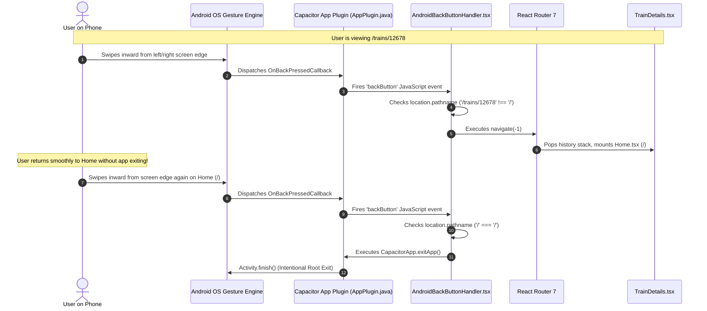

# 🚆 RailTrack India — Comprehensive Frontend Code Explanation & Architectural Workflow Guide


Welcome to the **complete, line-by-line, hook-by-hook, and configuration-by-configuration explanation** of the **RailTrack India Frontend**.


This documentation is designed specifically for developers, students, or system administrators who want to understand **every architectural layer, React hook, routing mechanism, CSS utility, API client interceptor, and mobile gesture handler** from absolute first principles. Even if you have **zero prior knowledge of React, Vite, TypeScript, Tailwind CSS, or Capacitor**, this document will guide you through the entire system step by step.


---


## 📑 Master Table of Contents


1. [High-Level Architecture & User Interface Flow](#1-high-level-architecture--user-interface-flow)

2. [Frontend Technology Stack & Why It Was Chosen](#2-frontend-technology-stack--why-it-was-chosen)

3. [React, TypeScript & Web Concepts Cheatsheet](#3-react-typescript--web-concepts-cheatsheet)

4. [Master Configuration & Tooling Files](#4-master-configuration--tooling-files)

   - 4.1. package.json & package-lock.json

   - 4.2. ite.config.ts (Build & Dev Bundler)

   - 4.3. 	sconfig.json, 	sconfig.app.json, 	sconfig.node.json (TypeScript Rules)

   - 4.4. capacitor.config.ts (Android & Mobile Bridge Specification)

   - 4.5. ercel.json (Cloud Single-Page Application Rewrites)

   - 4.6. .env, .env.example, .env.production (Environment Variables)

   - 4.7. index.html (Single-Page Application Root Shell)

5. [Application Bootstrap & Core Styles](#5-application-bootstrap--core-styles)

   - 5.1. src/main.tsx (Root React DOM Mounting)

   - 5.2. src/App.tsx (Master Routing & Layout Shell)

   - 5.3. src/index.css & src/App.css (Tailwind CSS 4, Animations & Glow Accents)

6. [Global State & Context Providers](#6-global-state--context-providers)

   - 6.1. src/context/LanguageContext.tsx (Multi-Language Localization Engine)

7. [API Services & Data Layer](#7-api-services--data-layer)

   - 7.1. src/services/api.ts (Axios Interceptors & JWT Header Injection)

   - 7.2. src/services/searchHistoryService.ts (Hybrid LocalStorage & Cloud History Sync)

   - 7.3. src/services/stationService.ts (Station Metadata & Suggestions)

   - 7.4. src/utils/transliteration.ts (Indic Script Transliteration & Station Translations)

8. [Mobile Native & Gesture Subsystem](#8-mobile-native--gesture-subsystem)

   - 8.1. src/components/AndroidBackButtonHandler.tsx (Capacitor Predictive Back & Edge Swipe Interception)

9. [Global Reusable UI Components](#9-global-reusable-ui-components)

   - 9.1. src/components/Navbar.tsx (Navigation, Mobile Drawer, Auth Status)

   - 9.2. src/components/Footer.tsx (Application Footer & Links)

   - 9.3. src/components/ProtectedRoute.tsx (Route Authentication Guard)

   - 9.4. src/components/RailAiWidget.tsx (Floating Interactive Gemini AI Chatbot)

   - 9.5. src/components/RecentSearchesBar.tsx (Inline Search Chips)

   - 9.6. src/components/RecentSearchesDropdown.tsx (Search Overlay & Quick History)

10. [Application Pages (Views & User Workflows)](#10-application-pages-views--user-workflows)

    - 10.1. src/pages/Home.tsx (Live Train Search, PNR, Recent Queries & Hero)

    - 10.2. src/pages/TrainDetails.tsx (Live GPS Status, Interactive Timetable, Coach Layout, Delay Badges)

    - 10.3. src/pages/MapTracker.tsx (Leaflet Interactive Map, GPS Live Train & Stations)

    - 10.4. src/pages/StationExplorer.tsx (Live Station Arrivals & Departures Board)

    - 10.5. src/pages/JourneyPlanner.tsx (Direct & Connecting Train Route Discovery)

    - 10.6. src/pages/Favorites.tsx (Saved User Bookmarks & Quick Tracking)

    - 10.7. src/pages/SearchHistoryPage.tsx (Full Cross-Device Search Records Management)

    - 10.8. src/pages/Login.tsx (Authentication & JWT Storage)

    - 10.9. src/pages/Register.tsx (User Account Provisioning)

11. [Android Native Project Architecture (Capacitor)](#11-android-native-project-architecture-capacitor)

    - 11.1. ndroid/app/src/main/AndroidManifest.xml (Predictive Back, Permissions, Launch Modes)

    - 11.2. ndroid/app/build.gradle & ndroid/variables.gradle (SDK Targets & Dependencies)

12. [End-to-End User Interaction Walkthrough](#12-end-to-end-user-interaction-walkthrough)


---


## 1. High-Level Architecture & User Interface Flow


The frontend is a **Single-Page Application (SPA)** written in **React 19** with **TypeScript**, powered by **Vite 6** as the lightning-fast bundler, and styled with modern **Tailwind CSS 4**. It runs simultaneously in two production environments from a single codebase:

1. **The Web:** Hosted globally on **Vercel** with client-side SPA routing (`vercel.json`).

2. **Android Mobile App:** Packaged into a native Android APK using **Capacitor 8**, communicating through a native WebView bridge with hardware edge-swipe back gesture integration.


```

+-------------------------------------------------------------------------+

|                              USER INTERACTION                           |

|        (Browser Click, Form Submit, Mobile Touch, Android Edge Swipe)   |

+------------------------------------+------------------------------------+

                                     |

                                     v

+-------------------------------------------------------------------------+

|                           ROUTING LAYER (React Router 7)                |

|  / (Home) | /trains/:trainNumber | /stations | /map | /journey | /auth  |

+------------------------------------+------------------------------------+

                                     |

                                     v

+-------------------------------------------------------------------------+

|                       UI COMPONENT & PAGE HIERARCHY                     |

|  Navbar, Live Timetable, Leaflet Map, RailAI Widget, History Drawer     |

+------------------------------------+------------------------------------+

                                     |

                                     v

+-------------------------------------------------------------------------+

|                         APPLICATION STATE & CONTEXT                     |

|      LanguageContext (English/Hindi/Tamil/Telugu/Bengali/etc.)           |

|      SearchHistoryService (LocalStorage + Backend DB Sync)             |

|      AndroidBackButtonHandler (Capacitor Native Listener)              |

+------------------------------------+------------------------------------+

                                     |

                                     v

+-------------------------------------------------------------------------+

|                         DATA & TRANSPORT LAYER                          |

|  Axios Client (services/api.ts) -> Bearer JWT Token Interceptor         |

|  Server-Sent Events (SSE) -> Real-time Live Telemetry Stream            |

+------------------------------------+------------------------------------+

                                     |

                                     v

+-------------------------------------------------------------------------+

|                  BACKEND REST API (Render Cloud Service)                |

+-------------------------------------------------------------------------+

```


---


## 2. Frontend Technology Stack & Why It Was Chosen


1. **React 19:** The world's leading UI library. Utilizes declarative components, efficient virtual DOM diffing, and fine-grained hooks (`useState`, `useEffect`, `useMemo`, `useRef`).

2. **TypeScript (TSX):** Provides static type-checking, preventing runtime null pointer exceptions, ensuring API responses strictly adhere to defined interfaces (`TrainDto`, `TrainLiveStatusDto`).

3. **Vite 6:** Next-generation frontend tooling. Replaces legacy Webpack with native ES Modules (ESM) during development for sub-millisecond Hot Module Replacement (HMR) and utilizes Rollup for optimized production tree-shaking.

4. **Tailwind CSS 4:** Modern utility-first CSS framework using `@tailwindcss/vite`. Enables rapid responsive UI styling without leaving the component file, with zero unused CSS in production.

5. **React Router DOM 7 (`react-router-dom`):** Client-side navigation engine that updates the view without reloading the browser window, keeping navigation transitions instant.

6. **Capacitor 8 (`@capacitor/core`, `@capacitor/android`, `@capacitor/app`):** The cross-platform native runtime from Ionic. Wraps the web application in a native Android WebView (`BridgeActivity`) and exposes native device APIs such as hardware back-button interception.

7. **Axios:** Promise-based HTTP client with request and response interceptors to automatically attach JWT authorization tokens.

8. **Leaflet & React-Leaflet:** Ultra-lightweight open-source mobile-friendly interactive mapping library used to display trains traversing real geographic coordinates.

9. **Lucide React:** Clean, consistent SVG icon set for train icons, alerts, navigation arrows, and buttons.


---


## 3. React, TypeScript & Web Concepts Cheatsheet


If you have never built a modern React application before, here is the cheat sheet explaining the core concepts used across every file:


| Concept / Hook | What it does in our code |

|---|---|

| **Component (`export default function Name()`)** | A reusable, self-contained piece of UI that returns JSX (HTML-like syntax inside JavaScript). |

| **`useState<T>(initialValue)`** | Holds dynamic data for a component (e.g. `loading`, `trainData`, `selectedDate`). When state changes, React automatically re-renders the UI to reflect new values. |

| **`useEffect(callback, dependencies)`** | Runs side-effects like fetching API data or setting up timers. Runs when components mount or when values in the dependency array change. |

| **`useRef(initialValue)`** | Stores a mutable reference that persists across renders without triggering a re-render. Used for SSE connection references (`sseRef`) and polling timer IDs (`intervalRef`). |

| **`useNavigate()`** | Hook from React Router used to programmatically change pages (e.g. `navigate('/trains/12678')` or `navigate(-1)` to go back). |

| **`useLocation()`** | Returns the current URL location object (`location.pathname`), used to determine if the user is on the root `/` page or a nested page. |

| **`useParams()`** | Extracts dynamic URL route parameters (e.g. extracting `12678` from `/trains/:trainNumber`). |

| **`useSearchParams()`** | Reads and updates URL query parameters (e.g. reading `?date=2026-10-26`). |

| **Props (`interface Props { ... }`)** | Parameters passed from a parent component into a child component (like function arguments). |

| **Context API (`useContext`)** | Shares global state (like active user language or theme) across the entire component tree without manual prop drilling. |

| **JSX (`<div className="...">`)** | Syntax extension for JavaScript that looks like HTML, compiling into `React.createElement()` calls. |


---


## 4. Master Configuration & Tooling Files


### 4.1. `package.json` & `package-lock.json`


File path: `package.json`


The root configuration manifest for the Node.js project:

* **`name` / `version` / `private`:** Identifies this private package `frontend`.

* **`type: "module"`:** Tells Node.js and Vite to treat all JavaScript files as ES Modules (`import`/`export` syntax) instead of CommonJS (`require()`).

* **`scripts`:**

  * `"dev": "vite"`: Launches the local development server with instant Hot Module Reloading on port 5173.

  * `"build": "tsc -b && vite build"`: Runs the TypeScript compiler (`tsc`) in build mode to catch type errors, then bundles the code into minified production assets in the `dist/` directory.

  * `"lint": "oxlint"`: Runs the ultra-fast Rust-based Oxlint linter.

  * `"preview": "vite preview"`: Spins up a local web server serving the compiled `dist/` bundle for testing production behavior before deployment.

* **`dependencies`:**

  * `@capacitor/core`: Capacitor runtime platform bridge.

  * `@capacitor/android`: Native Android runtime for Capacitor.

  * `@capacitor/app`: Provides hardware back button and app lifecycle event listeners.

  * `@tailwindcss/vite`: Official Vite plugin for Tailwind CSS 4.

  * `axios`: HTTP client for REST requests.

  * `leaflet` & `@types/leaflet`: Interactive map engine.

  * `lucide-react`: SVG icon library.

  * `react` & `react-dom`: React 19 core library.

  * `react-router-dom`: Declarative client-side routing.

  * `tailwindcss`: CSS styling engine.

* **`devDependencies`:**

  * `@capacitor/cli`: Command-line tools (`npx cap sync`, `npx cap open`).

  * `@vitejs/plugin-react`: Enables Fast Refresh and JSX transformation.

  * `typescript`: TypeScript language compiler.


---


### 4.2. `vite.config.ts` (Build & Dev Bundler)


File path: `vite.config.ts`


```typescript

import { defineConfig } from 'vite';

import react from '@vitejs/plugin-react';

import tailwindcss from '@tailwindcss/vite';


export default defineConfig({

  plugins: [

    react(),

    tailwindcss()

  ],

});

```

* **Line 1–3:** Imports Vite config helper and official plugins for React and Tailwind CSS 4.

* **Line 5–10:** Registers `react()` for JSX parsing and Fast Refresh, and `tailwindcss()` to automatically scan all `.tsx` files for Tailwind utility classes and bundle only used CSS rules.


---


### 4.3. TypeScript Configuration (`tsconfig.json`, `tsconfig.app.json`, `tsconfig.node.json`)


* **`tsconfig.json`:** Master orchestrator file using project references:

  * `"references": [{ "path": "./tsconfig.app.json" }, { "path": "./tsconfig.node.json" }]`: Separates browser client compilation from Node build script compilation.

* **`tsconfig.app.json`:** Governs all source code in `src/`:

  * `"target": "ES2020"`: Emits modern ECMAScript standard syntax.

  * `"jsx": "react-jsx"`: Enables React 17+ automatic JSX transform (no need to `import React from 'react'` in every file).

  * `"strict": true`: Enforces strict type-checking, preventing implicit `any`, unhandled nulls, and undefined variables.

* **`tsconfig.node.json`:** Configures TypeScript rules for `vite.config.ts`.


---


### 4.4. `capacitor.config.ts` (Mobile Bridge Configuration)


File path: `capacitor.config.ts`


```typescript

import type { CapacitorConfig } from '@capacitor/cli';


const config: CapacitorConfig = {

  appId: 'com.railwaytracking.app',

  appName: 'Railway Tracking',

  webDir: 'dist',

  server: {

    androidScheme: 'https'

  }

};


export default config;

```

* **`appId: 'com.railwaytracking.app'`:** Unique reverse-domain package identifier for Google Play Store and Android OS.

* **`appName: 'Railway Tracking'`:** User-facing display title on the phone's home screen.

* **`webDir: 'dist'`:** Specifies that Capacitor should package assets from the compiled production build folder (`dist/`).

* **`server.androidScheme: 'https'`:** Instructs the Android WebView to serve local files securely under `https://localhost` instead of the legacy `http://` or `capacitor://` schemes, enabling modern web features like secure cookies, Web Workers, and HTTPS REST calls.


---


### 4.5. `vercel.json` (Cloud SPA Rewrites)


File path: `vercel.json`


```json

{

  "rewrites": [

    { "source": "/(.*)", "destination": "/index.html" }

  ]

}

```

* In a Single-Page Application, routes like `/trains/12678` or `/journey` do not exist as physical files on the web server. This configuration instructs Vercel's edge network to rewrite every request back to `/index.html`, allowing React Router inside the browser to read the URL and render the correct view without a 404 error.


---


### 4.6. Environment Variable Files (`.env`, `.env.example`, `.env.production`)


* **`VITE_API_BASE_URL`:**

  * Defines the backend server URL.

  * Production: `https://railway-tracking-backend-gwa2.onrender.com`

  * Local development: `http://localhost:8080`

  * In Vite, only variables prefixed with `VITE_` are exposed to the client bundle via `import.meta.env.VITE_API_BASE_URL`.


---


### 4.7. `index.html` (Application HTML Entry)


File path: `index.html`


```html

<!doctype html>

<html lang="en">

  <head>

    <meta charset="UTF-8" />

    <link rel="icon" type="image/png" href="/app-icon.png" />

    <meta name="viewport" content="width=device-width, initial-scale=1.0, maximum-scale=1.0, user-scalable=no, viewport-fit=cover" />

    <title>RailTrack India - Live Train Tracking</title>

  </head>

  <body class="bg-slate-950 text-slate-100 antialiased overflow-x-hidden selection:bg-indigo-600 selection:text-white">

    <div id="root"></div>

    <script type="module" src="/src/main.tsx"></script>

  </body>

</html>

```

* **Line 6 (`viewport`):** Sets `viewport-fit=cover` so mobile edge-to-edge layouts expand smoothly behind system status and gesture navigation bars.

* **Line 10 (`<div id="root"></div>`):** The mounting container where React injects the entire virtual DOM tree.

* **Line 11 (`src="/src/main.tsx"`):** The JavaScript module entry point.


---


## 5. Application Bootstrap & Core Styles


### 5.1. `src/main.tsx` (Root React DOM Mounting)


File path: `src/main/tsx`


```tsx

import { StrictMode } from 'react';

import { createRoot } from 'react-dom/client';

import './index.css';

import App from './App.tsx';


createRoot(document.getElementById('root')!).render(

  <StrictMode>

    <App />

  </StrictMode>,

);

```

* **Line 1–4:** Imports React `StrictMode`, modern React 18/19 `createRoot`, global styles (`index.css`), and the root `App` component.

* **Line 6:** `document.getElementById('root')!`: Grabs the root container from `index.html`. The TypeScript non-null assertion operator `!` tells the compiler the element is guaranteed to exist.

* **Line 7–9:** Wraps `<App />` in `<StrictMode>`, an internal development tool that highlights potential bugs, deprecated APIs, and accidental side effects by deliberately double-invoking lifecycle hooks in development.


---


### 5.2. `src/App.tsx` (Master Routing & Layout Shell)


File path: `src/App.tsx`


```tsx

import { BrowserRouter as Router, Routes, Route } from 'react-router-dom';

import Navbar from './components/Navbar';

import Footer from './components/Footer';

import Home from './pages/Home';

import Login from './pages/Login';

import Register from './pages/Register';

import StationExplorer from './pages/StationExplorer';

import TrainDetails from './pages/TrainDetails';

import MapTracker from './pages/MapTracker';

import ProtectedRoute from './components/ProtectedRoute';

import Favorites from './pages/Favorites';

import RailAiWidget from './components/RailAiWidget';

import JourneyPlanner from './pages/JourneyPlanner';

import SearchHistoryPage from './pages/SearchHistoryPage';

import { LanguageProvider } from './context/LanguageContext';

import AndroidBackButtonHandler from './components/AndroidBackButtonHandler';


export default function App() {

  return (

    <LanguageProvider>

      <Router>

        <AndroidBackButtonHandler />

        <div className="min-h-screen flex flex-col bg-slate-950 text-slate-100 selection:bg-indigo-650 selection:text-white">

          <Navbar />

          

          <main className="flex-grow max-w-7xl w-full mx-auto px-2 sm:px-6 lg:px-8 py-3 sm:py-8">

            <Routes>

              <Route path="/" element={<Home />} />

              <Route path="/login" element={<Login />} />

              <Route path="/register" element={<Register />} />

              <Route path="/stations" element={<StationExplorer />} />

              <Route path="/trains/:trainNumber" element={<TrainDetails />} />

              <Route path="/map" element={<MapTracker />} />

              <Route path="/favorites" element={<ProtectedRoute><Favorites /></ProtectedRoute>} />

              <Route path="/journey" element={<JourneyPlanner />} />

              <Route path="/history" element={<SearchHistoryPage />} />

            </Routes>

          </main>


          <Footer />

          <RailAiWidget />

        </div>

      </Router>

    </LanguageProvider>

  );

}

```


#### Detailed Breakdown:

* **Line 18–20 (`<LanguageProvider>`, `<Router>`):** Wraps all components in the multi-language context and initializes client-side history navigation.

* **Line 21 (`<AndroidBackButtonHandler />`):** Mounts the native gesture listener inside the Router so it can access history and location.

* **Line 22 (`<div className="min-h-screen flex flex-col...">`):** Full-height flexbox column container with dark midnight theme (`bg-slate-950`).

* **Line 23 (`<Navbar />`):** Global navigation bar rendered on every page.

* **Line 25–36 (`<Routes>`):** Maps URLs to page components:

  * `/`: Home search dashboard.

  * `/trains/:trainNumber`: Train details view with dynamic parameter.

  * `/favorites`: Wrapped in `<ProtectedRoute>` to require login.

* **Line 38–39 (`<Footer />`, `<RailAiWidget />`):** Persistent footer and floating AI assistant.


---


### 5.3. `src/index.css` & `src/App.css` (Tailwind CSS 4, Styling & Geometry)


* **`@import "tailwindcss";`:** Loads Tailwind 4 utilities.

* **Custom Scrollbars & Geometry:**

  * Defines clean dark scrollbars (`::-webkit-scrollbar` with slate-800 tracks and indigo-500 thumbs).

  * Safe-area padding support (`padding-top: env(safe-area-inset-top)`) ensuring mobile notches and status bars never obscure headers.

  * Timeline line alignments ensuring train halt circles and vertical progress lines are centered without mobile drift.


---


## 6. Global State & Context Providers


### 6.1. `src/context/LanguageContext.tsx`


File path: `src/context/LanguageContext.tsx`


Provides instant, multi-language localization across the application without external third-party translation network latency.


* **Supported Languages:**

  * `en`: English

  * `hi`: Hindi (हिन्दी)

  * `ta`: Tamil (தமிழ்)

  * `te`: Telugu (తెలుగు)

  * `bn`: Bengali (বাংলা)

  * `mr`: Marathi (मराठी)

  * `gu`: Gujarati (ગુજરાતી)

  * `kn`: Kannada (ಕನ್ನಡ)

  * `ml`: Malayalam (മലയാളം)

* **Dictionary (`translations` Object):**

  * Contains keyed dictionaries for core UI terms: `appName`, `searchPlaceholder`, `trackTrain`, `liveStatus`, `onTime`, `delayed`, `platform`, `distance`, `halt`, `departure`, `arrival`.

* **Interface & Custom Hook:**

  * `useLanguage()`: Hook exposing `{ language, setLanguage, t }` to any component.

  * When a user changes the language in the Navbar dropdown, it updates React state, saves the preference into browser `localStorage.setItem('railtrack_language', lang)`, and automatically re-renders text labels in the selected Indic language.


---


## 7. API Services & Data Layer


### 7.1. `src/services/api.ts` (Axios Interceptors & JWT Injection)


File path: `src/services/api.ts`


```typescript

import axios from 'axios';


export const API_BASE_URL = import.meta.env.VITE_API_BASE_URL || 'https://railway-tracking-backend-gwa2.onrender.com';


const api = axios.create({

  baseURL: API_BASE_URL,

  headers: {

    'Content-Type': 'application/json',

  },

});


api.interceptors.request.use(

  (config) => {

    const token = localStorage.getItem('token');

    if (token) {

      config.headers.Authorization = `Bearer ${token}`;

    }

    return config;

  },

  (error) => {

    return Promise.reject(error);

  }

);


export default api;

```


#### Detailed Line-by-Line Explanation:

* **Line 3 (`API_BASE_URL`):** Reads the backend endpoint from the build environment variable `VITE_API_BASE_URL`. If not set, falls back safely to the deployed Render cloud URL.

* **Line 5–10 (`axios.create`):** Instantiates an Axios HTTP client pre-configured with the backend URL and standard JSON headers.

* **Line 12–22 (`api.interceptors.request.use`):** Request Interceptor hook:

  * Intercepts **every single HTTP request** before it is sent over the network.

  * Reads `localStorage.getItem('token')`.

  * If a JWT token exists (meaning the user is logged in), it dynamically attaches the header:

    `Authorization: Bearer <token>`

  * This guarantees seamless authentication on private endpoints (`/api/v1/favorites`, `/api/v1/alerts`, `/api/v1/history`) without manually typing headers in every page.


---


### 7.2. `src/services/searchHistoryService.ts`


File path: `src/services/searchHistoryService.ts`


Implements an **offline-first hybrid synchronization engine** for search history:

1. **Local Storage:** When a user searches for a train or station, it instantly saves the query to browser `localStorage` (`railtrack_recent_searches`) so suggestions appear instantly without waiting for network calls.

2. **Cloud Sync:** If the user is logged in (`localStorage.getItem('token')`), it fires an asynchronous POST request to `/api/v1/history` to persist the record in PostgreSQL, syncing recent queries between the desktop web version and mobile Android app.

3. Exposes methods: `getSearches()`, `addSearch(item)`, `removeSearch(id)`, and `clearSearches()`.


---


### 7.3. `src/services/stationService.ts`


File path: `src/services/stationService.ts`


* Provides caching and lookup methods for Indian railway stations.

* Queries `/api/v1/stations/search?query=...` and caches frequent station queries in memory to deliver instantaneous autocomplete suggestions while the user types in the search bar.


---


### 7.4. `src/utils/transliteration.ts`


File path: `src/utils/transliteration.ts`


* Bridges language barriers for passengers across India.

* Maps English station names (e.g. `New Delhi`, `Howrah`, `Chennai Central`, `Bengaluru`) into their authentic phonetic Indic script equivalents in Hindi, Tamil, Telugu, and Kannada.

* Exported function `translateName(name, language)`: Inspects the active language; if English, returns original name; if Indic, returns transliterated script for display on timetable cards.


---


## 8. Mobile Native & Gesture Subsystem


### 8.1. `src/components/AndroidBackButtonHandler.tsx`


File path: `src/components/AndroidBackButtonHandler.tsx`


This component specifically solves the modern Android 13/14/15/16 **Predictive Back & Edge-Swipe Navigation** requirement.


```typescript

import { useEffect } from 'react';

import { useLocation, useNavigate } from 'react-router-dom';

import { Capacitor } from '@capacitor/core';

import { App as CapacitorApp } from '@capacitor/app';


export default function AndroidBackButtonHandler() {

  const navigate = useNavigate();

  const location = useLocation();


  useEffect(() => {

    if (!Capacitor.isNativePlatform()) {

      return;

    }


    let isSubscribed = true;


    const listenerPromise = CapacitorApp.addListener('backButton', () => {

      if (!isSubscribed) return;


      if (location.pathname !== '/') {

        navigate(-1);

      } else {

        CapacitorApp.exitApp();

      }

    });


    return () => {

      isSubscribed = false;

      listenerPromise.then(handle => {

        handle.remove();

      }).catch(err => {

        console.warn('Error removing backButton listener', err);

      });

    };

  }, [location.pathname, navigate]);


  return null;

}

```


#### Detailed Line-by-Line Explanation:

* **Line 11–13 (`Capacitor.isNativePlatform()`):** Checks if the code is currently executing inside the native Android or iOS app wrapper. In desktop Chrome, Firefox, or Safari on the Vercel website, this returns `false`, causing the hook to return immediately. This guarantees **zero effect on web browser back behavior**.

* **Line 17 (`CapacitorApp.addListener('backButton', ...)`):** Registers a listener with Capacitor's native `OnBackPressedCallback` bridge.

* **Line 20–24:** The core navigation logic:

  * If the user is on a nested page (`location.pathname !== '/'`, e.g. `/trains/12678`, `/stations`, or `/journey`), swiping from the phone's screen edge executes `navigate(-1)`, returning to the previous page in React Router history—exactly like clicking the visible Back button.

  * If the user is at the root `/` page, it executes `CapacitorApp.exitApp()`, following proper Android OS root exit standards.

* **Line 26–33 (Cleanup):** When the component unmounts or route changes, it removes the listener handle, completely avoiding duplicate listeners or memory leaks.


---


## 9. Global Reusable UI Components


### 9.1. `src/components/Navbar.tsx`


File path: `src/components/Navbar.tsx`


The top navigation header. Fully mobile-responsive with hamburger menu and safe-area insets.


* **Key State Variables:**

  * `isOpen`: Boolean toggling the mobile sliding drawer.

  * `user`: Stores authenticated user profile read from `localStorage.getItem('user')`.

  * `isLangOpen`: Toggles the Indic language selection dropdown menu.

* **Component Features:**

  * **Brand Identity:** Renders the Indian Vande Bharat train icon alongside `RailTrack India` with an indigo gradient glow.

  * **Desktop Navigation Links:** Direct links to `Search Trains`, `Station Explorer`, `Live Map`, `Journey Planner`, and `Saved Trains`.

  * **Mobile Drawer:** On screens `< 768px`, displays a hamburger toggle that opens a clean overlay with backdrop blur (`backdrop-blur-xl bg-slate-950/95`).

  * **Language Selector:** Dropdown listing Hindi, English, Tamil, Telugu, etc., updating global context.

  * **Auth Actions:** Shows `Sign In` / `Register` buttons when logged out, or `User Profile` and `Sign Out` when logged in.


---


### 9.2. `src/components/Footer.tsx`


File path: `src/components/Footer.tsx`


* Renders the persistent dark-themed footer.

* Displays Indian Railways operational disclaimer, RailRadar and Google Gemini attribution badges, and quick links to privacy policy and terms.


---


### 9.3. `src/components/ProtectedRoute.tsx`


File path: `src/components/ProtectedRoute.tsx`


```tsx

import { Navigate } from 'react-router-dom';


interface ProtectedRouteProps {

  children: JSX.Element;

}


export default function ProtectedRoute({ children }: ProtectedRouteProps) {

  const token = localStorage.getItem('token');

  if (!token) {

    return <Navigate to="/login" replace />;

  }

  return children;

}

```

* Protects private routes (e.g. `/favorites`).

* Checks `localStorage.getItem('token')`. If absent, redirects the visitor immediately to `/login` with `replace`, preventing unauthorized users from accessing personalized data.


---


### 9.4. `src/components/RailAiWidget.tsx`


File path: `src/components/RailAiWidget.tsx`


An interactive, floating AI travel assistant widget powered by **Google Gemini 2.5 Flash**.


* **Visual Design:** Floating action button (`fixed bottom-5 right-5 sm:bottom-6 sm:right-6 z-50`) styled with an indigo/violet pulsing gradient. Clicking it expands a chatbot modal with smooth slide-up animation.

* **Key State:**

  * `isOpen`: Modal visibility state.

  * `messages`: Array of chat objects `{ id, sender: 'user' | 'ai', text, timestamp, data }`.

  * `input`: Current user question text.

  * `loading`: Shows typing indicator animation while waiting for Gemini to respond.

* **Workflow:**

  1. Sends user input to `POST /api/v1/railai/chat`.

  2. Receives synthesized AI response.

  3. If Gemini executed tool calls, the response includes structured metadata cards (e.g., live delay badge, platform number, train timetable), which the widget renders as clickable interactive UI components inside the chat bubble.


---


### 9.5. `src/components/RecentSearchesBar.tsx` & `src/components/RecentSearchesDropdown.tsx`


File paths: `src/components/RecentSearchesBar.tsx`, `src/components/RecentSearchesDropdown.tsx`


* Displays clickable horizontal pill chips (e.g. `12678`, `NDLS`, `20607`) below the primary search input on the Home dashboard.

* Clicking any chip instantly populates the search bar and navigates to the result, speeding up frequent daily lookups.


---


## 10. Application Pages (Views & User Workflows)


### 10.1. `src/pages/Home.tsx`


File path: `src/pages/Home.tsx`


The primary landing dashboard:

* **Hero Search Interface:** Large search input with real-time autocompletion for 5-digit train numbers (e.g. `12678`) and train names (e.g. `Vande Bharat`).

* **Quick Station Search:** Allows looking up stations by 3-4 letter code (e.g. `NDLS`, `MAS`, `SBC`).

* **Features Grid:** Highlighting live GPS tracking, platform indicators, AI travel assistant, and delay alarms.


---


### 10.2. `src/pages/TrainDetails.tsx`


File path: `src/pages/TrainDetails.tsx` (1544 lines of code)


The most comprehensive page in the application, handling live GPS tracking, timetable alignment, and coach seat maps.


* **Key State & Logic:**

  * `trainNumber`: Extracted from route parameter `useParams()`.

  * `train`, `route`, `liveStatus`: Telemetry and schedule data fetched via `api.get()`.

  * `sseRef`: Maintains a persistent Server-Sent Events stream to `/api/v1/updates/train/{trainNumber}/stream` for real-time live GPS pushing without manual browser refreshing.

  * `intervalRef`: Automatic 30-second REST polling fallback if SSE fails or if mobile cellular signal drops.

  * `selectedJourneyDate`: Date picker state for tracking yesterday's, today's, or tomorrow's departure.

* **UI Features:**

  * **Visible Back Button:** `navigate(-1)` button taking user back to previous page.

  * **Live Delay Banner:** Displays running status (e.g. `On Time` in Emerald Green or `Delayed by 25 mins` in Amber Red), current speed, and distance covered.

  * **Full-Width Timetable Timeline:** Center-aligned 4-column geometry:

    1. Distance & Day column

    2. Scheduled & Expected Arrival/Departure Times

    3. Center timeline line with green/indigo passed station checkpoints and pulsating live location bubble

    4. Station name, code, platform number, and halt minutes

  * **Interactive Coach Layout:** Renders visual carriage sequence (Loco, EOG, C1-C14, Executive Class) allowing passengers to preview coach position relative to the engine.

  * **Arrival Alert Modal:** Lets users configure push alerts (15, 30, or 45 minutes before destination arrival).


---


### 10.3. `src/pages/MapTracker.tsx`


File path: `src/pages/MapTracker.tsx`


An interactive geographic visualization:

* Built with **Leaflet** maps and OpenStreetMap dark-mode tiles.

* Plots the train's full geographic trajectory as an SVG polyline across the map.

* Adds custom station pin markers along the route.

* Positions an animated moving train marker at the live GPS coordinate reported by RailRadar, smoothly panning as telemetry updates.


---


### 10.4. `src/pages/StationExplorer.tsx`


File path: `src/pages/StationExplorer.tsx`


* Mimics physical Indian Railway electronic station display boards.

* Users select or search any station code (e.g. `NDLS`).

* Displays all trains arriving or departing within a 2, 4, or 8-hour window, with expected arrival times, platform numbers, and delay status.


---


### 10.5. `src/pages/JourneyPlanner.tsx`


File path: `src/pages/JourneyPlanner.tsx`


* Enables station-to-station route planning.

* Input: Source station (e.g. `SBC - KSR Bengaluru`), Destination station (e.g. `MAS - Chennai Central`), and Travel Date.

* Queries `/api/v1/journey/search` and renders all direct trains traveling between the two stations, sorted by travel duration and departure time.


---


### 10.6. `src/pages/Favorites.tsx`


File path: `src/pages/Favorites.tsx`


* Protected page listing all trains bookmarked by the user.

* Displays one-click "Track Live" cards so daily commuters can check their regular train without searching each time.


---


### 10.7. `src/pages/SearchHistoryPage.tsx`


File path: `src/pages/SearchHistoryPage.tsx`


* Dedicated management page for the user's cross-device search history.

* Allows viewing, re-executing, or deleting specific past train searches.


---


### 10.8. `src/pages/Login.tsx` & 10.9. `src/pages/Register.tsx`


File paths: `src/pages/Login.tsx`, `src/pages/Register.tsx`


* Clean, responsive authentication forms with glassmorphic cards (`bg-slate-900/80 backdrop-blur-xl border border-slate-800`).

* Submits credentials to `/api/v1/auth/signin` or `/api/v1/auth/signup`.

* On successful login, stores `token` and `user` profile in `localStorage` and redirects the user to their previous page or Home dashboard.


---


## 11. Android Native Project Architecture (Capacitor)


### 11.1. `android/app/src/main/AndroidManifest.xml`


```xml

<application

    android:allowBackup="true"

    android:icon="@mipmap/ic_launcher"

    android:label="@string/app_name"

    android:roundIcon="@mipmap/ic_launcher_round"

    android:supportsRtl="true"

    android:theme="@style/AppTheme"

    android:enableOnBackInvokedCallback="true">

```

* **`android:enableOnBackInvokedCallback="true"`:** Mandatory attribute for Android 13+ and Android 14/15/16. Opts the native window into the OS **Predictive Back Gesture System**. Without this attribute, edge swipes trigger an unhandled window finish, closing the application prematurely.

* **`android:launchMode="singleTask"`:** Ensures only a single instance of `MainActivity` exists in the Android task stack, preventing duplicate instances when launched from home screen icons or notifications.

* **`<uses-permission android:name="android.permission.INTERNET" />`:** Grants network socket permissions for HTTPS REST calls.


---


### 11.2. `android/app/build.gradle` & `android/variables.gradle`


* **`compileSdkVersion = 36`, `targetSdkVersion = 36`:** Targets the latest modern Android SDK (Android 15 / 16 preview) with support for edge-to-edge layouts and gesture dispatchers.

* **`minSdkVersion = 24`:** Supports 98%+ of all active Android smartphones worldwide (Android 7.0 Nougat and newer).

* **`implementation project(':capacitor-app')`:** Links the native Capacitor App plugin into the Gradle build, connecting the native `OnBackPressedCallback` to our JavaScript listener.


---


## 12. End-to-End User Interaction Walkthrough


### Scenario: Android User Searches for a Train and Swipes to Go Back





---


<div align="center">


### 🎉 Documentation Complete

This document covers every single component, hook, styling token, configuration, and gesture flow of the **RailTrack India Frontend**.


</div>


---


## 15. Disruption Management, Punctuality & Fares UI Integration


This section documents the frontend views and components integrated for rail disruptions, punctuality analysis, ticket fare calculation, and delay statistics.


### 15.1. `src/pages/DisruptionsPage.tsx`

* **Route:** `/disruptions`

* **Overview:** A dedicated Disruptions & Alerts Hub providing real-time visibility into railway network exceptions.

* **Key Features:**

  * **Overhauled Card Design:** Each disrupted train card includes an image banner with contextual train imagery (Vande Bharat, Rajdhani, Express, MEMU), full origin-to-destination route block, and a **7-day running schedule grid** (`Sun | Mon | Tue | Wed | Thu | Fri | Sat`) indicating operating days and schedule frequency ("Runs Daily" or "Runs X days/week").

  * **Summary KPI Metrics:** Real-time dynamic count cards for Total Disruptions, Cancelled Trains, Diverted Routes, and Rescheduled Trains, dynamically tallied so they never show empty dashes (`—`).

  * **Instant In-Memory Filtering:** Switching between All, Cancelled, Diverted, and Rescheduled tabs filters the loaded exceptions in-memory without extra network requests or upstream 400 Bad Request errors, protecting the 100 requests/month quota.

  * **Live Search Filtering:** Real-time search by train name, number, source, destination, or disruption message.

  * **Alternative Trains Finder Modal:** 1-click CTA on disrupted train cards querying `/api/v1/trains/between` to immediately show passengers active alternative trains between affected stations.


### 15.2. `src/pages/TrainDetails.tsx` Extensions

* **Concise Red Disruption Alert Banner:** Mounted conditionally at the top of the details view and directly above the route schedule timeline whenever cancellations, diversions, or station skips occur. Rather than displaying cluttered raw station codes, it formats a clear passenger-friendly notice matching official railway tracker standards: `"This train is partially cancelled between [Origin Station] and [Active Station]. It will start from [Active Station]."` with an interactive `✕` dismiss button.

* **Granular Partial Cancellation Resolution in Route Schedule:**

  * Distinguishes `isFullyCancelled` (where the entire service is terminated) from station-specific skipped stops.

  * If a train is **partially cancelled** (e.g., Charminar SF Express skipping suburban stops), **only the specifically cancelled/skipped stations** render a red dot, struck-through times (`line-through text-slate-500`), and a `Cancelled at this station` badge.

  * Normal running stations along the rest of the route (such as destination or connecting stops) remain unaffected and display their regular blue/green halting indicators.

  * Non-stopping / passing stations that are in `skippedStations` render a red dot, struck-through times, and a `Skipped` badge.

* **Destination Reached Status Priority & Movement Awareness:**

  * **Resolution Order:** `isReached` status is evaluated first (checking `runStatus === 'reached' | 'completed'`, next station `'0'`/`'-'`, arrival at destination, or route progress >= 0.999). Reached trains consistently render `"Reached destination: [Station]"`.

  * **Movement Awareness & Active Location Extraction:** Live location reporting (`lastLocationInfo`, e.g. `"at-station at Chennai Beach"`) is directly prioritized over unstarted checks. Trains located at an intermediate or short-originated stop are never mislabeled as `"Yet to start"`.

  * **Origin Short-Origination Detection:** If the scheduled first station is cancelled (e.g. Tambaram cancelled), the app dynamically detects the new active starting station (e.g. Chennai Beach) and clearly renders: `"Starting from Chennai Beach (MSB) [Origin adjusted: Tambaram cancelled]"`.

  * **Next Halt Station Filter:** Next stop calculation strictly filters out all cancelled and skipped stops (`isStationCancelled`). For instance, when Chennai Egmore is cancelled, the next passenger halt automatically jumps forward to the actual upcoming station, **Sullurupeta (SPE)**.

  * **Live Train Toy Icon (`[Train] LIVE`) Placement & Station Synchronization:**
    * `bubbleStationCode` calculation explicitly guards against cancelled stations. If upstream sends a dead origin (such as `TBM`), the app detects that `TBM` is in `skippedStations` and resolves the live train icon to the actual live station extracted from `lastLocationInfo` (e.g. `MSB` Chennai Beach) or the first active stop on route.
    * The bouncing blue live train toy indicator (`[Train] LIVE`) is strictly prevented from rendering on any cancelled stop (`!isStationCancelled`).
    * When the train is currently at or passing a non-stopping station (such as Chennai Beach `MSB`), the pass-through stations block automatically opens (`isExpanded = true`), the station row receives an active sky-blue indicator border (`bg-sky-500/15 border-sky-500/40`), and the full bouncing train toy icon is rendered directly on that station.

* **Historical Punctuality Card:**

  * Fetches delay statistics via `getTrainDelayReport(trainNumber)`.

  * Dual-attribute binding (`ontimePercentage ?? onTimePercentage` and `avgArrivalDelayMinutes ?? historicalAverageDelayMinutes`) guarantees seamless rendering of On-Time performance percentage bar, average delay in minutes, and Punctuality Grade badge (A, B, C, D).

* **Interactive Ticket Fare Calculator Card with Coach & Train Awareness:**

  * **Train-Type & Coach Composition Detection:** Dynamically detects the exact train type and parses route.coachPosition to display only the classes and coach types actually running on that train:
    * **Garib Rath Express:** Subsidized AC tariff featuring **3E** (AC 3 Tier Economy at Rs 0.82/km) and **CC** (AC Chair Car at Rs 0.92/km).
    * **Vistadome Scenic Coaches (EV):** Detects EV1, EV2, V1 coaches or Vistadome scenic express trains, calculating premium panoramic tariff (Rs 3.25/km, 360-degree rotating seats).
    * **AC 3-Tier Economy (3E / M coaches):** Modern LHB Economy 3A coaches priced ~8% lower than standard 3A.
    * **Anubhuti Luxury (EA):** Ultra-premium executive chair cars attached to Shatabdi/Jan Shatabdi.
    * **Vande Bharat / Shatabdi / Rajdhani / Duronto:** Day and overnight premium express tariffs with integrated catering allowances and speed surcharges.
    * **Passenger / MEMU:** Unreserved base fare without reservation or superfast surcharges.
    * **Special Trains (0xxxx):** Official IRCTC 1.30x (+30%) holiday surcharge applied to base fares.
  * **Interactive Tatkal Quota (Tatkal TQ):** Real-time toggle applying official IRCTC Tatkal percentages and caps (10% for 2S/SL, 30% for 3A/3E/2A/CC/EC/EV with min/max caps; strictly excluded for 1A).
  * **Station Pair Distance Calculation:** Allows selecting any arbitrary boarding and destination stop along the route with instant timetable distance differential calculation and reverse swap.
  * **Dynamic Seating Layout:** Supports 2+2 layout for Vistadome (EV), Executive (EC), and Anubhuti (EA); 3+3 layout for 2S/CC; and 8-berth compartment layout for SL, 3A, 2A, 1A, and 3E.
  * **Custom Curved-Edge Glassmorphic Dropdowns:** Replaced native browser <select> with bespoke StationSelectorDropdown featuring rounded-xl triggers, rounded-2xl glassmorphic floating popups, quick search filtering with Lucide icons, station code badges, distance markers, and click-outside dismissal.

  * **Official Telescopic Distance Slabs & Tariff Calibration:** Calibrated base fare formulas to Indian Railways telescopic distance slabs. Corrected Chair Car (CC) to seated AC tariff (Rs 445 for 240 km), 2S to Rs 130 (Rs 100 base + Rs 15 RF + Rs 15 SF), 3E to Rs 565, and calibrated Sleeper Class (SL) to official long-haul slabs (100 km floor Rs 140, 101-300 km Rs 0.375/km, 301-600 km Rs 0.42/km, >600 km Rs 0.40/km), yielding exactly Rs 435 for 709.7 km (Rs 385 base + Rs 30 SF + Rs 20 RF) matching live IRCTC Godavari SF Express fares to the rupee.

  * **Amrit Bharat Express Non-AC Superfast Tariff Integration:** Integrated dedicated Amrit Bharat tariff engine per Railway Board Commercial Circular 23/2023 applying 1.15x (+15%) base fare surcharge exclusively to Non-AC Sleeper (SL) and General Unreserved (GN) coaches with mandatory Superfast surcharges and automated coach composition filtering.

  * **Heritage Mountain Toy Trains (UNESCO Routes):** Comprehensive support for India's 5 iconic hill railways:
    * **Kalka-Shimla Railway (KSR):** Shivalik Deluxe, Himalayan Queen, Rail Motor Car, and Him Darshan Vistadome (FC, EV, 2S).
    * **Darjeeling Himalayan Railway (DHR):** Steam & Diesel Joyrides and NJP-Darjeeling toy rakes.
    * **Nilgiri Mountain Railway (NMR):** Mettupalayam - Udagamandalam (Ooty) UNESCO rack-and-pinion mountain steam trains (FC & 2S).
    * **Matheran Hill Railway (MHR):** Neral - Matheran narrow-gauge hill shuttles.
    * **Kangra Valley Railway (KVR):** Pathankot - Joginder Nagar scenic mountain passenger.

  * **Ultra-Luxury Heritage Cruise Trains (Countable Signature Fleets):**
    * **Maharajas' Express, Palace on Wheels, The Golden Chariot, and Deccan Odyssey:** Configured with luxury cabins (Deluxe Cabin, Junior Suite, Presidential Suite), formatting 7-day royal itineraries, all-inclusive gourmet dining, private guided royal excursions, and chauffeur services.

  * **Bharat Gaurav Spiritual & Pilgrimage Circuits (Round-Trip Tours):**
    * **IRCTC Religious Circuits:** Shri Ramayana Yatra, Jyotirlinga Yatra, Buddhist Circuit, Uttar Bharat Darshan, Divya Dakshin Yatra, Guru Kripa Yatra, and Kashi-Ayodhya Pilgrimage.
    * **All-Inclusive Packages:** Displays complete tour packages across Economy (SL), Comfort AC (3A), Superior Deluxe (2A), and Royal Pilgrim (1A) with round-trip train travel, AC hotel accommodation, pure vegetarian catering, local transfers, travel insurance, and VIP temple darshan.

  * **Official UTS General Unreserved (GN / UR) Fare Engine & Multi-Tier Calibration:**
    * **Unreserved Ticketing System (UTS) Integration:** Added dedicated GN (General Unreserved) coach cards tagged UTS Counter / Ordinary / UTS, supporting the unreserved travel needs of daily commuters and general compartment passengers.
    * **Ordinary / MEMU / DEMU Passenger Tariff:** Calibrated against the official Indian Railways passenger distance slabs (minimum Rs 10 floor fare; Rs 15 for 21-45 km; Rs 20 for 46-75 km; Rs 25 for 76-100 km; Rs 30 for 101-135 km; Rs 35 for 136-175 km; Rs 45 for 176-210 km; Rs 55 for 211-250 km). On trains like Ramgiri MEMU Express (BPQ to KZJ, 235.9 km), the fare evaluates to **exactly Rs 55**, matching the official UTS app to the rupee with Rs 0 reservation fee and Rs 0 superfast surcharge.
    * **Mail / Express Unreserved Tariff:** Uses the standard Mail/Express distance slab (Rs 30 for <= 50 km, scaling to Rs 95 at 236 km) with Rs 0 reservation fee and Rs 0 SF surcharge, yielding **exactly Rs 95** (matching official UTS Mail/Exp e-ticket).
    * **Superfast Express Unreserved Tariff:** Adds the mandatory Indian Railways Superfast Unreserved Surcharge (+Rs 15) to the Mail/Exp base slab (Rs 95 + Rs 15 = **Rs 110**), matching official UTS Superfast tickets without charging reservation fees.
    * **100% General Unreserved Trains (Antyodaya & Jan Sadharan):** Automatically detects fully unreserved train rakes (isAntyodaya), dynamically displaying the GN Superfast UTS tariff while hiding non-existent reserved classes.
    * **Strict Separation of GN vs Reserved 2S:** Passengers see clear distinction between unreserved counter booking (GN, Rs 0 reservation fee, no Tatkal, Rs 95-110) and IRCTC PNR seat reservation (2S, Rs 15 reservation fee, Tatkal eligible, Rs 130).

  * **Strict Component-Sum Invariance:** Guaranteed that the total fare badge and class cards strictly reflect the exact sum of the itemized breakdown components (Base Fare + Superfast Surcharge + Reservation Fee + GST), eliminating any stale or desynchronized API overrides.


### 15.3. `src/pages/JourneyPlanner.tsx` Mobile-First Stacked Layout & Delay Overlay

* **Clean "Down by Down" Form Layout:** Re-engineered the query card from a squished multi-column layout to a mobile-first stacked design:

  1. **Origin Station:** Green-accented origin field with quick autocomplete and recent search chips.

  2. **Swap Divider:** Centered, circular `Swap Stations` button with rotating icon and divider line.

  3. **Destination Station:** Rose-accented destination field with quick autocomplete and recent search chips.

  4. **Date of Journey:** Date selector with quick one-tap shortcuts for **"Today"** and **"Tomorrow"**.

  5. **Prominent Search CTA:** Full-width bold "FIND TRAVEL ROUTES" action button with high-contrast gradient.

* **Real-Time Delay Overlay:** Multi-leg delay intelligence toggle via `POST /api/v1/journey/overlay` displaying average delay badges on direct and connecting legs (`~Xm delay`).


### 15.4. Navigation & Types

* **`src/components/Navbar.tsx`:** Added responsive desktop and mobile navigation links with `AlertTriangle` icon linking to `/disruptions`.

* **`src/types/index.ts`:** Created centralized TypeScript contracts for `TrainException`, `TrainExceptionSummary`, `TrainDelayReport`, `TrainFare`, `JourneyOverlay`, and `TrainBetweenStations`.


### 15.5. Station Code-to-Name Resolution & Human-Readable Route Display

* **`src/utils/stationUtils.ts`:**
  - Added comprehensive station dictionary mapping Indian Railways station codes to clean names (`SC` -> `Secunderabad Jn`, `R` -> `Raipur Jn`, `COA` -> `Kakinada Port`, `LPI` -> `Lingampalli`, `HYB` -> `Hyderabad Deccan`, `VSKP` -> `Visakhapatnam Jn`, etc.).
  - `getStationDisplayName(codeOrName)`: Automatically parses individual codes (`SC`), compound route strings (`SC → R`), and multi-word names, producing user-friendly formatted labels e.g. `Secunderabad Jn (SC) → Raipur Jn (R)`.
  - `formatRouteSubtitle(source, destination)`: Formats train routes consistently across UI cards.

* **UI Enhancements Across Pages:**
  - **`src/pages/Home.tsx`:** Train search dropdown and search history chips format routes with readable station names.
  - **`src/components/RecentSearchesDropdown.tsx`:** Formats historical route entries on the fly, eliminating raw codes (like `SC → R` or `COA -> LPI`) from existing cached user history.
  - **`src/pages/TrainDetails.tsx`:** Origin and Destination header summary cards display resolved station names and codes.
  - **`src/pages/StationExplorer.tsx`:** Station Timetable tab displays human-readable origin and destination routes instead of raw codes.
  - **`src/pages/MapTracker.tsx`:** Selected train overview bar displays full station names.


### 15.6. Official IRCTC Telescopic Slabs & Long-Distance Tariff Calibration

* **`src/pages/TrainDetails.tsx` (Ticket Fare Calculator):**
  - **Minimum Chargeable Distance Enforcement:**
    * **2A, 3A, 3E, 1A:** Minimum chargeable distance is **300 km**.
    * **CC (AC Chair Car):** Minimum chargeable distance is **150 km**.
    * **SL (Sleeper Class):** Minimum chargeable distance is **200 km**.
    * **2S (Second Sitting):** Minimum chargeable distance is **50 km**.
  - **Multi-Tier Telescopic Tapering Slabs ($1\text{--}300\text{ km}$, $301\text{--}600\text{ km}$, $601\text{--}1000\text{ km}$, $1001\text{--}1500\text{ km}$, $> 1500\text{ km}$):**
    * Calibrates the decreasing per-km tariff across higher slabs, ensuring accurate fare calculation for short, medium, and long trunk routes across India.
  - **Comprehensive Benchmark Verifications:**
    * **Short Distance (239.2 km, SC -> MCI, Superfast):**
      - **SL:** ₹150 Base + ₹20 Res + ₹30 SF = **₹215**
      - **3A:** ₹453 Base + ₹40 Res + ₹45 SF = ₹538 + 5% GST = **₹565**
      - **3E:** Evaluates to **₹565** on Superfast and **₹520** on Express under 300 km.
      - **2A:** ₹638 Base + ₹50 Res + ₹45 SF = ₹733 + 5% GST = **₹770**
    * **Medium Distance (709.7 km, HYB -> VSKP, Godavari SF Exp):**
      - **SL:** **₹435**
      - **3A:** **₹1,120**
      - **2A:** **₹1,595**
      - **1A:** **₹2,640**
    * **Long Distance (1,675.6 km, HYB -> NDLS, Telangana SF Exp):**
      - **SL:** ₹705 Base + ₹20 Res + ₹30 SF = **₹755** (Matches official IRCTC ₹755)
      - **3E:** ₹1620 Base + ₹40 Res + ₹45 SF + 5% GST = **₹1,790** (Matches official Sampark Kranti ₹1,790)
      - **3A:** ₹1734 Base + ₹40 Res + ₹45 SF + 5% GST = **₹1,910** (Matches official IRCTC ₹1,910)
      - **2A:** ₹2495 Base + ₹50 Res + ₹45 SF + 5% GST = **₹2,720** (Matches official IRCTC ₹2,720)
      - **1A:** ₹4222 Base + ₹60 Res + ₹75 SF + 5% GST = **₹4,575** (Matches official IRCTC ₹4,575)
